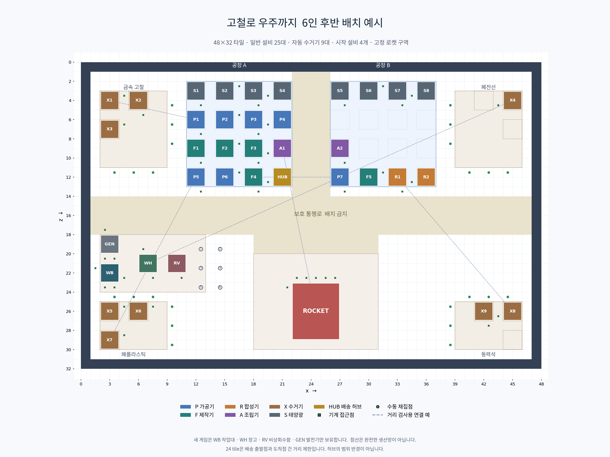

# 고철로 우주까지 ASTRA 구현 기획서 - Meshy 3D

설계 버전 1.1.0  |  기준일 2026년 11월 16일  |  1~6인 협동 웹게임

실제 Meshy 3D 모델과 고정 방향 정사영 카메라로 폐품 수집, 자동 생산과 배송, 로켓 조립과 발사를 구현하는 제품·기술 계약이다. 현재 결과물은 설계 및 계산 자료다. 실제 모델과 게임은 아직 제작하지 않았으며 모든 자산 제작·게임 인수 검증은 미실행이다.

## 문서 구성

1. 프로젝트 목표와 범위
2. 고정 방향 3D 카메라와 조작
3. Meshy 모델 제작과 자산 규격
4. 실행 수치와 데이터 표
5. 경제 규칙과 경계 동작
6. 월드와 조작 및 화면
7. 구현 계약과 API
8. 3D 런타임과 게임 상태 연결
9. 서버와 멀티플레이 및 저장
10. 밸런스와 3D 설계 검산
11. 인수 검증 기준
12. 배포 준비와 플레이테스트
13. ASTRA 실행 지시문
14. Meshy 자산별 영문 프롬프트
15. 기술 근거와 용어

# 1 프로젝트 목표와 범위

## 이번 개정의 확정 요구

고철로 우주까지는 1~6인 온라인 협동 건설 게임이며, 주요 월드 자산은 Meshy AI로 생성한 실제 3D 모델을 사용한다. 화면은 작은 작업장을 대각선 위에서 내려다보는 디오라마처럼 구성한다. 깊이와 입체적인 동작은 모델과 조명으로 표현하고, 카메라의 회전이나 흔들림으로 표현하지 않는다.

이번 산출물은 설계 1.1이다. 실제 Meshy 생성 작업, 유료 호출, 모델 다운로드, 리깅, 실게임 구현은 수행하지 않았다. 자산 목록의 상태는 NOT_GENERATED이며 예시 모델 경로는 제작 후 배치할 경로다. 계획된 자산을 이미 생성되거나 검수된 결과물로 보고해서는 안 된다.

| 영역 | 1.1 확정 방향 |
| --- | --- |
| 주요 시각 자산 | Meshy 기반 작업자, 생산 설비, 낮은 원료 트레이, 배송 포드, 로켓 모듈 |
| 시점 | 고정 방향 정사영 3D, 지면 기준 내려다보는 각도 55도 |
| 기본 화면 이동 | 화면 중앙 영역 안에서는 정지, 밖으로 나갈 때만 제한된 속도로 이동 |
| 카메라 선택 | 기본 추적과 수동 고정 모드, 명시적 다시 중앙으로 버튼 |
| 카메라 효과 | 자유 회전, 머리 흔들림, 화면 흔들림, 모션 블러, 자동 확대 축소 없음 |
| 공간 규칙 | x,z 지면 이동과 기존 서버 충돌 규칙 유지. 모델 높이 y는 시각 표현 |
| 협동 | 기존 1~6인, 6개 개인 제작 채널과 원료별 6개 채집 자리 |
| 경제 | 기존 14품목, 10레시피, M1~M6, 건설 배율과 가격 및 전력 유지 |
| Meshy 사용 시점 | 개발 중 자산 제작. 플레이어의 접속·제작·건설 중 AI 생성 호출 없음 |
| 검증 | 카메라 기하와 자산 예산의 설계 검사, 실제 모델·기기·체감 검증은 별도 |

## 플레이어가 보게 될 화면

작업자는 둥근 안전모와 분명한 팔·다리가 있는 작은 작업복 캐릭터다. 여섯 명은 하나의 리깅된 기본 모델을 사용하며 작업복 색, 번호, 이름표를 함께 표시한다. 발밑 원과 상호작용 강조는 캐릭터가 작은 화면에서도 선택 대상을 찾게 하는 정보다.

가공기는 투입구, 본체, 배출구가 큰 덩어리로 구분된다. 금속 재료 가공기에는 낮은 배기구와 둥근 가공 챔버, 제작기에는 프레스, 정제기에는 짧은 탱크와 굵은 배관 등 서로 다른 실루엣을 쓴다. 작은 볼트나 잔뜩 얽힌 전선에 형태 구분을 맡기지 않는다. 모델의 실루엣과 상태 UI를 함께 사용한다.

자동 배송은 작은 공중 운반 포드가 출발과 도착 사이를 일정한 경로로 이동하는 모습으로 표현한다. 모든 아이템을 고유한 고해상도 모델로 들고 다니게 하지 않는다. 운반 상자 한 종류와 품목 아이콘, 수량으로 14종 아이템을 표현한다. 자원 수량은 서버가 보유하며 상자의 외형 개수로 계산하지 않는다.

로켓은 단계마다 구조물이 더해지는 모듈 조립 방식이다. 모든 단계를 서로 다른 완성 로켓 모델 여섯 개로 생성하는 대신, 정해진 모듈을 좌표에 맞춰 연결하고 진행도에 따라 표시한다. 발사대와 갠트리는 발사 후에도 지면에 남으며 본체에 붙는 부품만 함께 올라간다.

## 스타일 규칙

색은 따뜻한 크림색, 짙은 청회색, 작업장 주황, 물류 청록을 기본으로 한다. 원재료 구역은 단순하고 거칠게, 자동화 설비는 정돈된 모양으로, 완성 로켓은 밝고 명확한 실루엣으로 만든다. 표면은 무광의 페인트와 금속이며 얇은 부품과 과도한 반사는 줄인다.

Meshy 프롬프트는 실사 우주선·영화 수준 디테일을 요청하지 않는다. 하나의 물체를 전체가 보이도록 묘사하고, 동일한 스타일 문장과 색 체계를 반복 사용한다. 정확한 글자, 번호, 상태 표시, 화살표, 브랜드 로고는 생성 텍스처에 넣지 않고 게임의 UI와 별도 표식으로 붙인다.

지면, 통로, 2×2 배치 격자, 포트 표시, 단계별 진행 표시, 보호 구역은 코드로 만드는 간단한 도형을 사용한다. 모듈 연결을 맞추는 어댑터와 얇은 고정판도 코드 또는 DCC 편집으로 만든다. AI가 정확한 타일 치수와 접합 위치를 한 번에 생성한다는 전제에 의존하지 않는다.

## 카메라와 손맛의 역할

작업의 피드백은 공구가 움직이는 모습, 설비의 압축·회전 동작, 자재가 들어가는 위치, 짧은 효과음, 작은 진행 표시로 전달한다. 채집할 때 화면 전체가 흔들리거나 생산할 때 카메라가 기계 쪽으로 끌려가지 않는다.

카메라는 플레이어의 지면 위치를 기준으로 움직인다. 머리·안전모·도구·걷기 애니메이션의 뼈를 따라가지 않는다. 여러 친구를 모두 화면에 담기 위한 자동 줌도 사용하지 않는다. 화면 밖 팀원은 방향 표시와 미니맵으로 안내한다.

발사 중에도 카메라의 방향과 줌을 자동으로 바꾸지 않는다. 사용자가 발사 전에 선택한 고정 화면에서 로켓만 상승시킨다. 큰 흰색 플래시, 카메라 진동, 로켓을 뒤쫓는 급격한 상승 카메라는 넣지 않는다. 발사 소리와 로켓의 움직임으로 완성의 성취감을 표현한다.

이 선택은 움직임에 민감한 사용자의 부담을 줄이기 위한 제품 설계다. 정사영이나 고정 각도라는 사실만으로 모든 사람의 불편이 없어졌다고 판단하지 않는다. 실제 모델을 넣은 상태에서 이동, 공장 가동, 배송, 발사까지 체감 검증한다. 자동 카메라 움직임을 끄고 불필요한 흔들림을 제거하는 방향은 Microsoft의 게임 접근성 지침과도 맞는다. [CAM-S2]

## 구현 순서에서 달라진 점

P0에서 기존 경제와 네트워크 계약에 더해 카메라, 모델 크기, 원점, 방향, 자산 로딩 계약을 먼저 고정한다. 임시 도형으로 이동·카메라·클릭 판정을 검증한 뒤 작업자, 재료 가공기, 하부 선체의 세 가지 자산을 먼저 제작해 같은 화면에 넣는다. 이 세 자산에서 크기·색·가독성·애니메이션과 성능을 확인한 다음 나머지를 제작한다.

P1~P4의 생산·협동·저장 개발은 자산 제작과 분리하여 진행할 수 있다. P5에서는 목록의 출시 필수 자산과 애니메이션을 실제 GLB로 교체하고 6인 장면을 검사한다. P6의 완료 기준에는 카메라 설정, 실제 Meshy 자산의 검수, 표시 품질과 목표 기기의 성능 기록도 포함한다. 임시 도형으로 플레이가 된다는 사실만으로 Meshy 3D 버전이 완료된 것은 아니다.

## 버전과 파일 구분

설계 버전은 1.1.0이다. 경제 balanceVersion 1.0.0-design과 mapVersion 1.0.0은 유지한다. runtimeVersion, presentationVersion, appearanceSetVersion 및 자산 카탈로그는 1.1.0-design으로 구분한다. 모델 외형과 카메라 설정은 경제 데이터를 수정할 근거가 아니다. 같은 로켓 단계가 서로 다른 클라이언트에서 다른 자산으로 해석되지 않도록 자산 버전과 카탈로그 해시를 검사한다.

수치 원본은 balance_v1.json, 지도 원본은 map_v1.json, 런타임 공통 제한은 runtime_v1.json이다. 3D 표현은 presentation_v1_1.json, 자산 목록과 형식·크기·상태는 asset_catalog_v1_1.json, 모델별 생성 문장은 meshy_prompts.csv에서 읽는다. 자산 생성 기록과 실제 검사 결과는 작업 후 채우며 계획값과 측정값을 혼합하지 않는다.

## 문서 목적과 적용 범위

이 문서는 Meshy AI의 실제 3D 자산과 편안한 고정 방향 카메라를 사용하는 설계 1.1이다. 브라우저에서 1~6명이 함께 폐품을 수집하고 가공 설비와 운송망을 성장시켜 로켓 한 대를 조립한 뒤 발사하는 게임의 구현 기준이다. 작업명은 Scrap to Orbit, 한국어 가칭은 고철로 우주까지로 한다. 수신자는 이 문서와 동봉 데이터에 따라 게임을 구현하고 검증할 GPT ASTRA다. 기획서 작성일은 2026년 11월 16일, 기준 시간대는 Asia/Seoul이다.

사용자의 확정 요구는 웹게임, 최대 6명 협동, 수작업에서 자동화로 발전하는 제작과 건설, 그리고 구현자가 임의로 핵심을 축소하지 않아도 되는 상세 기획이다. 나머지 사항은 그 목표를 완성하기 위해 이 문서가 선택한 기본 설계다. 주요 모델은 Meshy로 제작하고 카메라 움직임은 제한한다. 기존 대화에서의 최대 4명 제안은 폐기한다. 인벤토리 4슬롯 등 인원과 무관한 숫자 4는 유지한다.

정적 검증은 레시피 참조, 수량 계산, 해금 의존성, 전력 및 생산량 산식, 참조 생산 계획을 점검한다. 실제 조작의 재미, 장치별 성능, 네트워크 장애 복구, 보안, 버그 유무는 구현 후 수락 시험과 플레이테스트로 검증한다. 기획 데이터의 계산 검증을 실게임의 무결점 보증으로 표현하지 않는다.

### 기준 문서와 충돌 처리

- 게임 규칙, 상태 전이, 인터랙션 및 예외 동작은 본문을 따른다.
- 자원 ID, 레시피, 생산 시간, 비용, 배율, 설비 전력 등의 실행 수치는 balance_v1.json을 따른다. 문서의 수치표는 해당 JSON에서 생성한다.
- 지도 좌표는 map_v1.json, 네트워크 타이머와 입력 제한은 runtime_v1.json을 따른다. 조작 규칙은 UX 장, 저장과 명령 규칙은 기술 장을 따른다. 한 작업장은 하나의 저장 런이며 영구 roomId가 그 런을 식별한다.
- 수락 시험은 구현 완료를 증명하는 방법이다. 시험을 통과시키기 위해 규칙이나 실제 동작을 축소하지 않는다.
- 본문과 JSON 또는 시험이 충돌하면 해당 기능의 구현을 보류하고 conflict_log.md에 위치와 영향을 기록한다. 누락된 숫자나 상충하는 규칙을 임의로 선택하지 않는다. 먼저 계산과 관련 조항으로 해소하고, 사용자 결정이 필요한 제품 방향의 변경만 질문한다.
- 설계는 1.1이며 경제 데이터의 1.0 규칙은 버전과 해시를 고정한다. 진행 중인 방에 새 밸런스 수치를 덮어쓰지 않는다.

## 게임의 핵심 경험

시작할 때 플레이어는 작은 폐품 야적장과 손으로 조작하는 작업대만 가지고 있다. 직접 돌아다니며 고철을 모으고, 금속을 가공하고, 발사대에 자재를 전달한다. 발사대가 완성되면 자동 가공 설비를 건설할 수 있다. 조립 갠트리가 생기면 설비 간 운송을 연결한다. 선체와 연료 탱크를 완성하면 원료 채집도 자동화한다. 후반에는 생산량과 전력을 조절하고 로켓의 엔진과 항법 장치를 완성한다. 마지막에는 모두가 준비 상태를 확인하고 로켓 발사를 함께 본다.

자동화는 반복하는 일을 인계받는다. 플레이어의 다음 일은 새 부품을 생산하고, 다음 목표의 수요에 맞춰 라인을 바꾸고, 실제 로켓의 새로운 구역을 조립하는 것이다. 제작 화면에서 숫자만 늘어나는 방식으로 이 경험을 대체하지 않는다.

### 반드시 느껴져야 하는 변화

| 시점 | 플레이어의 체감 | 화면과 소리로 보여줄 증거 |
| --- | --- | --- |
| 첫 채집 | 내가 집은 폐품이 자원이 된다 | 손동작, 자원 아이콘, 휴대량 변화, 짧은 획득음 |
| 첫 가공 | 원료가 쓸모 있는 부품으로 바뀐다 | 작업대의 소재 변화와 완성품 등장 |
| 첫 건설 | 내가 전달한 부품이 로켓 공사의 일부가 된다 | 발사대의 지지대와 바닥이 실제로 추가됨 |
| 첫 자동 가공 | 다른 일을 하는 동안 설비가 일한다 | 설비 작동과 출력 버퍼의 완성품 |
| 첫 배송 연결 | 직접 나르던 일을 운송망이 맡는다 | 출발, 비행, 도착이 보이는 운반 포드 |
| 첫 자동 채집 | 원료 공급부터 생산이 이어진다 | 채집기와 배송망이 동시에 가동 |
| 최종 조립 | 작은 폐품에서 거대한 로켓까지 왔다 | 선체, 엔진, 상부가 완성된 외형 |
| 발사 | 친구들과 만든 결과물이 움직인다 | 발사 준비, 카운트다운, 상승, 공동 결과 화면 |

### 1.1의 승리와 실패

승리는 모든 건설 목표와 연료 납품을 완료한 뒤 발사 준비 절차를 통과하여 발사 결과가 저장되는 것이다. 로켓이 비행하는 동안 조종하지 않는다. 결과 화면 이후에는 같은 작업장을 보존한 완성 상태로 돌아가거나 별도의 새 작업장을 만든다.

패배 시간제한, 굶주림, 캐릭터 사망, 자원 영구 고갈, 확률적인 필수 재료 드롭은 없다. 전력 부족이나 재고 정체는 생산 효율과 흐름의 문제이며 자원이 파괴되는 사건이 아니다. 조작 실수는 복구할 수 있어야 한다. 접속 장애로 자원이나 이미 확정된 건설이 사라지는 것은 게임 규칙이 아니라 결함이다.

## 제품 범위와 완성 기준

### 첫 공개 버전에 포함

| 영역 | 필수 내용 | 완료 판정 |
| --- | --- | --- |
| 협동 | 1~6인 방 생성, 코드 및 링크 입장, 중간 참가, 재접속 | 서로 다른 브라우저 6개가 같은 상태를 보고 작업 가능 |
| 조작 | 캐릭터 이동, 직접 채집, 수동 가공, 자재 운반 및 납품 | 시작부터 첫 건설까지 실제 조작으로 진행 |
| 생산 | 가공 설비, 제조법 선택, 입력과 출력 버퍼, 전력 | 설비가 서버 시간에 따라 자원을 정확히 변환 |
| 자동화 | 포트 간 배송 링크와 실제 비행 중 화물, 원료 채집기 | 원료부터 중간 부품 생산까지 사람의 반복 운반 없이 지속 |
| 건설 | 여섯 개의 순차 마일스톤과 로켓 외형 변화 | 납품 및 조립 결과가 모든 플레이어에게 동일하게 표시 |
| 성장 | 운반, 이동, 가공 설비와 자동 수거기의 명시된 업그레이드 | 비용과 효과가 JSON 및 저장 데이터와 일치 |
| 저장 | 영속 저장, 이어하기, 방장 이탈, 서버 재시작 복구 | 확정 응답을 받은 경제 행동이 재시작 후 유지 |
| UX | 한국어 기본 UI, 설명, 튜토리얼, 상태 원인 표시 | 사용자가 정체 원인과 다음 행동을 확인 가능 |
| 화면 | 데스크탑, 4K, 모바일 가로 조작, 세로 회전 안내 | 화면 크기 때문에 핵심 버튼이 가려지지 않음 |
| 운영 | 상태 점검, 오류 기록, 부하 제한, 저장 복구 진단 | 장애를 무한 로딩으로 감추지 않고 복구 경로 제공 |

### 후속 버전으로 분리

공개 매칭, 7명 이상 방, PvP, 공격과 약탈, 실시간 음성 채팅, 여러 행성을 오가는 플레이, 로켓 조종, 실제 유체 및 연소 시뮬레이션, 자유 각도의 대형 물리 건축, 전체 서버 공용 경제, 거래소, 유료 성장 상품은 1.1의 구현 대상에 넣지 않는다. 이 구분은 필수 기능을 미완성으로 남기기 위한 근거로 사용하지 않는다. 특히 멀티플레이, 자동 배송, 채집 자동화, 저장, 발사는 첫 공개 버전의 필수 기능이다.

## 인원과 방 설정

최대 접속 플레이어 수는 6명이다. 계획 인원은 방 생성 시 1~6명 중 선택하고, 권장 기본값은 초대한 친구 수가 정해졌을 때 그 수로 설정한다. 아직 모르면 2명 기본값을 보여주되 변경 가능하게 한다. 시작 전에는 변경할 수 있고, 게임 시작이 확정되면 고정한다. 최대 수용 인원 6명과 계획 인원은 별개의 개념이다.

계획 인원은 로켓 건설 목표의 수량만 바꾼다. 설비 가격, 레시피 수율, 이동 속도, 채집량, 전력 생산량, 업그레이드 가격을 접속 인원에 맞춰 실시간 조정하지 않는다. 이미 시작한 1인 계획 방에 여섯 명이 들어오면 빠르게 완성할 수 있고, 6인 계획 방에 한 명만 남으면 더 오래 걸린다. 이에 따른 순위 경쟁이나 기록 보상은 1.1에 두지 않는다.

계획 인원을 선택하는 화면에는 1~6인 각 배율과 예상 플레이시간이 목표값임을 보여준다. 참가 인원이 바뀌어도 건설 비용이 바뀌지 않는다는 짧은 설명을 함께 제공한다. 진행 중 비용을 줄여 이미 납품한 수량의 환급 차익을 얻는 경로는 만들지 않는다.

### 협동의 원칙

- 캐릭터 직업과 전용 제작법을 두지 않는다. 모든 플레이어가 모든 작업을 수행할 수 있다.
- 작업대는 플레이어별 독립 채널을 제공한다. 한 명의 메뉴 조작이 다른 다섯 명의 작업을 가로막지 않는다.
- 동시에 입력되는 납품은 남은 요구량에 한해 서버가 순서대로 반영한다. 초과분은 플레이어 인벤토리에 남긴다.
- 자동화 설비의 설정은 공용이다. 다른 사람이 수정한 항목에는 이름과 변경 내용을 짧게 표시하고, 오래된 편집본은 충돌 오류를 반환한다.
- 캐릭터끼리는 길을 막지 않는다. 기계 및 건설물의 충돌과 서비스 접근 경로는 서버가 판정한다.
- 2인 이상이 같은 조립 작업을 돕는 경우 조립 단계만 가속한다. 자재 수요와 출력 수량은 늘거나 줄지 않는다. 정확한 조립 속도는 건설 규칙을 따른다.
- 특정 인원수의 동시 버튼 누르기나 둘이 들어야만 하는 물체를 필수 진행 조건으로 두지 않는다.
- 개인 기여 화면은 채집, 운반, 생산, 건설, 설비 구축을 각각 보여준다. 한 종류의 행동만 유리한 총점과 개인 보상 차등을 만들지 않는다.

## 진행 단계와 화면의 성장

마일스톤은 M1부터 M6까지 순서대로 진행한다. 단계가 열리는 순간 그 단계의 목표와 사용할 수 있는 제조법을 보여준다. 아직 잠긴 단계의 비용은 보기만 가능하며 선행 납품을 허용하지 않는다. 잠금 해제는 한 번 발생하면 유지된다.

| 단계 | 시각적 완성물 | 그 단계의 주요 고민 | 다음 단계에 제공하는 변화 |
| --- | --- | --- | --- |
| M1 기초 발사대 | 콘크리트풍 기반, 지지대, 작업 조명 | 첫 부품을 직접 만들고 가져오기 | 자동 가공 및 전력 확장 |
| M2 조립 갠트리 | 로켓 주변 철골과 조립 구조물 | 생산에 투자할지 건설부터 할지 | 회로와 선체 제작, 자동 배송 |
| M3 연료 탱크와 선체 | 하부 선체와 양쪽 연료 탱크 | 여러 재료의 흐름을 맞추기 | 동력석 채집, 연료와 엔진, 자동 채집 |
| M4 추진부 | 엔진 묶음과 배기 노즐 | 발전과 가공 능력의 균형 | 항법 부품과 설비 성능 강화 |
| M5 항법과 상부 | 상단 캡슐과 안테나 | 선체와 정밀 부품 생산 조정 | 마지막 연료 납품과 발사 안내 |
| M6 연료 충전과 외장 | 도색, 배관 조명, 완성된 로켓 | 최종 납품과 준비 상태 확인 | 준비 투표와 발사 |

각 단계의 재료는 유형별로 부분 납품할 수 있다. 전부 모은 뒤 한 번에 지급하는 방식으로 제한하지 않는다. 납품 비율에 따라 해당 단계의 외형을 25%, 50%, 75%, 100% 지점에서 갱신한다. 중간 외형은 진행 표현이며 추가 충돌체를 만들지 않는다. 조립 작업이 끝나야 다음 단계가 열린다. 재료와 조립 작업 중 하나만 완료된 상태는 단계 완료가 아니다.

### 납품과 설치가 보이는 방법

플레이어는 로켓 서비스 지점에서 휴대 중인 자재를 납품한다. 자동 배송도 현재 단계가 요구하는 품목만 수용하는 로켓 입력 포트로 보낼 수 있다. 자동 납품은 같은 요구량 검증을 거친다. 준비가 되면 플레이어가 조립을 시작하고 공구 애니메이션이 재생된다. 자동 납품이 모든 마지막 상호작용을 대체하지 않는다.

로켓 포트는 단계가 바뀔 때 수용 품목과 남은 수량을 원자적으로 바꾼다. 이전 단계로 향한 비행 중 화물은 이미 예약한 수요만큼 정확히 도착해야 한다. 미도착 예약을 실제 납품으로 계산하지 않는다. 마지막 예약이 도착하고 조립이 끝난 뒤에만 완료할 수 있도록 구현한다.

## 튜토리얼과 도움말

튜토리얼은 첫 런에 자동으로 표시하는 짧은 상황별 안내다. 건너뛰기와 도움말에서 다시 보기를 제공한다. 안내를 다시 보아 자원을 추가 지급받거나 해금 플래그를 중복 처리할 수 없어야 한다. 보상 없는 안내 단계로 구현한다.

| 순서 | 실제 달성 조건 | 안내 내용 | 건너뛰었을 때 |
| --- | --- | --- | --- |
| T1 이동 | 이동 입력으로 시작 위치에서 벗어남 | 이동과 카메라 복귀 | 조작 도움말에 남김 |
| T2 채집 | 원재료 한 단위 이상 획득 확정 | 채집 위치와 휴대 공간 | 목표를 강제로 완료하지 않음 |
| T3 가공 | 수동 레시피 한 번 완료 | 재료와 제작 시간 확인 | 제조법 메뉴의 설명 유지 |
| T4 납품 | M1에 자재 일부 납품 확정 | 휴대 재료만 납품되는 규칙 | 로켓 체크리스트로 대체 |
| T5 자동 가공 | 자동 설비의 첫 출력 생성 | 입력, 출력, 전력 상태 | 설비 도움말로 재접근 |
| T6 자동 배송 | 배송 링크의 첫 화물 도착 | 출발과 도착 포트, 필터, 정체 원인 | 물류 패널에서 설명 가능 |
| T7 전력 | 전력 패널을 열어 공급과 수요 확인 | 부족하면 비례 감속 | 실시간 전력 경고는 유지 |
| T8 확장 | 첫 채집기 제작 또는 첫 M3 완료 | 자동 원료 공급과 다음 목표 | 핵심 진행에 영향 없음 |

현재 행동과 관계없는 튜토리얼 모달을 연속으로 띄우지 않는다. 친구가 이미 단계를 완료한 뒤 참가하면 해당 방의 진행에 맞춘 짧은 안내와 사용 가능한 설비 목록을 제공한다. 개인 튜토리얼 진행과 방의 마일스톤 진행을 별도 저장한다.

## 재미를 유지하는 밸런스 방향

수작업이 필요한 이유는 초반의 이해와 직접 참여이며, 반복 행동을 끝없이 요구하는 것이 아니다. 첫 자동 가공을 경험하기 전에 여러 종류의 생산 시설을 모두 요구하지 않는다. 자동 배송과 자동 채집은 서로 다른 성장 단계로 열어 새로 편해지는 순간을 만든다.

발사대에 필요한 재료와 생산 설비에 투자하는 재료가 겹치게 하여 단기 완성과 장기 효율 사이의 선택을 만든다. 완주에 꼭 필요한 공정을 수동 작업대로도 수행할 수 있게 하여 기계를 잘못 설치했거나 전력이 부족해도 진행 자체가 잠기지 않도록 한다. 수동 방식은 가공 시간이 더 길고 플레이어의 상호작용을 필요로 하므로 자동화의 가치가 유지된다.

후반의 과도한 대기는 다음 기준으로 판단한다. 표준 계획에서 특정 재료 때문에 다른 작업 없이 5분 이상 기다리는 구간이 반복되면 생산 시간, 해금 시점 또는 목표 수량을 조정한다. 이를 실제 플레이테스트에서 측정하기 전에는 대기 시간이 해결되었다고 주장하지 않는다. 목표 완료시간은 작업 숙련도, 배치, 역할 분담, 지연 시간에 따라 달라지는 목표 범위다.

재접속, 설비 철거, 업그레이드, 계획 인원 변경, 이미 납품한 부품 되찾기를 통해 자원이나 비용을 늘릴 수 있는 경우는 밸런스가 아니라 경제 무결성 결함으로 분류한다. 경제 보존식과 실제 지불 원가 장부로 먼저 막는다.

## 아트와 사운드 방향

주요 월드 모델은 Meshy AI로 제작한다. 세부 자산 ID와 분리 규격, 제작 순서는 Meshy 3D 자산 장을 따른다. 실제로 생성·검수한 GLB만 완성 자산으로 집계한다.

폐품 야적장의 회색과 녹슨 주황에서 시작해, 가공 설비의 파랑, 물류의 청록, 완성 로켓의 밝은 크림색으로 발전하는 저폴리 스타일을 사용한다. 캐릭터는 작업복과 작은 안전모를 갖춘 둥근 실루엣으로 한다. 여섯 플레이어는 색상과 1~6 번호, 이름표를 함께 사용하여 색만으로 구분하지 않는다.

참고 게임의 명칭, 캐릭터, UI, 소리, 3D 모델을 복제하는 지시가 아니다. 로켓 공사와 폐품 재활용이라는 독자적인 소재와 자산을 사용한다. 사용한 자산에는 출처와 라이선스를 ASSET_LICENSES.md에 기록한다.

### 최소 자산 목록

| 범주 | 필수 자산 | 변형 규칙 |
| --- | --- | --- |
| 캐릭터 | 기본 모델 1개, 작업복 팔레트 6개 | 걷기, 대기, 채집, 가공, 휴대, 조립 |
| 원료 | 고철, 폐전선, 폐플라스틱, 동력석 채집장 | 잠김과 사용 가능 상태 |
| 생산 시설 | 각 machineType의 정지 모델과 작동 표현 | 전력 부족, 재료 부족, 출력 정체 표시 |
| 물류 | 허브, 입력 포트, 출력 포트, 공중 운반 포드 | 필터 아이콘, 방향, 비행 화물 |
| 로켓 | Meshy 모듈을 조합한 6단계 외형, 동일 본체의 발사 | 단계 완료 및 납품 진척에 따른 표시, 지면 구조와 상승 본체 분리 |
| 환경 | 바닥, 울타리, 통로, 표지판, 시작 지점 | 경계와 보호 구역을 시각적으로 구분 |
| UI | 자원 14종, 기계, 상태, 조작 아이콘 | 크기가 작아도 구별되는 실루엣 |
| 사운드 | 클릭, 오류, 채집, 가공, 납품, 해금, 발사 | 반복음 볼륨과 동시 재생 수 제한 |

작동중이라는 이유로 매 프레임 입자를 대량 생성하지 않는다. 저사양 모드에서는 그림자와 먼지, 배경 장식을 줄여도 자원 수량, 경로 방향, 진행 상태, 조작 피드백은 유지한다. 화면 흔들림, 머리 흔들림, 모션 블러, 전체 화면 플래시는 사용하지 않는다. 저자극 설정은 주변 입자와 비필수 반복 동작을 추가로 줄인다. 브라우저가 소리를 허용하지 않은 초기 상태에서는 시작 버튼 클릭 이후에 오디오를 활성화하고, 음소거 상태도 정상 진행으로 인정한다.

## 결과와 반복 플레이

결과 화면에는 공동 완성 로켓, 계획 인원, 실제 참가자, 방의 유효 플레이시간, 최대 동시 인원, 설치한 자동 설비, 자동 운송량, 단계별 소요시간을 보여준다. 유효 플레이시간은 연결자가 있고 게임 경제가 진행한 tick으로 계산하며 재접속과 서버 장애로 정지한 시간은 제외한다. 전체 방 생성부터 발사까지의 벽시계 경과는 별도 정보로만 제공한다.

자동 생산량과 수동 작업량은 팀의 방식이 어떻게 달랐는지 보여주는 통계다. 가장 일을 못한 사람, 효율이 낮은 사람을 평가하는 순위를 만들지 않는다. 서버에 저장한 event 또는 통계 누적값에서 도출하며 클라이언트 보고값을 믿지 않는다.

새 작업장 만들기는 현재 방을 덮어쓰지 않는다. 완성 상태의 저장을 유지하고 새 roomId와 새 계획 인원을 사용한다. 1.1의 반복 플레이는 친구 구성과 설비 배치, 생산 순서가 달라지는 데서 나온다. 추가 맵, 난이도, 랜덤 이벤트, 다른 로켓 종류는 첫 완주 경험을 검증한 뒤 별도 밸런스 버전으로 추가한다.

## 개발 단계와 인수 기준

| 단계 | 산출물 | 다음 단계로 넘어가기 위한 증거 |
| --- | --- | --- |
| P0 계약과 기반 | 모노레포, 타입, 시뮬레이터, 고정 방향 카메라, 자산 계약, Meshy 대표 3종 제작 계획 | 데이터 검산과 임시 도형의 조작 검증, 대표 3종의 실제 모델 크기·스타일·리깅 검수 후 대량 제작 |
| P1 직접 플레이 | 이동, 채집, 인벤토리, 수동 가공, M1, 최소 방 | 2개 실제 브라우저에서 수집과 첫 납품 일치 |
| P2 전체 경제 | 모든 레시피, M1~M6, 전력, 투자, 업그레이드 | headless 시뮬레이션과 수동 1인 완주 |
| P3 자동화 | 배송 링크, 예약 화물, 자동 채집, 상태 원인 | 원료부터 목표 납품까지 자동 흐름과 정체 복구 |
| P4 영속 협동 | DB, durable ACK, 동시성, 재접속, 권한, 발사 | 6명 시나리오 및 강제 종료 복구 시험 |
| P5 사용자 경험 | 실제 Meshy 필수 자산·애니메이션 적용, 6명 로비, 카메라 설정, 4K·모바일·사운드 | 자산 검수와 지정 해상도 영상, 시각 가림·루트 이동·품질 전환 검사 |
| P6 공개 검증 | 부하, 보안, 밸런스 플레이테스트, 배포 구성 | 모든 필수 수락 시험과 운영 점검, 실제 모델·성능·편안함 기록, 실제 URL 확인 |

단계 구분은 구현 순서를 의미하며 P1이나 P2만 마치고 전체 게임 완료로 보고하지 않는다. 도중에도 매 단계 실행 가능한 빌드를 유지한다. 실시간 협동을 단일 브라우저의 가짜 플레이어로만 확인한 상태, 서버 대신 localStorage만 사용하는 상태, 발사 버튼이 장식만 하는 상태는 완료가 아니다.

실제 외부 저장소나 호스팅 서비스에 적용할 때는 사용자가 해당 환경에 대해 부여한 권한과 지시를 따른다. 이 기획서 자체가 유료 서비스 가입이나 기존 프로젝트 덮어쓰기에 대한 승인을 부여하지 않는다. 구현자는 변경 내용과 검증 결과가 있는 구체적인 결과물을 먼저 준비한다.

### ASTRA 작업 보고 형식

각 단계 종료 시 구현한 실제 동작, 실행 방법, 검사 명령과 결과, 아직 남은 항목, 문서와 달라진 점을 보고한다. 자동 시험과 수동 시험을 구분한다. 네트워크와 DB를 모의 응답으로 대체한 시험은 실제 다중 접속 검증으로 표기하지 않는다. 최종 전달에는 실행 URL 또는 재현 가능한 로컬 실행 절차, 전체 소스, 환경변수 예시, DB 마이그레이션, README, QA 결과, 미해결 이슈를 포함한다.

# 2 고정 방향 3D 카메라와 조작

개정 설계 1.1.0. 이 문서의 수치는 게임에 적용할 설계값이다. 카메라 투영과 모델 크기는 수학적으로 검산했지만 실제 브라우저의 체감·성능·불편 여부는 아직 측정하지 않았다. 목표는 입체적인 모델과 안정적인 화면을 함께 제공하는 것이다. 모든 사람에게 멀미가 없다고 보장하지 않는다.

## 1 방향과 기존 명세 교체 범위

Meshy로 제작한 실제 3D GLB 모델을 Three.js에서 렌더링한다. 플레이는 고정 방향에서 내려다보는 정사영 쿼터뷰로 한다. 캐릭터와 기계의 입체감, 재질, 그림자는 보이되 카메라가 캐릭터의 시선과 머리 움직임을 따라 회전하지 않는다. 서버의 평면 이동, 2D 충돌 footprint, 채집·제작·배송·건설·저장 규칙은 그대로 사용한다.

다음 기존 문구는 이 개정으로 대체한다.

- ‘작은 dead zone’은 아래에 정의한 화면 중앙 30% × 28%의 정지 영역으로 바꾼다.
- ‘발사대가 화면을 가리면 카메라를 적절히 멀리’는 삭제한다. 가림 처리를 적용하고 전체 보기와 발사대 보기는 사용자가 직접 선택한다.
- ‘화면 흔들림 끄기 제공’은 기본 구현에서 카메라 흔들림 자체를 넣지 않는 규칙으로 강화한다.
- 모바일 자유 핀치 줌은 v1.1에서 제공하지 않는다. 가까이·기본·넓게의 세 단계 버튼을 사용한다.
- 기계 패널, 자원 획득, 단계 완료, 팀원 이탈, 플레이어 수 변화, 그래픽 품질 변경이 카메라 각도나 줌을 바꾸지 않는다.

Microsoft XAG 117은 카메라 흔들림·head bob·motion blur의 회피 또는 해제, 자동 카메라 이동을 끌 수 있는 설정 등을 제안한다. 이 문서의 고정 각도·정사영·세 단계 줌 수치는 그 원칙을 본 게임에 적용하기 위한 별도 설계다. [CAM-S2]

## 2 좌표·시점·이동의 단일 계약

월드는 +X가 동쪽, +Z가 남쪽, +Y가 위다. 시뮬레이션의 캐릭터 위치는 지면 XZ이며 Y=0이다. 카메라는 목표점에서 +X와 +Z가 같은 방향의 위쪽에 위치한다.

| 항목 | 확정값 |
| --- | --- |
| 투영 | OrthographicCamera |
| 지면 위 고도각 | 55도. 수평면에서 위로 잰 각도 |
| 수평 방향 | +X와 +Z 사이 45도, 남동쪽 위에서 바라봄 |
| roll | 0도 |
| 목표와 카메라 거리 | 80 tile |
| clipping | near 0.1, far 200 |
| 일반 추적 목표 | 로컬 예측 캐릭터의 지면 앵커 XZ |
| 추적하지 않는 것 | 머리·뼈 애니메이션·달리기 바운스·팀원 중심·배송 화물 |
| 회전 조작 | 없음. 건설 R 키는 설비만 90도 회전 |

`e = 55°`, `a = 1/√2`라고 할 때 목표점 C에 대한 카메라 위치는 다음과 같다.

```text
camera.position = C + 80 * (cos(e)*a, sin(e), cos(e)*a)
camera.lookAt(C)
screenRight = (a, 0, -a)
screenUp = (-sin(e)*a, cos(e), -sin(e)*a)
```

일반 추적의 C.y는 0이다. 고정 발사대 보기에서만 프레임 중심을 위해 C.y=4를 쓸 수 있으며 카메라 offset 방향은 같다. GLB에 포함된 camera, light, 애니메이션 root motion은 게임 카메라를 대체하지 않는다.

화면 방향을 기준으로 이동한다. 입력 `sx`는 화면 오른쪽, `sy`는 화면 위쪽이다. WASD, 방향키, 가상 스틱 모두 이 단위를 사용한다.

```text
normalize (sx, sy) to length <= 1
dx = (sx - sy) / sqrt(2)
dz = (-sx - sy) / sqrt(2)
convert (dx, dz) to server integer movement input
server normalizes once more to its existing allowed magnitude
```

W는 북서쪽으로 이동하며 화면에서 위로 보인다. D는 북동쪽으로 이동하며 화면에서 오른쪽으로 보인다. 대각선 입력도 속도 4 또는 강화 후 4.5 tile/s를 넘지 않는다. 카메라 수동 이동·줌·품질 설정은 이 변환을 바꾸지 않는다. 모델의 기본 앞방향이 -Z라면 기존 지도 quarterTurns q에 대응하는 모델 yaw는 `-q*π/2`이다. 이 부호와 캐릭터 입력 변환을 각각 검사한다.

## 3 화면 크기·줌·가독성

WebGL canvas는 게임 viewport 전체를 차지한다. H와 W는 canvas.getBoundingClientRect()에서 구한 실제 CSS 크기다. HUD와 패널은 그 위에 겹쳐 표시하며 패널을 여닫아 canvas 크기를 바꾸지 않는다. OS 배율이 있는 4K 모니터는 실제 CSS viewport와 물리 픽셀 크기를 각각 기록한다.

카메라의 `spanHeight`는 화면 세로에 투영되는 월드 길이다. Three.js camera.zoom은 1로 고정하고 `top=spanHeight/2`, `bottom=-spanHeight/2`, `right=spanHeight*(W/H)/2`, `left=-right`로 설정한다. DPR은 이 계산에 넣지 않는다.

| 화면 프로필 | 가까이 | 기본 | 넓게 |
| --- | --- | --- | --- |
| 데스크탑 | 18 | 22 | 28 |
| 작은 가로 화면·터치 | 10 | 12 | 15 |

작은 가로 프로필은 CSS 높이 600px 미만 또는 주 입력이 coarse pointer인 가로 화면에 적용한다. 기본값은 가운데 단계다. 창 크기·기기 회전으로 프로필이 달라지면 선택한 단계 이름을 유지하고 해당 프로필 수치로 바꾼다. 프로필 변경은 한 번의 resize 확정에서만 반영하고 연속 확대·축소 애니메이션을 하지 않는다. 패널 열기나 품질 변경은 프로필 변경 사유가 아니다.

작업자 모델의 발부터 머리 끝까지 높이는 1.8 tile이다. 같은 지면 위치에서 수직 높이만의 화면 투영은 `1.8*cos(55°)`이며 약 1.03244 단위다. 아래는 safe-area가 없는 기준 viewport의 기하 계산이다.

| CSS viewport | 기본 span | 작업자 수직 높이 | 가까이 / 넓게 높이 |
| --- | --- | --- | --- |
| 1366×768 | 22 | 36.04px | 44.05 / 28.32px |
| 3840×2160 | 22 | 101.37px | 123.89 / 79.65px |
| 800×360 | 12 | 30.97px | 37.17 / 24.78px |

이 값은 몸의 수직 길이만 계산하며 머리·팔다리의 폭이나 자세에 따른 전체 bounds는 별도다. 기본 캐릭터가 작은 화면에서 읽히도록 단순한 큰 머리와 굵은 몸통, 팀 색 영역, 발밑 선택 링을 사용한다. 최소 44×44 CSS px의 선택·상호작용 hit area는 실제 모델의 화면 크기와 별개로 제공한다.

48×32 지도를 같은 방향으로 모두 맞추면 지면의 투영 폭은 약 56.569, 높이는 약 46.338이다. 여유 12%를 더한 spanHeight는 약 51.899가 되며 작업자 높이는 1366×768에서 15.28px, 800×360에서 7.16px까지 작아진다. 따라서 전체 지도를 고정한 카메라를 기본 플레이 시점으로 쓰지 않는다. 전체 보기는 명시적인 읽기 전용 모드다.

휠은 월드 위에서만 세 단계 줌을 변경한다. Ctrl+휠은 브라우저 확대에 맡긴다. 패널 안의 휠은 패널만 스크롤한다. 한 입력 묶음에서 여러 단계를 급히 통과하지 않도록 150ms에 한 단계까지만 반영한다. 줌 기준점 C는 유지한다. 커서 쪽으로 카메라가 함께 이동하지 않는다. 모바일은 44px 이상의 +/- 버튼과 현재 단계 이름을 제공한다.

## 4 기본 카메라의 따라가기

기본 모드는 FOLLOW_DEADZONE이다. 화면 중앙에 폭 30%, 높이 28%인 사각형을 둔다. 정규화 화면 좌표로 X=0.35..0.65, Y=0.36..0.64다. 판단점은 캐릭터 발의 로컬 예측·표시 위치다. 발점이 이 안에 있고 카메라가 정지해 있으면 카메라도 정지한다.

영역 밖에서는 발점이 영역의 가까운 경계로 돌아오도록 카메라 목표 C를 지면에서 평행 이동한다. yaw, elevation, roll, spanHeight는 유지한다. 오차는 화면 픽셀에서 투영 단위로 바꾼 뒤 지면으로 역변환한다.

```text
u = dot(playerGround - C, screenRight)
v = dot(playerGround - C, screenUp)
eu = u - clamp(u, -spanWidth*0.15, spanWidth*0.15)
ev = v - clamp(v, -spanHeight*0.14, spanHeight*0.14)
groundError.x = (eu - ev/sin(e)) / sqrt(2)
groundError.z = (-eu - ev/sin(e)) / sqrt(2)
```

추적 목표 속도는 `groundError * 10 / second`이고 벡터 길이를 5.5 tile/s로 제한한다. 속도가 증가하거나 방향이 바뀔 때는 변화량을 12 tile/s²로 제한한다. 오차가 0이면 정지하며, 기존 속도가 오차와 반대 방향이면 그 잔여 속도를 버린다. 한 프레임의 이동은 X/Z 성분별로 오차와 같은 부호만 허용하고 각 성분의 절댓값을 해당 오차 이하로 제한한다. 적용 후 실제 이동량/dt를 다음 프레임의 속도로 저장하여 축별 초과 이동과 반대 방향 관성을 남기지 않는다. 이동 입력이 멈춘 뒤 목표에 가까워지는 짧은 정리 이동은 허용하지만 관성으로 빈 화면을 계속 이동하지 않는다. 이 세부 체감은 구현 후 시험하고 계수 조정 시 기록한다.

기본 게임 이동 속도와 강화 속도는 기존 4/4.5 tile/s다. 카메라 최대 5.5는 최대 캐릭터 속도를 따라갈 수 있도록 잡은 설계값이다. 순간 위치 보정, 재접속, 디버그 순간이동을 정상 추적 경로에 넣지 않는다. 큰 상태 복원은 로딩 화면 뒤에서 위치를 한 번 확정하고 새 이동 입력을 기다린다.

연속으로 표시 중인 프레임에서는 실제 경과 dt 전체를 처리한다. dt를 버리지 않고 ceil(dt/0.05)개의 같은 길이 substep으로 나누어 각 단계가 0.05초 이하가 되게 한다. 15fps의 약 0.0667초를 단순히 0.05초로 잘라 추적 속도가 느려지는 구현은 금지한다. 단일 프레임 공백이 0.25초를 넘거나 숨긴 탭에서 돌아오면 누적 이동을 재생하지 않는다. 카메라를 보류하고 동기화 안내를 표시한 뒤 최신 상태를 가린 화면에서 한 번 적용하고 속도·이동 입력을 0으로 초기화한다. 이후 새 입력을 기다린다. 서버 수신 위치마다 카메라를 바로 이동하지 않는다. 로컬 캐릭터와 카메라가 서로 다른 보간 상태를 따라 화면이 흔들리지 않게 같은 표시용 지면 앵커를 사용한다.

카메라 목표 C의 평면 한계는 X=-4..52, Z=-4..36이다. 지도 가장자리의 빈 배경이 조금 보이는 것은 허용한다. 지도 전체가 화면을 항상 채워야 한다는 조건으로 강제 줌이나 강제 회전을 추가하지 않는다.

## 5 자동 이동 끄기·수동 이동·패널

설정에서 ‘카메라 자동 따라가기’를 끌 수 있다. 이 상태는 STATIC_MANUAL이며 캐릭터가 움직여도 카메라는 움직이지 않는다. 캐릭터가 화면 밖이면 가장자리에 내 캐릭터 방향과 ‘내 위치 보기’ 버튼을 표시한다. 캐릭터를 화면으로 되돌리기 위해 서버 위치를 옮기거나 게임 이동을 강제로 막지는 않는다.

중간 버튼 드래그 또는 화면의 카메라 이동 버튼으로 지면을 평행 이동한다. 드래그를 놓으면 즉시 멈추고 자동 복귀하지 않는다. 드래그에는 관성이나 mouse-edge 스크롤이 없다. 기존 자동 따라가기 사용자는 DETACHED 상태로 전환하며 ‘내 위치 보기’로 돌아오기 전까지 따라가기를 재개하지 않는다.

F 또는 ‘내 위치 보기’는 현재 줌과 각도를 유지하고 C를 현재 캐릭터 지면 위치로 즉시 옮긴다. 긴 비행 애니메이션을 사용하지 않는다. 원래 자동 따라가기 설정이 꺼져 있으면 STATIC_MANUAL을 유지하고, 켜져 있으면 FOLLOW_DEADZONE으로 돌아간다. 설정과 모드는 클라이언트 시각 상태이며 경제 저장이나 다른 플레이어 카메라를 바꾸지 않는다.

기계·제작 패널을 열면 캐릭터 이동 입력을 0으로 보내고 자동 따라가기를 보류한다. 기존 자동 설비는 계속 진행하며 작업대 패널의 명시적 제작 유지 조작은 서버 규칙대로 가능하다. 패널이 열렸다는 이유로 작업대 job을 삭제하지 않는다. 패널을 닫아도 카메라를 즉시 재중앙화하지 않으며 다음 이동 입력부터 이전 추적 모드를 재개한다.

OS의 prefers-reduced-motion이 reduce이고 사용자가 게임 안에서 명시한 선택이 아직 없으면 STATIC_MANUAL, 비필수 애니메이션 최소화, 카메라 전환 애니메이션 없음으로 시작한다. 첫 화면에서 현재 모드를 알려주고 사용자가 바꿀 수 있게 한다. 이미 저장한 사용자 선택은 OS 값보다 우선한다. CSS 설정만으로 WebGL 애니메이션이 자동 중지되는 것은 아니므로 렌더러 설정에도 직접 연결한다. [CAM-S3]

## 6 모델 높이와 가림 처리

| 모델 | 월드 크기 계약 |
| --- | --- |
| 작업자 | 높이 1.8 tile |
| 일반 설비 | 시각 XZ 1.8×1.8 이내, 높이 2.4 이하, 논리 footprint 2×2 |
| 원료 바닥층 | 최대 높이 0.15. 지면에 파인 수집 트레이 또는 얕게 흩어진 자원. VisualRoot.y=-0.12로 매립하여 지면 위 돌출 0.03 이하. 수동 슬롯과 자동 패드 접근 유지 |
| 완성 로켓 | 장식 포함 XZ 4.6×5.6 이내, 높이 8.0 이하. 기존 5×6 논리 footprint 유지 |

시각 모델의 모서리나 날개가 서비스 접근 셀을 가려도 실제 서버 판정은 기존 footprint와 interaction_anchor를 사용한다. Meshy 원본 mesh를 그대로 충돌체로 쓰거나 모델 높이로 서버 상호작용 거리를 바꾸지 않는다.

카메라에서 로컬 캐릭터 몸 중심과 현재 상호작용 대상의 서비스 앵커를 향한 가림 검사를 한다. 로컬 플레이어 실루엣과 선택 링은 가림 즉시 표시한다. 100ms 동안 지속되는 가림 물체는 해당 개체의 시각 opacity를 0.22로 낮추고, 가림이 300ms 동안 사라진 뒤 복원한다. 일반 모드의 전환은 150ms 단조 fade, 동작 최소화에서는 전환 애니메이션 0ms다. 같은 상황에서 매 프레임 투명·불투명으로 깜박이지 않아야 한다.

공유 material 하나를 수정하여 같은 종류의 모든 기계를 함께 투명하게 만들지 않는다. 개체별 fade 상태를 사용한다. 이름·아이콘·선택 링·raycast용 proxy는 opacity와 독립적이다. 원격 플레이어는 윤곽과 이름으로 우선 표시하고 로컬 캐릭터를 위한 투명화 대상에 무조건 추가하지 않는다.

원료 구역에는 기존 고체 footprint가 없으므로 키가 큰 폐품 더미를 추가하지 않는다. 통과 가능한 지면에는 깊이가 낮은 시각 자원층만 놓는다. 높은 장식으로 바꾸려면 지도 버전과 충돌·접근 검증을 별도 변경해야 한다.

이 가림 raycast는 클라이언트 표시 처리다. 서버의 clearSegment와 충돌 판정을 대체하지 않는다. 가려진 기계를 투명하게 했다는 이유로 벽 너머에서 자원을 넣거나 받을 수 없다.

## 7 전체 보기와 발사

‘작업장 전체 보기’는 사용자가 눌렀을 때만 진입한다. 현재 카메라 목표·줌·모드를 보관하고 수동 이동과 작업 유지 입력을 종료한다. 자동 생산과 다른 참가자의 플레이는 계속된다. 고정된 같은 각도에서 실제 월드 bounds를 투영해 필요한 span을 구하고 12% 여유를 준다. 비행이나 연속 줌 전환 없이 한 프레임에 전환한다. 이 화면에서는 정보와 핑만 가능하며 재료 투입·건설·채집은 비활성화한다. 돌아오기는 저장한 카메라 상태를 복구하며 새 이동 입력이 있기 전에는 움직이지 않는다.

발사 연출의 기본은 현재 카메라 유지다. 발사 준비 UI에 ‘고정 발사대 화면으로 보기’를 제공하며 사용자가 선택하면 카메라 목표 (24.5, 4, 26), spanHeight 16의 같은 방향 정사영 샷으로 전환한다. 이 선택은 해당 클라이언트에만 적용한다. 발사대 시점에서도 카메라는 고정되고 로켓 비행 부분만 위로 움직여 화면 밖으로 나간다. 궤도 회전, 로켓 추적 상승, 급격한 줌, 카메라 흔들림은 없다. 발사대·갠트리는 원래 위치에 남는다.

기본 카운트다운과 발사 성공 조건, 자원 소비, 취소 명령, 경제 확정은 기존 서버 명세를 따른다. 발사 뷰 선택·건너뛰기·효과 최소화는 이 조건에 영향을 주지 않는다. 발사 투표가 취소되어도 자동 카메라 비행으로 되돌리지 않는다. ‘내 위치’나 ‘이전 화면’으로 사용자가 복귀한다.

## 8 시각 효과와 성능의 경계

1.1에 카메라 shake, bob, roll, motion blur, depth-of-field blur, chromatic aberration, full-screen lens distortion, 속도선, 자동 노출 변화를 넣지 않는다. 로비 배경도 회전하는 모델이나 카메라 대신 정적인 구도를 쓴다. 성공·오류는 배너와 아이콘으로 표시하고 화면 전체의 흰색 번쩍임이나 빠른 명멸을 사용하지 않는다.

월드 기계의 작은 회전 부품과 캐릭터 걷기 애니메이션은 입체감을 위한 국소 움직임이다. ‘효과 최소화’는 먼지·불꽃·드론 궤적·비필수 장식 반복 동작을 줄인다. 생산 상태는 진행바와 아이콘으로 항상 확인할 수 있어야 한다. 실제 재고인 배송 cargo를 시각적으로 묶어 표시하더라도 서버의 수량과 도착은 모두 유지한다.

고해상도·저사양 전환은 내부 렌더링 픽셀과 그림자·장식만 바꾼다. CSS viewport, 정사영 span, 줌 단계와 캐릭터 이동을 바꾸지 않는다. 내부 DPR은 `min(devicePixelRatio, qualityDprCap, sqrt(maxRenderPixels/(cssWidth*cssHeight)))`로 계산한다. maxRenderPixels와 qualityDprCap의 실제 값은 성능 설정 원본을 따른다. 4K 화면에 DPR 1.5를 무조건 적용하면 내부 해상도가 5760×3240이 되므로 상한을 별도로 관리한다.

Photosensitivity 관련 공식 지침은 의도한 섬광뿐 아니라 전체 게임 영상 검사를 권한다. 본 기획의 효과 제한은 안전성 인증이나 모든 사용자에게 불편이 없다는 보장이 아니다. [CAM-S4]

# 3 Meshy 모델 제작과 자산 규격

설계 버전 1.1.0. 기준일 2026년 11월 16일. 본 문서는 제작 지시이며 실제 Meshy 생성 작업이나 유료 호출은 실행하지 않았다. 자산과 애니메이션의 현재 상태는 모두 NOT_GENERATED 또는 NOT_RUN이다.

## 1. 화면의 목표와 자산의 역할

작업장 전체를 작은 장난감 공장처럼 표현한다. 플레이어, 작업대, 자동 기계, 운반 포드, 로켓은 실제 3D 모델로 렌더링한다. 모서리는 둥글고, 형태는 크고 단순하게, 재질은 무광 도장 금속과 플라스틱으로 통일한다. 표면의 작은 볼트와 긁힘보다 가공기의 투입구와 출력구, 조립기의 작업 공간, 로켓의 단계별 변화가 먼저 보이게 한다.

기존 1~6인 게임의 레시피, 건설 요구량, 생산 시간, 전력, 저장 규칙, 서버 충돌과 지도 좌표는 유지한다. Meshy는 시각 자산의 제작 도구다. 모델의 무게나 높이, 포트처럼 보이는 그림이 생산량, 도달 거리, 배송 시간 또는 서버 충돌을 바꾸지 않는다.

카메라 방향과 이동, 가림 처리, 발사 화면은 별도의 카메라 계약을 적용한다. 모델에는 게임용 카메라나 조명, 배경을 함께 넣지 않는다. 자동 카메라 회전, 장면 흔들기, 강한 피사계 심도, 화면 전체 번쩍임을 모델의 멋을 보여주는 수단으로 사용하지 않는다.

### 공통 미술 규칙

| 항목 | 제작 기준 |
| --- | --- |
| 기본 색 | 따뜻한 아이보리, 낮은 채도의 청록, 짙은 청회색, 제한적인 주황 포인트 |
| 표면 | 거친 무광, 넓은 면, 최소한의 선과 패널 경계 |
| 형태 | 두껍고 짧은 지지대, 둥근 모서리, 읽기 쉬운 큰 입출력 구역 |
| 금지 형태 | 가늘고 긴 안테나, 미세한 철망, 복잡한 전선 다발, 화면을 덮는 연기 |
| 글자 | 모델 텍스처에 생성하지 않는다. 이름·수량·상태는 게임 UI에서 표시 |
| 팀 구분 | 동일 작업자 모델에 6색 재질과 숫자 1~6을 함께 적용 |
| 작동 표시 | 작은 기계 부품의 움직임과 상태 아이콘. 카메라나 모델 전체 크기를 반복 진동시키지 않음 |
| 재질 변화 | MK2와 원료 종류는 같은 모델의 재질·배지로 구분. 매번 새 모델 생성 금지 |

## 2. 먼저 만들 세 가지 파일

전체 모델을 한 번에 생성하기 전에 아래 세 종류로 공통 품질을 확인한다. 이는 새로운 게임 기능을 줄이는 절차가 아니라 26개 자산에 같은 크기·색·가독성 기준을 적용하기 위한 제작 순서다.

| 순서 | 모델 | 확인할 이유 | 실제 합격 기준 |
| --- | --- | --- | --- |
| 1 | 작업자 worker | 사람의 비율, 팀 색, 리깅과 움직임의 품질 확인 | 높이 1.8tile, 손발 분리, 무기 없는 A-pose, 실제 스켈레톤과 이동·작업 동작 확인 |
| 2 | 재료 가공기 processor | 가장 많이 반복되는 공장 모델의 기준 | 2×2 서버 footprint 안에서 1.8×1.8 시각 폭, 입출력 구분, 기본 카메라에서 형태 식별 |
| 3 | 로켓 하부 선체 rocket_lower_hull | 로켓 모듈의 굵기, 색과 접합 규칙 확인 | 지름 2tile, 높이 3tile, 위아래 접합면, 다른 모듈을 붙일 수 있는 기준 축 |

세 파일을 실제 게임 카메라의 회색 테스트 장면에 넣고 1366×768, 4K, 모바일 가로에서 확인한다. Meshy 뷰어에서 크게 보았을 때의 인상만으로 통과시키지 않는다. 통과한 결과의 색표·참조 이미지·스케일·재질 설정을 다른 자산의 기준으로 고정한다. 파일이 아직 생성되지 않았으면 해당 검사는 NOT_RUN으로 남긴다.

## 3. 제작할 기본 모델은 26종

| 분류 | 기본 모델 수 | 재사용 방법 |
| --- | ---: | --- |
| 작업자 | 1 | 한 스켈레톤과 형상을 6명의 독립 애니메이션·팀 색으로 재사용 |
| 시작 설비 | 4 | 작업대, 공용 보관함, 비상 회수함, 시작 발전기 |
| 건설 가능한 설비 | 7 | 가공기, 제작기, 합성기, 조립기, 수거기, 태양광, 허브 |
| 운반·회수 | 2 | 화물 포드와 현장 회수상자 |
| 원료 구역 | 4 | 종류별 낮은 수집 트레이, 구역마다 최대 6개 인스턴스 |
| 로켓 | 8 | 발사대, 갠트리, 하부·상부 선체, 엔진, 상부 캡, 안정판, 외장 패널 |
| 합계 | **26** | 인원과 설치 대수가 늘어도 기본 생성 수는 증가하지 않음 |

14종 아이템 각각을 별도의 Meshy 모델로 만들지는 않는다. 직접 운반·배송 중에는 공용 3D 포드에 품목 아이콘과 수량을 표시한다. 휴대품이 있는 작업자는 한 개의 포드만 들며 현재 선택한 비어 있지 않은 슬롯의 아이콘을 우선 표시하고, 선택 슬롯이 비었으면 가장 낮은 번호의 비어 있지 않은 슬롯을 표시한다. 실제 네 슬롯 재고는 UI로 확인하며 포드 하나에 재고를 합치지 않는다. 인벤토리와 제작 화면에는 형태가 서로 다른 14종 아이콘을 사용한다. 타일 바닥, 도로, 건설 격자, 선택 윤곽, 진행 막대와 UI는 코드와 벡터 자산으로 만든다.

### 자산별 최종 삼각형 예산

아래 값은 최종 파일의 상한이며 생성 결과를 측정한 값이 아니다. Meshy 생성 목표 수가 정확한 출력 수를 보장하지 않으므로 다운로드 뒤 실제 삼각형 수를 확인한다.[M2] 일반 설비는 합계 최대 64대이며, 표의 설비별 수량을 각각 64대씩 허용한다는 뜻이 아니다.

| ID | 기본 모델 | 표준 LOD0 | 저사양 LOD1 | 배포 색 텍스처 |
| --- | --- | ---: | ---: | ---: |
| worker | 작업자 | 6,000 | 3,000 | 1,024px |
| workbench | 수동 작업대 | 3,000 | 900 | 512px |
| warehouse | 공용 보관함 | 2,000 | 700 | 512px |
| recovery_vault | 비상 회수함 | 1,200 | 500 | 512px |
| starter_generator | 시작 발전기 | 1,600 | 600 | 512px |
| processor | 재료 가공기 | 2,600 | 900 | 512px |
| fabricator | 부품 제작기 | 2,600 | 900 | 512px |
| refinery | 추진 팩 합성기 | 2,600 | 900 | 512px |
| assembler | 모듈 조립기 | 3,000 | 900 | 512px |
| extractor | 자동 수거기 | 2,200 | 800 | 512px |
| solar_array | 태양광 | 900 | 450 | 512px |
| logistics_hub | 배송 허브 | 1,800 | 650 | 512px |
| cargo_pod | 공용 운반 포드 | 180 | 96 | 256px |
| recovery_crate | 현장 회수상자 | 240 | 120 | 256px |
| source_metal | 금속 수집 트레이 | 800 | 300 | 512px |
| source_cable | 전선 수집 트레이 | 600 | 300 | 512px |
| source_plastic | 플라스틱 수집 트레이 | 800 | 300 | 512px |
| source_energy | 동력석 수집 트레이 | 800 | 300 | 512px |
| rocket_pad | 발사대 | 2,000 | 1,000 | 512px |
| rocket_gantry | 조립 갠트리 | 4,000 | 2,000 | 512px |
| rocket_lower_hull | 하부 선체 | 4,000 | 2,200 | 512px |
| rocket_upper_hull | 상부 선체 | 3,000 | 1,700 | 512px |
| rocket_engine | 엔진 모듈 | 2,500 | 1,300 | 512px |
| rocket_nose | 상부 캡 | 2,000 | 900 | 512px |
| rocket_fin | 안정판, 4개 반복 | 600 | 300 | 512px |
| rocket_panel | 패널, 총 8개 반복 | 400 | 200 | 512px |

일반 자산의 재질은 한 슬롯, 작업자는 최대 두 슬롯으로 제한한다. 생성 결과의 분리된 작은 부품마다 재질이 생기면 정리하고 필요한 움직임 부품만 보존한다. 6명 작업자 재질을 바꿀 때 공유 재질 객체를 직접 변경하여 다른 사람의 색까지 바꾸지 않는다.

## 4. Meshy 생성 경로

### 4.1 참조 이미지부터 통일

한 장에 공장 전체를 그린 그림을 게임 모델 생성에 사용하지 않는다. 각 자산을 온전히 보여주는 단일 물체 참조 이미지를 만든다. 크기 비교용 작업자와 공통 색표는 별도 기준 시트에 두고, 실제 입력 이미지에는 해당 물체 하나만 둔다. 동일한 시점과 부드러운 조명을 유지한다.

`meshy_prompts.csv`는 26종 각각의 완전한 영문 지시문을 제공한다. 가장 긴 지시문은 647자이며 텍스트 생성의 800자 제한 안에서 사용할 수 있다. 이미지를 만든 뒤 형상과 색을 확인하고 모델로 전환한다. 원본 참조, 선택한 모델, task ID와 실패 이유는 자산 기록에 남긴다.

### 4.2 기본 모델 선택

일반 설비·자원·운반 모델은 `meshy-t2`, 작업자와 로켓 모듈은 `meshy-t2.5`를 사용한다. 텍스처는 `meshy-n1`을 명시한다. 이 모델 선택은 공식 문서의 게임 소품·캐릭터 용도 구분을 적용한 본 프로젝트의 결정이다.[M1]

Smart Topology는 삼각형 모델을 대상으로 한다. 고밀도 표준 모델을 생성한 뒤 무조건 줄이는 단계를 기본 경로에 넣지 않는다. API의 `latest` 기본값에 맡기지 말고 선택 모델과 목표 삼각형 수를 요청에 기록한다.[M1][M2]

N1은 참조 이미지로 색을 만들며 PBR 지도나 텍스트 기반 텍스처 지시를 받지 않는다.[M1] 따라서 색과 무광 표현은 참조 이미지에서 정한다. `enable_pbr: true`, 4K·8K 텍스처, `texture_prompt`, quad를 N1 요청에 붙이지 않는다. 원본 2K 색 이미지는 보관하되 배포 파일에는 표의 해상도로 줄인 이미지를 사용한다.

### 4.3 도구와 CLI의 역할

일반 소품의 생성·조회·텍스처·다운로드는 제공되는 Meshy 도구를 먼저 사용한다. 현재 도구의 실제 입력 스키마를 읽고 지원하는 필드만 보낸다. HTTP API의 `model_type` 같은 필드를 도구 입력에 임의로 추가하지 않는다.

작업자 제작은 리깅과 애니메이션이 포함되므로 실제 제작 착수 때 CLI 경로를 준비한다. 캐릭터를 A-pose로 만들고, 성공한 텍스처 모델을 리깅한 다음 필요한 동작을 적용한다. 이번 기획 수정에서는 설치·로그인·생성 호출을 하지 않았다.

도구로 만든 자산에 나중에 CLI 처리가 필요하면 기존 task ID를 이어서 사용한다. CLI가 같은 task를 읽을 수 있는지 먼저 확인한다. 로그인 계정이 다르다고 같은 모델을 새 계정에서 다시 생성하지 않는다.

### 4.4 정리와 LOD는 실제 호환성을 확인

현재 Meshy 웹 문서는 T2 모델과 split parts의 Remesh를 지원하지 않는다고 설명한다.[M3] 따라서 본 계획은 T2 생성 후 Meshy Remesh 호출에 의존하지 않는다. 최종 파일의 예산 초과나 LOD1 제작은 로컬 DCC의 감축·정리로 처리하고 결과를 검수한다. 재생성이 필요하다면 별도의 비용이므로 승인된 생성 예산에 포함되는지 확인한다.

LOD는 같은 승인된 모델에서 파생한다. 작업자 LOD는 스킨 가중치와 모든 동작을 재검수한다. 삼각형 수만 맞췄다고 관절 변형까지 통과한 것은 아니다. 리깅 전에 형상과 토폴로지를 정리하며, 이후 축·크기 보정은 스켈레톤 전체를 함께 처리한다.

## 5. 좌표와 피벗의 정확한 계약

| 항목 | 확정 규칙 |
| --- | --- |
| 게임 축 | +X 동쪽, +Y 위쪽, +Z 남쪽 |
| 게임 모델의 기본 정면 | -Z, 북쪽 |
| 일반 피벗 | 바닥 중앙, 지면 접촉 y=0 |
| 작업자 피벗 | 두 발 사이의 지면점. 애니메이션 hips를 서버 위치로 사용하지 않음 |
| 일반 설비 외형 | 폭·깊이 각 1.8tile 이하, 높이 2.4tile 이하 |
| 로켓 전체 외형 | 4.6×5.6tile 안, 높이 8tile 이하 |
| 로켓 서버 footprint | 기존 5×6 그대로. 중심 (24.5, 26), 새 충돌 추가 없음 |
| 설치 회전 | `rotation.y = -quarterTurns * Math.PI / 2` |
| 업그레이드 | 외형 크기를 키워 통로나 접근점을 가리지 않음 |

quarterTurns=0, 1, 2, 3은 북·동·남·서를 뜻한다. +Y 회전의 부호를 반대로 적용하면 동쪽 설치가 서쪽으로 보이므로 네 방향 표식을 실제로 확인한다. 원본 GLB마다 다른 정면을 보정하는 변환은 import 때 한 번만 적용하고 서버 설치 회전과 중복 적용하지 않는다.

Meshy의 외부 GLB 리깅 입력은 캐릭터 정면 +Z를 요구한다.[M4] 리깅 전 파일은 이 방향으로 유지한다. 리깅·동작 제작 후 게임으로 가져올 때 전체 리그의 부모를 Y축 π만큼 보정해 게임의 -Z 정면과 맞춘다. 메시만 돌리고 뼈·클립을 남겨 두면 안 된다. 최종 worker 높이는 1.8tile이다. 리깅 결과의 단위를 추측하지 말고 실제 바운딩 박스와 접지 높이를 측정한다.

작업자의 1.8tile은 중립 자세의 머리 높이다. A-pose 폭은 최대 1.4tile이고 동작 중 뻗은 손까지 포함한 culling bounds는 최대 1.6×2.2×1.2tile로 별도 검사한다. 손을 들었다고 카메라 추적점이나 서버 충돌 반경을 키우지 않는다. 이동·운반 동작의 발 접지와 주변 기계 관통도 실제 클립으로 확인한다.

### 원료 구역의 낮은 모델

기존 지도에는 원료 구역의 큰 장식 장애물이 없다. 보행 가능한 자리에 키 큰 폐품 더미를 넣으면 캐릭터가 관통하는 문제가 생기므로 원료 시각은 낮은 수집 트레이로 만든다. 최대 크기는 0.7×0.15×0.7tile이며 VisualRoot.y=-0.12로 두어 지면 위 돌출은 최대 0.03tile이다. 바닥 소품이므로 새 충돌을 추가하지 않는다.

각 구역의 수동 채집 마커 6개마다 같은 트레이를 하나씩, 총 24개 재사용한다. 트레이 XZ 중심은 map_v1.json의 해당 manual_service_point.interaction_anchor와 정확히 같고 추가 XZ 오프셋은 0, yaw는 0이다. VisualRoot.y=-0.12이며 채집 링은 트레이 위에 겹쳐 표시한다. 얕은 비충돌 모델과 수동 마커의 시각 겹침은 허용하며 자동 수거기 패드와 기존 접근은 유지한다. 상호작용 위치는 항상 원본 지도 마커다. 트레이 위치나 표면의 꼭짓점에서 채집 거리를 다시 계산하지 않는다. 더 큰 배경 장식이 필요하면 이미 비보행인 경계 바깥에 두고 별도로 가림을 검수한다.

## 6. 로켓은 처음부터 조립 가능한 모듈로 만든다

완성 로켓 한 개를 생성한 뒤 정확히 여섯 공정으로 자동 분리될 것이라고 가정하지 않는다. Smart Topology의 분리된 메시가 게임의 단계·피벗·접합 위치와 일치한다는 보장은 없다. 또한 Meshy Auto Split API는 현재 Smart Topology 모델을 지원하지 않으므로 이 기능에 의존하지 않는다.[M6]

8개 기본 모듈은 같은 기준 이미지의 색·반경·패널 구조로 생성한다. 이후 로컬 DCC에서 바닥과 접합면을 정리하고 고정한 좌표에 배치한다. 생성 프롬프트에 치수를 적는 것만으로 정확한 접합을 완료했다고 처리하지 않는다.

| 단계 완료 | 새로 표시할 모델 | 화면상 변화 |
| --- | --- | --- |
| START | 코드로 만든 공사 구역 표식 | 빈 공사 구역과 자재 목표 |
| M1 | rocket_pad | 낮은 발사대 바닥 완성 |
| M2 | rocket_gantry | 양쪽 지지대와 조립 프레임 완성 |
| M3 | rocket_lower_hull + rocket_upper_hull | 연료 탱크와 원통형 선체가 프레임에 장착 |
| M4 | rocket_engine + rocket_fin 4개 | 아래 엔진과 안정판 완성 |
| M5 | rocket_nose + rocket_panel 1개 | 둥근 상부 캡과 항법 패널 완성 |
| M6 | rocket_panel 추가 7개, 총 8개 | 외장 마감, 충전 상태 표시, 최종 점검 가능 |

개별 모듈의 y 범위는 발사대 0~0.25, 엔진 0.25~1.25, 하부 선체 1.2~4.2, 상부 선체 4.2~6.2, 상부 캡 6.2~7.8tile이다. 엔진과 하부 선체의 0.05tile 겹침은 접합 칼라 안쪽의 의도된 겹침이다. 안정판·패널을 포함한 최종 폭과 높이를 다시 검사한다.

단계 내부의 조립 진행률은 고정된 부품 목록 순서로 표시한다. 예를 들어 조립 25%에서 첫 외장 부품, 50%에서 둘째 부품을 보이게 할 수 있다. 모델 전체를 0배에서 1배로 늘리거나 지면이 솟아오르는 연출은 사용하지 않는다. 재접속 때는 현재 서버 진행률에서 표시 상태를 직접 계산하여 같은 부품이 중복 생성되지 않게 한다.

발사 시 발사대·갠트리는 GroundRoot에 남고, 선체·엔진·상부 캡·안정판·패널은 RocketFlightRoot 하나로 함께 움직인다. 발사는 서버의 확정 결과 이후에만 연출한다. 화면 연출 완료 콜백으로 연료 소비, 보상, 다음 단계 진행을 처리하지 않는다.

## 7. 작업자는 실제 리깅과 동작이 필요하다

출시 기준의 작업자는 텍스처가 있는 분명한 두 팔·두 다리의 휴머노이드이며 스켈레톤을 가진다. Meshy 리깅은 이런 형상에 맞춰 제공된다.[M4] 작업자의 머리·몸·손발이 서로 붙은 단일 덩어리를 움직이는 것만으로 리깅을 대신하지 않는다.

필수 게임 동작 이름은 다음 다섯 개다. 실제 파일의 이름은 검사 후 이 이름으로 매핑한다.

| 게임 클립 | 사용 상황 | 제작·확인 규칙 |
| --- | --- | --- |
| idle | 정지 상태 | 과한 상하 이동 없이 서 있는 짧은 반복 동작 |
| locomotion | 빈손 이동 | 걷기·가벼운 달리기 결과를 검토하고 4/4.5tile/s 이동과 발 움직임을 조정 |
| work_loop | 채집·수동 제작·조립·점검 | 손을 앞으로 움직이는 동작을 재사용. 서버 작업 시간과 별도 |
| carry_locomotion | 자원을 들고 이동 | 동일 리그의 운반 자세, 포드는 손 부착점에 연결 |
| celebrate | 발사 결과 | 제자리 손 흔들기. 점프나 카메라 흔들기 필요 없음 |

먼저 리깅 결과가 실제로 포함한 이동 동작을 조회한다. 부족한 동작은 공식 애니메이션 목록에서 선택하거나 로컬에서 같은 리그에 작성한다. 존재 여부를 확인하지 않은 action ID를 하드코딩하지 않는다. Meshy Animation API는 리깅된 캐릭터에 동작을 적용하는 별도 단계다.[M5]

클립의 x/z root motion을 게임 이동에 중복 적용하지 않는다. EntityRoot는 서버 위치와 클라이언트 보간으로 이동하고 RigRoot는 제자리 동작을 한다. 캐릭터 높이 변화는 카메라 추적점에 전달하지 않는다. 작업 완료는 서버 tick으로 결정한다.

6명은 같은 형상과 텍스처를 공유하되 스켈레톤과 AnimationMixer 상태는 각각 분리한다. 타인의 방향·동작 변경이 내 캐릭터에 전파되면 실패다. 임시 회색 모델로 게임 코어 개발은 계속할 수 있지만, 정적인 캐릭터가 미끄러지는 상태를 모델링과 애니메이션의 출시 완료로 판정하지 않는다.

## 8. 게임에 넣기 전 후처리와 GLB 계약

처리 순서는 원본 보관 → 형상 확인 → 축·크기·피벗 정리 → 필요 부분 분리와 재질 정리 → LOD 제작 → 작업자 리깅과 동작 확인 → 텍스처 축소 → 배포용 GLB와 계측 결과 생성이다. 작업자 LOD가 리깅 후 만들어졌다면 각 LOD의 뼈와 클립을 다시 검증한다.

부품별 편집은 모델의 하위 메시를 검사하고 이름을 붙여 수행한다. 생성된 메시가 반드시 특정 이름이나 부모 구조를 가진다고 가정하지 않는다. 모든 리그와 스켈레톤을 지운 뒤 렌더링만 성공한 파일도 작업자 합격으로 처리하지 않는다.

### 배포 파일 요구

- glTF 2.0 GLB를 기본으로 한다. Meshy 원본과 배포 최적화본을 구분한다.
- 일반 모델은 기본 색 한 장과 상수 roughness/metalness로 시작한다. KTX2 등 압축을 쓸 경우 로더 지원을 함께 배포한다.[M7][M8]
- Meshopt나 Draco 압축을 적용했다면 해당 디코더가 실제로 설정되어 있어야 한다.[M7]
- 원본 모델의 카메라·조명·불필요한 배경을 제거한다. 임의 외부 텍스처 URL이나 Meshy 만료 다운로드 링크를 런타임에서 참조하지 않는다.
- 파일명 또는 경로에 콘텐츠 해시를 포함해 캐시를 구분한다. manifest에 파일 크기, SHA-256, 실제 삼각형 수, 재질 수, 텍스처 크기와 클립 이름을 기록한다.
- texture·geometry는 공유 사용량을 추적해 해제한다. 한 인스턴스를 삭제하면서 다른 인스턴스가 사용하는 텍스처를 dispose하지 않는다.
- assetCatalogVersion과 해시는 경제 버전 및 mapVersion과 별도로 관리한다. 시각 변경으로 기존 방의 비용·위치·생산 시계를 재계산하지 않는다.

`asset_catalog_v1_1.json`의 shipping URL·hash·측정 수치가 null인 것은 실제 파일이 아직 없다는 뜻이다. 이 값을 가짜 URL이나 임의 수치로 채우지 않는다. 배포용 manifest는 실제 파일 검사 후 별도로 만든다.

### 서버와 시각 노드 분리

EntityRoot는 서버의 위치·회전·ID를 받는다. InteractionProxy는 원본 지도와 서버 footprint를 따른다. VisualRoot는 승인된 Meshy 모델과 시각 스케일을 가진다. Worker의 RigRoot와 RocketFlightRoot는 VisualRoot 아래에서만 움직인다. Raycast로 찾은 그림의 면을 서버 비용·상호작용 거리의 근거로 사용하지 않는다.

기계 본체를 가리는 큰 창이나 작업자 머리 위 배지가 서버 충돌을 바꾸지 않는다. 원료 트레이와 회수상자·비행 화물은 기존 규칙대로 비충돌 시각이다. 기계의 예쁜 부분이 footprint 밖으로 튀어나와 통로를 가리면 모델을 수정한다.

## 9. 6인과 최대 화물 수를 고려한 예산

성능 수치는 설계 목표다. 실제 기기에서 아직 측정하지 않았다. 64대 설비, 6명, 배송 링크 48개와 링크당 화물 4개, 플레이어가 손에 드는 포드 6개를 기준으로 이론적 상한을 계산한다. 비행 화물은 최대 192개이고 손에 든 시각 포드를 합한 포드 인스턴스는 198개다. 모든 개체가 실제 한 화면에 들어올 수 있다고 가정한 보수적 도형 계산이다.

| 항목 | 표준 품질 도형 상한 | 저사양 품질 도형 상한 |
| --- | ---: | ---: |
| 설치 설비 64대 | 192,000 | 57,600 |
| 작업자 6명 | 36,000 | 18,000 |
| 시작 설비 4개 | 12,000 | 3,600 |
| 수집 트레이 24개 | 19,200 | 7,200 |
| 완성 로켓 | 32,000 | 18,000 |
| 비행 화물 192개 + 손에 든 포드 6개 | 35,640 | 19,008 |
| 자세히 표시하는 회수상자 32개 | 7,680 | 3,840 |
| 바닥·표식 | 5,000 | 5,000 |
| 합계 | **339,520** | **132,248** |
| 목표 상한 | **350,000** | **150,000** |

설비와 수집 트레이, 화물 포드는 가능하면 공유 형상과 InstancedMesh로 그린다. 화물 192개마다 독립 조명이나 그림자, 텍스트 레이블을 만들지 않는다. 192개 화물이 존재할 때 UI 숫자만 줄여 서버 화물을 삭제하는 최적화는 금지한다.

전체 프레임의 draw call 목표는 표준 180회, 저사양 100회다. 그림자와 추가 패스까지 포함해 측정한다. 기계 개수에 따라 draw call이 그대로 늘어나면 재질과 인스턴싱을 먼저 정리한다. 이 수치만으로 60fps 또는 30fps를 보장하지 않는다.

첫 화면의 모델·텍스처·필수 디코더 전송 목표는 표준 12MiB, 저사양 8MiB다. 게임 전체의 시각 파일 목표는 각각 24MiB와 16MiB다. 후반 로켓과 기계는 해금 전에 백그라운드로 준비한다. 렌더링에 필요 없는 Meshy 원본 2K 파일을 모두 시작 화면에서 읽지 않는다.

동시에 유지할 텍스처의 비압축 상한 추정 예산은 64MiB다. 예를 들어 RGBA8 512px 정사각형과 mipmap은 약 1.33MiB이며 26종에 무조건 2K 텍스처를 넣으면 이 예산을 쉽게 넘는다. 실제 지원 압축, mipmap, 재질 공유와 함께 계측하고 파일 크기를 GPU 메모리와 같은 값으로 취급하지 않는다.

## 10. 실패와 비용의 처리

예산은 실제 선택한 실행 경로의 가격으로 계산한다. 웹 앱의 표시 비용, API의 가격표, 연결된 도구의 반환 가격을 섞지 않는다. 본 문서에는 고정 요금이나 무료 생성 횟수를 적지 않는다. 실제 생성 전에 해당 모델·참조 이미지·텍스처·리깅·추가 동작의 비용과 현재 잔액을 확인한다.

최소 생성 수는 기본 모델 26개다. 별도 참조 이미지 생성과 작업자 리깅·동작은 별도 단계다. 팀 색 6개, 수거기 자원색 4개, MK2 배지, 4개 안정판, 8개 외장 패널은 기존 파일 재사용이므로 새 모델 생성 수에 더하지 않는다. 실패·수정 예비비는 별도 항목으로 관리하며 승인된 범위 밖 재생성을 자동 반복하지 않는다.

생성 요청은 한 번 제출한 후 task ID를 보관하고 완료 상태를 확인한다. 시간 초과로 결과가 불명확하면 같은 request ID로 결과를 확인한다. 새 request ID를 무조건 만들어 비용을 중복 사용하지 않는다. 파일 다운로드 실패는 모델 생성 실패와 구분한다.

배포 모델은 실제 출처 task ID, 생성·후처리 이력, 사용 조건과 필요한 출처 표시를 기록한다. 이번 단계에서는 해당 생성이 없으므로 출처·라이선스 상태도 확인 전으로 남긴다.

# 4 실행 수치와 데이터 표

이 장의 수치는 balance_v1.json에서 자동 생성했다. 원료 소비량은 정수 배치 계산이며 실제 기계 배치와 플레이시간의 측정값이 아니다. 단위 U는 가상의 게임 전력 단위다. 모든 가격은 같은 방의 현재 런에만 적용한다.

## 인원과 목표시간

건설 배율은 단계별 각 품목에 올림 적용한다. 시간은 첫 플레이테스트의 목표 범위이며 강제로 맞출 타이머가 아니다.

| 계획 인원 | 건설 배율 | 첫 자동 가공 목표 | 전체 완주 목표 |
| --- | --- | --- | --- |
| 1 | 1.00배 | 8 ~ 12분 | 80 ~ 120분 |
| 2 | 1.45배 | 5 ~ 9분 | 70 ~ 105분 |
| 3 | 1.80배 | 4 ~ 8분 | 60 ~ 95분 |
| 4 | 2.10배 | 4 ~ 7분 | 60 ~ 95분 |
| 5 | 2.35배 | 3 ~ 7분 | 60 ~ 90분 |
| 6 | 2.60배 | 3 ~ 6분 | 60 ~ 90분 |

## 아이템 사전

| ID | 표시 이름 | 분류 |
| --- | --- | --- |
| metal_scrap | 금속 고철 | raw |
| cable_scrap | 폐전선 | raw |
| plastic_scrap | 폐플라스틱 | raw |
| energy_shard | 동력석 | raw |
| ingot | 금속 주괴 | basic |
| wire | 전선 | basic |
| polymer | 수지 | basic |
| plate | 금속판 | intermediate |
| gear | 기어 | intermediate |
| circuit | 회로 | intermediate |
| fuel_cell | 추진 팩 | advanced |
| hull_panel | 선체 패널 | advanced |
| engine_part | 엔진 부품 | advanced |
| control_part | 항법 부품 | advanced |

모든 품목의 개인 기본 스택은 20개이고 휴대 슬롯은 4개다. 개인 운반 강화는 스택을 30개, 40개로 올린다. 기계 및 수동 채널의 품목별 버퍼 한도 20은 개인 강화로 변하지 않는다.

## 수동 채집과 자동 수거

| 품목 | 해금 | 수동 한 번 | 수동 이론량 | 기본 수거기 | 강화 수거기 |
| --- | --- | --- | --- | --- | --- |
| 금속 고철 | START | 3초 / 2개 | 40개/분 | 12개/분 | 24개/분 |
| 폐전선 | START | 4초 / 2개 | 30개/분 | 7.5개/분 | 15개/분 |
| 폐플라스틱 | START | 3초 / 2개 | 40개/분 | 12개/분 | 24개/분 |
| 동력석 | M3 | 3초 / 1개 | 20개/분 | 7.5개/분 | 15개/분 |

수동 이론량은 이동과 입출고를 제외한 연속 작업량이다. 각 품목 소스는 수동 6개 슬롯과 자동 수거기 3개 패드를 독립 제공한다. 기본 수거기는 2U, 강화 수거기는 4U를 소비한다.

## 전체 제조법

| 제조법 ID | 입력 | 출력 | 기본 시간 | 수동 시간 | 해금 |
| --- | --- | --- | --- | --- | --- |
| smelt_ingot | 금속 고철 2 | 금속 주괴 1 | 6초 | 9초 | START |
| draw_wire | 폐전선 1 | 전선 2 | 4초 | 6초 | START |
| recycle_polymer | 폐플라스틱 2 | 수지 1 | 6초 | 9초 | START |
| press_plate | 금속 주괴 2 | 금속판 1 | 6초 | 9초 | START |
| cut_gear | 금속 주괴 1 | 기어 2 | 4초 | 6초 | START |
| assemble_circuit | 전선 2, 수지 1 | 회로 1 | 8초 | 12초 | M2 |
| blend_fuel | 동력석 2, 수지 1 | 추진 팩 1 | 10초 | 15초 | M3 |
| assemble_hull | 금속판 2, 수지 1 | 선체 패널 1 | 10초 | 15초 | M2 |
| assemble_engine | 금속판 3, 기어 4, 회로 2 | 엔진 부품 1 | 16초 | 24초 | M3 |
| assemble_control | 회로 4, 전선 2, 금속판 1 | 항법 부품 1 | 16초 | 24초 | M4 |

## 자동 가공의 생산량

| 제조법 | 설비 | MK1 출력량 | MK2 이론 출력량 |
| --- | --- | --- | --- |
| smelt_ingot | 재료 가공기 | 10개/분 | 15개/분 |
| draw_wire | 재료 가공기 | 30개/분 | 45개/분 |
| recycle_polymer | 재료 가공기 | 10개/분 | 15개/분 |
| press_plate | 부품 제작기 | 10개/분 | 15개/분 |
| cut_gear | 부품 제작기 | 30개/분 | 45개/분 |
| assemble_circuit | 부품 제작기 | 7.5개/분 | 11.25개/분 |
| blend_fuel | 추진 팩 합성기 | 6개/분 | 9개/분 |
| assemble_hull | 부품 제작기 | 6개/분 | 9개/분 |
| assemble_engine | 모듈 조립기 | 3.75개/분 | 5.625개/분 |
| assemble_control | 모듈 조립기 | 3.75개/분 | 5.625개/분 |

자동 가공 표는 원료와 출력 공간이 충분하고 전력 100%일 때의 이론량이다. MK2의 실제 완료 tick은 정수 누산기와 완료 경계로 결정되므로 시간 반올림이 생길 수 있다. 운송 링크는 강화되지 않아 전선과 기어 MK2의 45개/분 생산을 한 링크의 30개/분으로 모두 운반할 수 없다. 적절한 목적지로 분기하거나 그만큼 출력 대기를 허용한다.

## 기계 가격과 전력

| 설비 ID와 이름 | 해금 | 건설비 | 작동 전력 |
| --- | --- | --- | --- |
| manual_workbench 수동 작업대 | START | 없음 | 0U |
| processor 재료 가공기 | M1 | 금속판 4, 기어 4, 전선 4 | 2U |
| fabricator 부품 제작기 | M1 | 금속판 6, 기어 4, 전선 6 | 3U |
| refinery 추진 팩 합성기 | M3 | 금속판 8, 회로 4, 전선 8 | 4U |
| assembler 모듈 조립기 | M3 | 금속판 10, 기어 8, 회로 6 | 4U |
| extractor 자동 수거기 | M3 | 금속판 6, 기어 4, 전선 4 | 2U |
| solar_array 태양광 어레이 | M1 | 금속판 8, 전선 8 | 공급 8.0U |
| logistics_hub 배송 허브 | M2 | 금속판 6, 기어 4, 전선 8, 회로 2 | 2U |

기본 발전기는 6U를 제공하며 별도 건설비가 없다. 일반 설비의 footprint는 2×2이고 자동 수거기는 지정 패드에만 배치한다. 배송 허브는 방 전체에 최대 1개, 태양광은 최대 12개다. 모든 설치 기계의 상한은 시작 설비 제외 64개지만 충돌과 통로 규칙을 동시에 만족해야 한다.

## 업그레이드 가격과 효과

| 업그레이드 ID | 해금 | 비용 | 대상과 효과 |
| --- | --- | --- | --- |
| carry_tier_1 | M1 | 금속판 4, 기어 4 | 개인 슬롯당 30개 |
| move_tier_1 | M2 | 금속판 4, 전선 4, 수지 4 | 개인 이동 4.5 tile/s |
| carry_tier_2 | M3 | 금속판 8, 기어 4 | 개인 슬롯당 40개 |
| machine_mk2 | M4 | 금속판 8, 회로 4 | 가공 기계 속도 1.5배, 전력 1.5배 |
| extractor_mk2 | M4 | 금속판 6, 기어 8, 회로 2 | 자동 수거기 속도 2배, 전력 2배 |

carry_tier_2는 carry_tier_1 구매가 선행되어야 한다. machine_mk2는 processor, fabricator, refinery, assembler만, extractor_mk2는 extractor만 대상으로 하며 인스턴스당 1회다. 개인 강화는 해당 memberId와 방에 저장하고 다른 방으로 이전하지 않는다.

## 배송과 저장 용량

| 항목 | 확정값 |
| --- | --- |
| 링크 가격 | 금속판 1, 전선 2 |
| 링크 상한 | 48개 |
| 링크 최대 길이 | 중심 사이 24 tile |
| 기본 발송 | 40 tick마다 1개, 최대 30개/분 |
| 비행 | 4 tile/s, 최대 길이에서 120 tick |
| 동시 비행 | 링크당 4개 |
| 공용 보관함 | 품목당 200개 |
| 기계 입력과 출력 | 허용 품목별 각각 20개 |
| 작업대 | 개인 6채널, 각 품목 입력 20 및 출력 20 |
| 회수상자 | 현장 직접 수령, 자동 포트 없음 |

## 단계별 건설 목표

### M1 기초 발사대

| 품목 | 1인 | 2인 | 3인 | 4인 | 5인 | 6인 |
| --- | --- | --- | --- | --- | --- | --- |
| 금속판 | 6 | 9 | 11 | 13 | 15 | 16 |
| 기어 | 4 | 6 | 8 | 9 | 10 | 11 |
| 전선 | 4 | 6 | 8 | 9 | 10 | 11 |

자재 완료 후 기본 조립 시간은 20초다. 해금 항목: processor, fabricator, solar_array, carry_tier_1.

### M2 조립 갠트리

| 품목 | 1인 | 2인 | 3인 | 4인 | 5인 | 6인 |
| --- | --- | --- | --- | --- | --- | --- |
| 금속판 | 16 | 24 | 29 | 34 | 38 | 42 |
| 기어 | 12 | 18 | 22 | 26 | 29 | 32 |
| 전선 | 12 | 18 | 22 | 26 | 29 | 32 |

자재 완료 후 기본 조립 시간은 30초다. 해금 항목: assemble_circuit, assemble_hull, logistics_hub, delivery_link, move_tier_1.

### M3 연료 탱크와 선체

| 품목 | 1인 | 2인 | 3인 | 4인 | 5인 | 6인 |
| --- | --- | --- | --- | --- | --- | --- |
| 선체 패널 | 24 | 35 | 44 | 51 | 57 | 63 |
| 회로 | 12 | 18 | 22 | 26 | 29 | 32 |
| 기어 | 12 | 18 | 22 | 26 | 29 | 32 |

자재 완료 후 기본 조립 시간은 45초다. 해금 항목: energy_shard_source, blend_fuel, assemble_engine, refinery, assembler, extractor, carry_tier_2.

### M4 추진부

| 품목 | 1인 | 2인 | 3인 | 4인 | 5인 | 6인 |
| --- | --- | --- | --- | --- | --- | --- |
| 엔진 부품 | 12 | 18 | 22 | 26 | 29 | 32 |
| 선체 패널 | 16 | 24 | 29 | 34 | 38 | 42 |

자재 완료 후 기본 조립 시간은 45초다. 해금 항목: assemble_control, machine_mk2, extractor_mk2.

### M5 항법과 상부

| 품목 | 1인 | 2인 | 3인 | 4인 | 5인 | 6인 |
| --- | --- | --- | --- | --- | --- | --- |
| 항법 부품 | 8 | 12 | 15 | 17 | 19 | 21 |
| 선체 패널 | 16 | 24 | 29 | 34 | 38 | 42 |
| 회로 | 12 | 18 | 22 | 26 | 29 | 32 |

자재 완료 후 기본 조립 시간은 30초다. 해금 항목: launch_checklist.

### M6 연료 충전과 외장

| 품목 | 1인 | 2인 | 3인 | 4인 | 5인 | 6인 |
| --- | --- | --- | --- | --- | --- | --- |
| 추진 팩 | 100 | 145 | 180 | 210 | 235 | 260 |
| 선체 패널 | 24 | 35 | 44 | 51 | 57 | 63 |
| 전선 | 20 | 29 | 36 | 42 | 47 | 52 |

자재 완료 후 기본 조립 시간은 20초다. 해금 항목: launch_inspections.

M5의 launch_checklist는 미리보기이고 M6의 launch_inspections는 실제 점검 가능 기능이다. 어느 플래그도 점검 3개와 참가자 합의를 생략하는 즉시 발사 조건이 아니다.

## 기여자 수에 따른 조립 속도

| 실제 유효 기여자 | 1 | 2 | 3 | 4 | 5 | 6 |
| --- | --- | --- | --- | --- | --- | --- |
| 조립 속도 | 1배 | 1.5배 | 1.75배 | 2배 | 2.25배 | 2.5배 |

조립 속도만 변하며 자원량과 최종 점검 시간은 변하지 않는다. 점검은 구조, 추진, 항법의 세 항목이며 각각 40 tick이다.

# 5 경제 규칙과 경계 동작

## 수량과 시간의 단위

아이템 수량은 항상 정수다. 0보다 작은 재고, 소수 아이템, NaN, Infinity, 정수 범위를 벗어난 수량은 유효하지 않다. 내부 아이템 카운터의 상한은 2,147,483,647이며 도달 시 생성을 중단하고 오류를 보고한다. 수량을 잘라 버리거나 정수 오버플로로 되돌리지 않는다.

논리 시간은 50ms 단위의 simTick이다. 위치는 tile의 1/1000인 millitile 정수로 저장한다. 4 tile/s는 tick당 200 millitile이다. 좌표와 전력, 비용을 브라우저 프레임 수에 곱하지 않는다. DB bigint와 tick 및 version은 네트워크에서 10진 문자열로 보낸다.

기계의 작업량은 workFp 정수다. 1 tick 분량의 기본 작업을 10,000 workFp로 표현한다. 기본 레시피의 필요 작업량은 durationTicks × 10,000이다. 레시피 시간은 해금된 제조법의 데이터로 계산하고 클라이언트가 제출한 시간을 사용하지 않는다.

## 재고의 장소와 보존식

자원은 다음 장소 중 하나에 존재한다: 플레이어 휴대품, 개인 작업대 채널 입력, 개인 작업대 채널 출력, 공용 보관함, 자동 기계 입력, 자동 기계 출력, 작업 중 입력 escrow, 배송 중 cargo, 현장 회수상자, 비상 회수함. 로켓에 납품한 자원과 설비 및 업그레이드에 사용한 자원은 각각 기록된 소비다.

용량 예약은 실제 아이템이 아니다. 재고 합계에 reservation 수량을 더하면 안 된다. 대신 공간 사용 여부와 목적지의 수용 가능한 남은 수량을 계산할 때 더한다. 화면은 실제 수량과 도착 예정 수량을 분리하여 표시한다.

품목별 보존식은 다음과 같다.

초기 재고 + 실제 채집 생성 + 완료된 레시피의 출력 + 기록된 환급 = 현재 모든 장소의 실제 재고 + 완료된 레시피의 입력 소비 + 건설 및 업그레이드의 실제 지급 + 로켓 납품.

아직 끝나지 않은 레시피의 입력은 escrow의 현재 재고다. 작업 시작과 작업 완료 양쪽에서 입력 소비를 중복 집계하지 않는다. 배송 출발은 컨테이너에서 cargo로의 이동이고 도착은 cargo에서 컨테이너로의 이동이다. 발사 직전 다시 로켓 재료나 연료를 차감하지 않는다. 이미 M6에 납품한 추진 팩이 해당 발사에 사용하는 전량이다.

### 가방과 창고가 가득 찼을 때의 임시 보관

공용 보관함 패널에는 STASH_OVERFLOW(itemId, quantity)에 대응하는 임시 보관 버튼을 제공한다. 공용 보관함의 서비스 앵커에서 1.5 tile 이내이고 접근 선분이 다른 고체에 가리지 않는 플레이어만 자신의 휴대품을 보관한다. 서버가 조건을 만족하는 가장 가까운 서비스 앵커를 선택하고, 거리 동률이면 지도 service_points의 낮은 index를 선택한다. 해당 서비스 셀의 현장 회수상자에 보관하며 없으면 생성하고 이미 있으면 합친다. 클라이언트는 저장 위치를 지정할 수 없다.

이 이체는 창고가 이미 가득 찼는지와 관계없이 허용한다. 입력한 양 전부를 개인 재고에서 차감하고 현장 상자에 더하는 하나의 원자 동작이며, 수량 부족이나 품목 카운터 상한 초과는 전부 거부한다. 상자의 자원은 팀 공용이며 누구나 가까이서 수령할 수 있고 자동 배송 포트는 없다. 일반 지도 어디서나 버리기나 원격 보관은 제공하지 않는다. 비상 회수함의 장애 복구 용도도 그대로 유지한다.

M1 이전에 가방이 금속 고철 80개, 창고가 금속 고철 200개, 개인 작업대 입력이 금속 고철 20개, 출력이 주괴 20개로 찬 경우에도 창고 앞에서 휴대 고철 일부를 임시 보관하고 작업대 출력과 입력을 비울 수 있어야 한다. 자원 폐기나 재접속 없이 제조법을 바꿔 계속 진행하는 필수 복구 경로다. 자동화용 창고 용량 200개는 유지되고 임시 보관을 자동 공급 우회로로 사용하지 않는다.

## 직접 채집

원재료 채집장은 무한 공급이며 무작위 수율을 사용하지 않는다. 각 소스의 채집 시간과 수량은 데이터 표를 따른다. 여섯 플레이어가 독립 슬롯에서 동시에 작업할 수 있고, 같은 플레이어가 여러 소스에 동시에 작업 명령을 유지할 수 없다.

채집 시간 완료 시 전체 산출물이 인벤토리에 들어가는지 먼저 확인한다. 결과의 일부만 넣는 채집은 허용하지 않는다. 공간이 없으면 WAITING_CAPACITY 상태로 완료 지점에서 정지한다. 결과물을 미리 만든 뒤 버리지 않는다. 입력이 유효하고 공간이 생기면 한 번 지급하고 다음 채집을 시작한다. 키를 놓거나 이동하거나 연결이 끊기면 미완료 채집 진행은 초기화된다. 완료 지점에서 대기 중이던 작업을 취소해도 아이템을 생성하지 않는다.

소스에 6명보다 많은 작업 슬롯을 요청하는 것이 가능하더라도 인증된 참가자의 유일한 작업 슬롯으로 제한한다. 오래된 연결, 중복 탭, 7번째 접속을 이용해 채집량을 늘릴 수 없어야 한다.

## 수동 작업대

시작 작업대는 철거할 수 없는 무전력 설비이며 한 플레이어당 개인 제작 채널 하나를 제공한다. 총 동시 채널은 6개다. 채널의 입력과 출력은 다른 플레이어가 직접 가져가지 못한다. 상대방에게 주려면 자신의 휴대품으로 수거한 다음 정상 전달 명령을 사용한다.

제조법이 해금되어 있으면 대응 자동 기계가 아직 없어도 수동 작업대에서 제작할 수 있다. 기본 자동 기계 시간의 1.5배가 걸린다. 제작의 입력은 개인 채널 입력 버퍼, 출력은 개인 채널 출력 버퍼다. 휴대 재료를 넣고 결과물을 수거하는 행위는 근거리 원자 이체다. 작업 시작과 동시에 가방의 부족 공간을 무시하고 결과물을 자동 지급하지 않는다.

반복 제작은 입력 재료, 출력 예약 공간, 해금, 상호작용 거리, 유효한 작업 유지 신호가 모두 충족될 때만 이어진다. 작업 유지 신호가 끊기면 진행을 보존하고 정지한다. 재료는 WIP에 남는다. 다시 작업대에서 같은 작업을 이어갈 수 있고, 취소는 아래의 WIP 취소 규칙을 따른다. 개인 채널을 타인에게 넘기는 이탈 회수 처리는 기술 명세의 유예와 현장 회수 규칙을 따른다.

## 자동 가공과 작업 중 자원

각 자동 가공기는 한 번에 하나의 제조법과 하나의 WIP만 가진다. 입력 버퍼는 선택한 레시피의 입력 품목만 받고, 출력 버퍼는 그 레시피의 출력 품목만 보유한다. 각 품목의 한도는 20개다. 컨테이너를 열었다고 자동 작업을 멈추지 않는다.

### 작업 시작

1. phase가 RUNNING, LAUNCH_VOTE, COUNTDOWN 중 하나이고 연결자가 있으며 전역 정지 사유가 없고 설비를 수동 정지시키지 않았는지 확인한다.
2. 제조법 해금과 기계 종류 및 tier를 확인한다.
3. 한 배치의 입력 전량이 있어야 한다.
4. 출력 현재 수량과 다른 예약을 합친 뒤에도 한 배치 출력 전량을 담을 공간이 있어야 한다.
5. 입력을 원자적으로 WIP escrow로 이동하고, 출력 공간을 해당 jobId로 예약한다.
6. 진행량 0에서 시작한다. 전력 비율이 작업 증가량에 영향을 준다.

### 작업 완료

필요 workFp에 도달하면 WIP 입력을 소비하고 정확한 산출량을 출력 버퍼에 추가하며, 출력 예약과 WIP를 한 번에 없앤다. 완료 이벤트를 받았다는 이유로 프런트엔드에서 별도로 재고를 더하지 않는다. 한 tick의 초과 workFp는 다음 job에 이월하지 않는다. 다음 tick에 새 작업 시작 조건을 확인한다. 이 규칙에 따른 최대 한 tick의 양자화 차이는 레시피 표의 이론 생산률과 구분하여 시험한다.

출력 공간은 시작할 때 예약했으므로 정상 실행 중 다른 입력이 그 예약을 빼앗을 수 없다. 불변식 위반으로 예약 공간이 사라졌다면 생산물을 삭제하지 말고 방의 경제를 정지하고 복구한다.

### 취소와 설정 변경

작업 취소는 원래 투입한 입력 전량을 같은 기계의 입력 버퍼에 반환할 수 있을 때만 성공한다. 공간이 부족하면 취소를 거부하고 WIP를 유지한다. 성공 시 출력 예약을 해제하고 입력 escrow를 반환하고 진행량을 0으로 만든다. 완료된 작업의 생산물을 원재료로 되돌리는 역레시피는 없다.

제조법 변경은 새 작업 시작을 정지한 뒤 WIP, 입력, 출력, 해당 설비와 관련된 비행 화물, 입출력 공간 예약이 모두 없는 EMPTY_IDLE에서만 허용한다. 즉시 변경 가능 여부와 남은 재고를 UI에 표시한다. 일괄 수거는 실제 휴대 용량까지만 원자적으로 수거한다.

## 자동 수거기

자동 수거기는 각 원재료 구역에 지정된 전용 패드에만 설치할 수 있다. 같은 패드를 두 기계가 점유할 수 없다. 수거기는 해당 소스의 산출물만 만들며 수동 채집 슬롯과 경쟁하지 않는다. 전력, 작동 정지, 출력 공간 예약과 완료는 다른 자동 기계의 규칙을 따른다. 입력 원료를 소비하는 레시피는 없고 완료 시 해당 원재료가 생성된다.

자동 수거기만 설치했다고 공장 전체가 최고 속도로 움직인다고 가정하지 않는다. 현재 공급량과 다음 기계의 소비량을 함께 확인하도록 만든다. M4에서 열리는 자동 수거기 강화는 수거 속도와 소비 전력을 각각 2배로 올린다. 가공 기계 강화의 1.5배와 구분하여 표시한다. 강화 비용은 실제 지급 원장에 추가한다.

## 전력의 정확한 규칙

전력은 연결선을 요구하지 않는 작업장 공용망이다. 시작 발전량 6U는 철거할 수 없고, 태양광 어레이는 기당 8U를 추가한다. 낮과 밤, 연료, 임의 정전은 1.0에 없다. 수동 채집, 수동 작업대, 캐릭터 이동, 로켓 조립, 이미 출발한 화물은 전력을 사용하지 않는다.

전력 수요에는 현재 진행 중인 자동 WIP, 이번 tick에 시작 가능한 자동 제작 또는 채집, 물류가 활성인 배송 허브만 포함한다. 허브는 credit 충족 여부와 무관하게 재고, 수신 용량, 비행 슬롯과 링크 상태가 유효한 링크가 하나라도 있으면 수요에 포함한다. credit을 쌓는 동안 전력을 사용하지 않는 순환 정의를 만들지 않는다. 수동 정지, 입력 부족, 출력 공간 부족으로 작업할 수 없는 기계는 수요에서 제외한다. 허브의 수요는 링크 수와 관계없이 허브 1개의 소비량이다.

공급 G와 유효 수요 D는 0.1U 단위 정수다.

```text
ratioFp = D == 0 ? 10000 : min(10000, floor(G * 10000 / D))
machineRateFp = 10000 for MK1, 15000 for processing MK2
extractorRateFp = 10000 for MK1, 20000 for extractor MK2
workDeltaFp = floor(machineRateFp * ratioFp / 10000)
workFp += workDeltaFp
```

처리 기계의 MK2는 기본 전력과 작업 속도 모두 1.5배다. 자동 수거기 MK2는 모두 2배다. 동일 설비에 같은 강화를 두 번 적용하지 않는다. 태양광과 배송 허브는 이 강화를 받지 않는다. 과부하를 해결하지 않은 채 설비만 강화하면 전체 기계가 같이 느려질 수 있음을 UI의 예상 전력 변화로 보여 준다.

단계별 전력은 수요를 산정한 뒤 해당 tick 동안 고정한다. 한 기계가 완료될 때마다 같은 tick의 다른 기계 배율을 다시 계산하지 않는다. 동등한 상태라면 entityId 순서 때문에 생산 속도가 달라지지 않아야 한다.

정상 시작 발전량이 있으므로 일반적인 전력 부족은 완전 중지가 아니라 0~100% 사이의 감속이다. 상태 표시는 전력 부족 64% 속도처럼 실제 원인을 설명한다. 0 출력 정전은 디버그와 장애 시험에서만 발생할 수 있다.

## 자동 배송의 정확한 규칙

배송 허브를 하나 건설하면 공용 배송 기능이 열린다. 허브는 출발과 도착 사이의 중계 창고가 아니며 허브 위치에 따른 반경 제한도 없다. 각 링크의 실제 출발 포트와 도착 포트 사이 거리가 24 tile 이하인지 검사한다.

링크는 단방향이고 품목 필터는 하나다. 기계 출력 또는 공용 보관함이 출발지이며, 기계 입력, 공용 보관함, 현재 단계 로켓 포트가 목적지가 될 수 있다. 개인 가방, 개인 수동 채널, 회수상자와 비상 회수함은 자동 배송 대상이 아니다. 동일 출발지, 도착지, 품목의 중복 링크와 자기 컨테이너로 돌아가는 링크는 거부한다.

기본 발송 간격은 40 tick, 즉 전력 100%에서 2초다. 화물 한 개가 아이템 한 단위를 운반한다. 최대 4개가 한 링크에서 동시에 비행할 수 있다. 최대 거리 24 tile의 비행은 120 tick으로 계산되므로 3개 비행 슬롯이면 정상 송신률을 감당하며, 4개 한도는 tick 경계 여유를 제공한다.

### 출발과 도착

발송 시 출발 재고가 실제로 있고 목적지가 해당 품목을 받아들이며 예약을 포함한 빈 공간이 있어야 한다. 출발 재고 1개 감소, 목적지 예약 1개 생성, shipmentId와 origin 및 destination 및 arrivalTick 기록을 같은 원자 동작으로 처리한다.

도착 시 shipment를 찾아 수신 버퍼에 1개 추가하고 해당 예약과 shipment를 삭제한다. 이미 처리한 shipmentId로 다시 도착 이벤트가 와도 재고는 늘지 않는다. 도착 시 물품 종류를 현재 화면 선택값으로 다시 정하지 않고 shipment에 저장한 품목을 사용한다.

거리는 포트의 millitile 정수 좌표로 계산한다. 거리 한계는 dx²+dz² ≤ 24000²로 비교하여 소수 반올림 차이를 막는다. lengthMilli는 정수 제곱근의 올림으로 계산하고 travelTicks는 ceil(lengthMilli / 200), 최소 1로 한다. 화물의 시각 위치는 출발과 도착 사이를 보간하며 논리 공간 충돌을 일으키지 않는다.

### 발송 주기와 정체

발송 credit은 전력 비율을 적용한 정수 누산기다. 발송 가능 조건이 충족되는 tick에만 credit을 늘리고 1회 발송 분량을 넘게 쌓지 않는다. 빈 재고나 가득 찬 목적지 때문에 10분 대기했다가 한꺼번에 수백 개를 보내는 동작은 없다. 허브 전력이 부족하면 신규 발송 간격만 길어지고 이미 비행 중인 화물의 속도는 바뀌지 않는다.

분배는 출발 컨테이너와 품목 그룹, 도착 컨테이너와 품목 그룹 각각의 저장된 cursor를 사용하는 두 단계 중재다. 링크는 안정된 ID 순서로 정렬한다. 매 tick 최대 48라운드를 실행하며 한 링크는 tick당 최대 한 번만 발송한다.

각 라운드에서 출발 그룹은 자신의 cursor부터 재고, 수신 용량, 비행 슬롯, credit 조건이 맞는 링크 하나를 제안한다. 도착 그룹은 그곳으로 들어온 제안을 자신의 cursor부터 검사해 실제 빈 공간만큼 승인한다. 승인된 제안의 출발 차감과 도착 예약 및 cargo 생성을 원자 적용한 뒤 양쪽 cursor를 그 승인 링크 다음으로 이동한다. 거절된 제안은 재고, credit과 cursor를 바꾸지 않는다. 다음 라운드는 바뀐 실제 재고와 예약을 사용한다. 후보 또는 성공이 없으면 종료한다.

한 출발 그룹은 한 라운드에서 한 제안만 하므로 같은 마지막 원료를 둘에게 지급하지 않는다. 도착 그룹은 정수 빈 공간까지만 승인하므로 마지막 칸의 중복 예약이 없다. 가득 찬 목적지는 후보에서 제외하여 다른 목적지를 막지 않는다. 관련 없는 C 링크의 성공으로 A와 B의 우선권을 매번 A로 되돌리는 전역 마지막 성공 cursor 구현은 금지한다.

배송망 연결선은 지형이나 다른 선을 가로지를 수 있다. 물류 기능을 위해 경로 탐색 NPC나 실제 충돌하는 수백 개 컨베이어 블록을 추가하지 않는다. 입력 필터가 맞지 않는 가공기를 임의 품목의 중계 창고로 사용할 수 없다.

### 편집과 철거

기존 링크 편집은 먼저 DRAINING으로 바꿔 새 송신을 멈추고 기존 화물을 도착시킨 뒤 수행한다. 그동안 동일 링크의 다른 변경 명령은 revision으로 충돌 검사를 한다. 화물이 남아 있는 링크의 즉시 삭제를 허용하지 않는다.

수신 목적지가 정체되어도 이미 발송한 화물은 예약한 공간으로 들어갈 수 있어야 한다. 그렇지 않다면 예약 불변식 위반이다. 시스템 손상 복구로 목적지가 사라진 예외에는 중앙 비상 회수함으로 한 번 회수하는 운영 절차를 사용하고 원인을 기록한다. 일반 조작으로 이 예외를 만들 수 없어야 한다.

## 건설과 투자

일반 설비의 설치 비용은 플레이어가 들고 있는 자원에서 지불한다. 공용 보관함의 재료를 먼 곳에서 즉시 소비하지 않는다. 설비 설치는 플레이어로부터 footprint 중심까지 3 tile 이내, 일반 상호작용과 수거는 지정 서비스 지점에서 1.5 tile 이내로 한다. 배송 링크의 생성과 편집은 출발 설비의 서비스 앵커 1.5 tile 이내에서 실행하며 도착 포트는 링크 거리 범위 내에서 원격 선택할 수 있다. 배송 포트의 중심 좌표를 사용자 조작 거리의 앵커로 사용하지 않는다. 빈 기계 이동은 원래 기계의 서비스 앵커에서 1.5 tile 이내이고 새 footprint 중심에서 3 tile 이내인 조건을 동시에 만족해야 한다.

설치 비용을 실제 차감한 내역을 paidCostLedger로 저장한다. 업데이트, 할인, 계획 인원, 밸런스 변경과 관계없이 이 원장을 기준으로 환급한다. 빈 설비 이동에는 비용을 받지 않고 entityId와 지급 원장을 그대로 유지한다. 이동할 설비의 연결 링크는 먼저 drain 후 명시적으로 제거한다. 묵시적 링크 자동 삭제나 자동 환급을 만들지 않는다.

정상 철거의 원가는 철거 현장의 회수상자에 100% 반환한다. 중앙 회수함으로 환급하면 원료가 있는 먼 곳에서 건설한 뒤 즉시 철거하여 재료를 순간 이동시키는 우회가 생기므로 허용하지 않는다. 링크 철거 환급은 출발 포트의 안전한 인접 셀에서 받는다. 같은 셀의 회수상자는 합치고 재고가 비면 지운다. 상자는 비충돌이며 자동 물류 포트가 없고 직접 접근해서 수거한다.

설비의 입력, 출력, WIP, 예약, 배송 화물이 남아 있으면 철거와 이동을 거부한다. 조작자가 따로 수거하도록 이유를 표시한다. 이동이 무료라는 이유로 가득 찬 저장 설비를 옮겨 운반을 대체할 수 없어야 한다.

## 로켓 건설과 조립

계획 인원별 수량은 각 단계의 각 품목에 ceil(base × numerator / denominator)를 한 번 적용한다. 모든 단계를 먼저 더한 뒤 한 번 올림하면 결과가 달라지므로 금지한다. 예를 들어 6인 계획의 직접 전선 요구량은 M1 11개, M2 32개, M6 52개로 총 95개다. 기본 전선 합계 36에 2.6을 곱해 한 번 올림한 94개로 대체하지 않는다.

받을 수 있는 수량은 required − delivered − inboundReserved이다. 직접 납품 명령이 20개를 요청했어도 7개만 남았다면 7개만 옮기고 ACK의 actualQuantity를 7로 보낸다. 6명이 동시에 납품해도 합계가 목표를 넘지 않는다. 예약 배송분을 수동 납품자가 먼저 채워 빼앗을 수 없다.

자재 납품 완료 후 조립 작업이 시작된다. 마일스톤별 기본 조립 시간은 데이터 표를 따른다. 실제로 가까이서 유효한 작업 유지 신호를 보낸 서로 다른 플레이어만 기여자 수에 포함한다. 기본 1인 배율은 1배이고 2~6인은 1.5, 1.75, 2, 2.25, 2.5배다. 비접속, 숨김 탭에서 만료된 신호, 중복 세션은 기여하지 않는다.

조립 진행은 중단돼도 보존하고 자원을 다시 요구하지 않는다. 조립 속도는 전력과 무관하며 계획 인원 배율도 적용하지 않는다. 완성은 stageId와 단계 완료 version으로 멱등 처리한다. 완료 배너, 다음 단계 개방, 건물 외형 변경이 여러 번 발생하지 않도록 한다.

## 발사 점검과 연료 처리

M5의 launch_checklist 해금은 체크리스트 미리보기만 허용한다. M6의 launch_inspections 해금과 M6 조립 완료가 실제 검사 시작 조건이다. M6 조립이 완료되면 누군가 로켓 서비스 지점에서 세 가지 항목을 점검한다. 구조 고정, 추진 연결, 항법 확인이며 각 항목은 40 tick의 단독 작업이다. 한 명이 순서대로 끝낼 수 있고 여럿이 서로 다른 항목을 나누어 검사할 수 있다. 동일 항목의 병렬 작업으로 추가 보상이나 중복 완료가 생기지 않는다. 취소 시 그 항목만 다시 검사하며 완성한 다른 항목은 유지한다.

점검은 자원을 소비하지 않는다. M6가 완료되면 로켓 자재 상태는 더 이상 수정할 수 없으므로 점검 플래그는 되돌리지 않는다. 플레이어가 새 기계나 전력을 편집했다는 이유로 완성 로켓의 점검을 취소하지 않는다. 세 점검이 끝난 뒤의 참여자 준비와 투표, 5초 카운트다운은 기술 장의 상태 전이를 따른다.

최종 발사는 이미 납품한 추진 팩과 부품을 다시 차감하지 않는다. LAUNCHED 전이와 일회성 결과 기록을 같은 저장 커밋으로 확정한다. 발사 연출을 건너뛰거나 재접속하는 동작으로 새로운 로켓이나 보상을 생성하지 않는다.

## 정체 원인의 표시 우선순위

메인 상태 문구의 우선순위는 연결 및 저장 정지, 수동 정지, 편집 drain, 제조법 또는 해금 미충족, 출력 공간 부족, 입력 재료 부족, 전력 감속, 정상 작업 순서다. 주된 이유 하나를 상단에 표시하고 상세 패널에는 동시 원인을 모두 보여준다.

입력이 없고 출력도 가득 차면 상단에는 출력 공간 부족을 표시한다. 출력 수거만으로 당장 시작하지 못하는 이유인 입력 부족은 상세에 남긴다. 전력이 부족하더라도 입력이 없으면 전력을 유일한 정지 원인처럼 표시하지 않는다.

## 반드시 다뤄야 하는 조합 경계

| 상황 | 확정 처리 |
| --- | --- |
| 출력 예약 후 다른 사람이 같은 버퍼에 투입 | 예약을 포함한 공간 검사로 초과 투입 거부 |
| WIP 취소와 완료가 같은 tick | 해당 tick의 사용자 명령이 먼저, 이미 이전 tick 완료한 작업은 취소 거부 |
| 기계 이동과 다른 사람의 자재 투입 동시 | 먼저 처리한 명령과 entityVersion에 따라 하나의 일관된 결과만 커밋 |
| 로켓 마지막 자재에 수동 납품과 드론 도착 경쟁 | 예약을 포함한 잔여 수요로 초과 차감 방지 |
| 필터 변경 직전 옛 품목 화물 비행 중 | drain 완료 전 변경 거부 |
| 로켓 단계 변경 후 기존 링크의 품목이 필요 없어짐 | 링크 유지, 신규 발송 정지, 현재 단계에 필요 없음 표시 |
| 자동 기계 강화 직후 전력 부족 | 비용 및 tier를 원자 적용하고 다음 tick의 새 수요로 비례 감속 |
| 이미 강화한 기계에 같은 강화 재전송 | 동일 commandId는 원래 영수증 반환, 새 commandId는 ALREADY_UPGRADED |
| 회수상자 있는 셀에 새 환급 | 같은 셀의 같은 품목에 정수 합산, 상한 초과 시 철거 자체 거부 |
| 완성 후 방에 재접속 | 저장된 결과 조회, 자동 생산과 추가 납품은 정지 |


## 수동 작업의 단일 소유와 발사 중 경제

플레이어별 activeWork는 NONE, GATHER, MANUAL_CRAFT, ASSEMBLY, INSPECTION 중 하나다. WORK_START가 새 종류를 시작하면 이전 작업의 유지 신호를 해제한다. 채집은 미완료 진척 0, 수동 제작은 WIP 정지 및 보존, 로켓 조립은 진행 보존, 미완료 점검은 해당 항목 진행 0으로 처리한다. 서로 다른 종류에 동시에 hold를 보내도 두 종류의 작업량을 얻지 못한다.

LAUNCH_VOTE와 COUNTDOWN 동안 기존 자동 기계의 새 배치와 진행 중 작업, 자동 수거, 배송의 발송과 비행은 정상 시계 규칙대로 계속된다. COUNTDOWN은 모든 수동 작업을 중지하고 경제 명령과 편집을 차단한다. 현재 참가자는 CANCEL_LAUNCH로 durable LAUNCHED 이전의 카운트다운을 취소할 수 있으며, 결과는 RUNNING 복귀이고 자원 반환이나 추가 차감은 없다. LAUNCHED가 커밋되면 생산과 운송을 포함한 경제 시계를 멈춘다. 완성 작업장은 읽기 전용으로 둘러본다.

# 6 월드와 조작 및 화면



도면은 6인 후반 배치 예시다. 시작 시에는 초기 설비만 지급하며 예시 공장과 운송망을 자동으로 주지 않는다.

## 2 월드 지도

### 2.1 좌표 규약

- 논리 격자는 x=0..47, z=0..31이다. 북쪽은 z가 작은 방향이다.
- 격자 한 칸의 논리 크기는 1 tile이며, 실제 미터로 설명하지 않는다.
- 렌더링 좌표에서 지면은 y=0, 높이는 y축이다. 셀 중심은 (x+0.5, 0, z+0.5)다.
- 아래 범위는 양 끝 셀을 포함한다. 장식물은 물리 충돌을 갖는지 데이터로 분리한다.
- 가장자리 x=0, x=47, z=0, z=31은 월드 경계다. 경계 외 이동과 설치는 서버가 거부한다.
- 모든 일반 빈 지면은 보행 가능하다. 보호 통행로에는 기계, 보관함, 장식 구조물을 설치할 수 없다.

### 2.2 고정 구역

| 구역 ID | 셀 범위 또는 좌표 | 역할 및 규칙 |
| --- | --- | --- |
| road_main | x1..46, z14..17 | 동서 4칸 폭 보호 통행로 |
| road_north | x22..25, z1..19 | 북쪽 공장 접근과 발사대 북측 연결 |
| factory_a | x11..21, z2..12 | 서쪽 공장 자유 배치 구역 |
| factory_b | x26..36, z2..12 | 동쪽 공장 자유 배치 구역 |
| home | x2..12, z18..23 | 공용 작업대, 공용 보관함, 비상 회수함, 시작 발전기 |
| spawn | (12,19), (14,19), (12,21), (14,21), (12,23), (14,23) | 6개 기본 스폰 위치, 모두 보호 지면 |
| rocket_pad | x18..30, z20..29 | 로켓과 단계별 자재 접수처, 일반 설비 설치 금지 |
| rocket_access | x18..30, z18..20 | 발사대 북측 보호 접근 공간 |
| source_metal_scrap | x2..8, z3..10 | 금속 폐품 수동 채집과 추출기 전용 패드 |
| source_cable_scrap | x39..45, z3..10 | 케이블 폐품 수동 채집과 추출기 전용 패드 |
| source_plastic_scrap | x2..8, z25..29 | 플라스틱 폐품 수동 채집과 추출기 전용 패드 |
| source_energy_shard | x39..45, z25..29 | 동력석 수동 채집과 추출기 전용 패드 |

동력석의 해금은 경제 명세의 마일스톤 이벤트로 결정한다. 잠긴 동안에도 지형과 설명 표지는 보이게 하며, 아직 필요한 자원이 아니라는 문구와 해금 조건을 표시한다. 다른 원재료 3종은 시작 시 접근 가능해야 한다.

자동 채집 설비는 일반 공장 칸이 아니라 소스별 3개 전용 패드에만 설치한다. 4종 합계 12개 패드다. 패드를 점유해도 수동 채집 위치가 막히지 않아야 한다.

### 2.3 소스별 동시 작업 공간

| 소스 | 수동 작업 지점 6개 | 2×2 자동 추출기 패드 좌상단 3개 |
| --- | --- | --- |
| 금속 | (9,4), (9,6), (9,8), (3,11), (5,11), (7,11) | (2,3), (5,3), (2,6) |
| 케이블 | (38,4), (38,6), (38,8), (40,11), (42,11), (44,11) | (44,3), (41,3), (44,6) |
| 플라스틱 | (9,25), (9,27), (9,29), (3,24), (5,24), (7,24) | (2,25), (5,25), (2,28) |
| 동력석 | (38,25), (38,27), (38,29), (40,24), (42,24), (44,24) | (44,25), (41,25), (44,28) |

수동 지점은 정확히 그 셀 중앙을 밟아야 하는 퍼즐이 아니다. 서버가 허용한 상호작용 범위 안에서 비어 있는 작업 슬롯을 배정하며, 가까운 캐릭터들은 서로 충돌하지 않는다. 한 플레이어는 한 번에 하나의 수동 작업 슬롯만 점유한다. 같은 계정 또는 게스트 세션의 중복 탭은 슬롯을 추가로 얻을 수 없다.

### 2.4 길막 방지

설치나 이동의 최종 확정 전에 가상의 변경 후 격자에서 4방향 BFS를 수행한다.

1. 보호 통행로의 기준 노드에서 각 소스 수동 작업 접근점, 공용 보관함, 회수함, 로켓 자재 접수처에 도달 가능해야 한다.
2. 모든 기존 및 신규 기계에는 상호작용 가능한 서비스 접근점이 하나 이상 남아 있어야 한다.
3. 현재 접속 플레이어가 있는 셀과 기본 스폰 셀이 고립되지 않아야 한다.
4. 새 기계의 고체 footprint가 캐릭터의 현재 위치를 덮으면 설치를 거부한다.
5. 배송 경로는 공중 경로이므로 보행 BFS의 장애물이 아니다.
6. 플레이어 캐릭터와 드론은 서로의 이동을 막지 않는다.

실패 메시지는 단순히 설치 불가가 아니라 막히는 대상과 이유를 보여 준다. 예: 로켓 자재 접수처로 가는 통로가 막힙니다. 붉은 footprint와 함께 끊긴 접근점을 점선으로 표시한다.

## 3 인벤토리와 직접 운반

### 3.1 확정 방향

플레이어는 서로 다른 자원을 담을 수 있는 4슬롯 인벤토리를 가진다. 기본 스택 상한은 슬롯당 20개이며 운반 강화 후 개인 슬롯 상한은 JSON에 따라 30개, 40개가 된다. 기계 버퍼의 품목별 20개 상한은 개인 운반 강화의 영향을 받지 않는다. 동일 자원은 기존 스택부터 합쳐 넣는다. 분할 스택과 이동은 정수 수량으로만 처리한다.

로컬 인벤토리, 공용 보관함, 기계 입력 버퍼, 기계 출력 버퍼, 배송 중 재고, 로켓에 투입된 자원을 서로 다른 장소로 취급한다. HUD가 공용 보관함의 재고를 플레이어가 직접 들고 있는 것처럼 표시해서는 안 된다.

휴대 슬롯 하나를 선택하면 캐릭터 손이나 등에 해당 자원의 대표 묶음이 보인다. 실제 20개를 각각 물리 오브젝트로 생성하지 않는다. 여러 종류를 들고 있어도 대표 묶음과 가방 표시로 전달한다.

### 3.2 자원 전달

- 근처 플레이어를 대상으로 전달 패널을 열어 자신의 선택 슬롯에서 지정 수량을 보낼 수 있다.
- 상대 인벤토리 공간이 부족하면 가능한 수량을 사전에 표시하고 사용자가 보낼 수량을 선택한다. 전송 명령은 선택 수량 전량 이동 또는 전체 거절이며 서버가 다시 검증한다. 가능한 만큼 받는 기능은 별도 TAKE_MAX 명령으로 구별한다.
- 전달은 한 트랜잭션으로 처리한다. 보낸 사람만 감소하거나 받는 사람만 증가하는 화면이 남지 않아야 한다.
- 상대의 동의를 기다리는 거래창은 필요 없다. 공동 자원 게임이므로 받은 수량 알림을 작게 보여 준다.
- 상대 인벤토리를 직접 비우거나 가져오는 명령은 제공하지 않는다.
- 바닥 투하와 자유 던지기는 1.1의 필수 운송 수단으로 채택하지 않는다. 직접 전달, 보관함과 배송 링크로 자원 이동을 완결한다.

### 3.3 공간 부족

인벤토리가 가득 찼으면 채집 작업은 원료를 소비하거나 결과물을 생성하기 전에 대기 상태가 된다. 화면에는 가방이 가득 찼습니다와 공용 보관함 핑 버튼을 표시한다. 공간이 생겼을 때 계속 작업할지 여부는 현재 입력 유지 상태에 따른다. 키를 놓았거나 앱이 비활성화되었으면 자동 재개하지 않는다.

완료 직전에 기다리는 작업을 취소했을 때의 부분 진행률 처리와 원료 반환은 서버 명세를 따른다. 어떤 경우에도 결과물이 바닥에 자동 소실되는 방식으로 처리하지 않는다.

### 3.4 창고 앞 임시 보관

가방, 공용 창고와 개인 작업대 버퍼가 모두 차 있어도 재고를 정리하고 필요한 제작을 이어갈 수 있도록 공용 창고 패널에 **창고 앞 임시 보관** 버튼을 제공한다. 개인 휴대품의 아이템 종류와 수량을 선택하면 STASH_OVERFLOW 명령으로 해당 수량 전부를 현장 임시보관 상자에 원자적으로 옮긴다.

명령 payload는 itemId와 quantity뿐이다. 플레이어는 창고의 서비스 앵커에서 1.5 tile 이내에 있어야 하고 앵커까지 시야가 가려지지 않아야 한다. 서버는 창고의 서비스 지점 중 이 두 조건을 만족하는 가장 가까운 앵커를 선택하며 동률이면 낮은 인덱스를 선택한다. 그 지점의 cell에 공용 회수상자가 있으면 합치고 없으면 생성한다. 북쪽과 남쪽 서비스 지점에서 모두 사용할 수 있으며 클라이언트가 상자 위치를 지정하지 않는다.

버튼 근처에는 **팀원도 수령할 수 있습니다**를 표시한다. 상자 내용은 팀 공용이며 직접 접근해서 수령한다. 상자는 비충돌이고 자동 물류 포트가 없으며, 재고가 남아 있는 동안 저장되고 비면 제거된다. 정상 재접속이나 작업장 이어하기로 사라지지 않는다.

창고가 가득 찼는지 여부와 관계없이 이 행동을 사용할 수 있다. 실제 창고 재고에 넣는 행동이 아니므로 품목당 창고 용량을 늘리거나 넘기는 효과가 없다. 일반 장소에서 바닥에 버리기, 원격 보관, 다른 위치의 상자 생성, 중앙 비상 회수함으로 이동하는 행동은 제공하지 않는다.

가방과 창고, 작업대가 동시에 포화되면 다음처럼 안내한다.

1. 창고 앞에서 현재 들고 있는 품목 한 묶음을 임시 보관해 가방 공간을 만든다.
2. 작업대에서 완성품이나 정리할 입력 재고를 직접 수거해 버퍼를 비운다.
3. 필요한 자재는 제작 또는 로켓 납품에 사용한다. 지금 필요하지 않은 재고는 창고 앞 상자에 추가 보관할 수 있다.
4. WIP 취소나 제조법 변경에 필요한 빈 공간을 확보하고 작업을 이어간다.

클라이언트는 임시보관이 확정되기 전에 가방 수량을 줄이거나 상자 수량을 더하지 않는다. 거리, 시야, 수량, 대상 버전 또는 상자 수량 상한 검사에 실패하면 원래 휴대품을 유지하고 실패 이유를 표시한다. 공용 UI의 현장 상자 핑 목록에서 임시보관 상자도 찾을 수 있어야 한다.

## 4 화면 상태와 전이

서버의 roomState와 UI 패널 상태를 분리한다. 로컬에서 제작창을 열었다고 다른 사람이나 방 시뮬레이션을 멈추지 않는다.

| 화면 상태 | 반드시 보일 정보 | 주 행동 | 전이 및 차단 규칙 |
| --- | --- | --- | --- |
| Landing | 게임 소개, 새 작업장, 코드로 입장, 이어하기 | 방 생성 또는 입장 | 네트워크 확인 전 성공 상태를 보여 주지 않음 |
| Create | 방 이름, 계획 인원 1~6, 공개 범위 비공개, 비용 배율 설명 | 생성 | 실제 동접 인원이 바뀌어도 건설비는 바뀌지 않음을 표시 |
| Join | 방 코드 입력, 오류 이유 | 입장 | 만료, 없음, 가득 참, 버전 차이를 분리 |
| Lobby | 최대 6명 목록, 연결 상태, 계획 인원, 이어할 단계 | 시작 또는 이어하기 | 시작 전 계획 인원 변경 가능, 시작 확정 후 고정, 방장과 영구 소유권 구분 |
| Loading | 월드 수신, 필수 에셋, 상태 동기화 단계 | 취소 | 수신 완료 전 이동과 자원 명령을 전송하지 않음 |
| Game | 캐릭터, 현재 목표, 인벤토리, 설비 상태 | 이동과 작업 | 정상 플레이 상태 |
| Machine | 기계명, 입출력, 레시피, 진행, 전력, 정지 이유 | 투입, 수거, 레시피 선택, 정지 | 거리 밖에서는 읽기 전용 |
| Storage | 창고 재고, 개인 휴대품, 현장 임시보관 안내 | 보관, 수거, 창고 앞 임시 보관 | 임시 보관은 서비스 앵커 1.5 tile와 시야 검사, 팀 공용 수령 안내 |
| Build | 고스트, 비용, 방향, 배치 가능 여부 | 배치 또는 이동 | 실제 설치 성공 ACK 후에만 확정 오브젝트로 전환 |
| Logistics | 출발, 도착, 필터, 거리, 대기 재고, 비행 중 수량 | 연결 또는 변경 | 목적지 공간과 거리 검증 |
| Upgrade | 효과, 실제 비용, 해금 조건 | 업그레이드 | 효과와 비용이 확인 가능한 1회 명령 |
| Rocket | 단계별 요구량, 현재 투입량, 남은 공정 | 자재 투입, 조립, 최종 점검 | 미충족 조건을 항목별 표시 |
| Ready | 참석자별 준비 상태, 준비 취소 | 준비 또는 취소 | 투표 규칙은 서버 발사 상태 명세와 일치 |
| Countdown | 남은 시간, 취소 가능 상태 | 허용된 취소 | 로컬 시간만으로 발사 완료를 선언하지 않음 |
| Launch | 로켓 발사 장면, 건너뛰기 | 연출 건너뛰기 | 건너뛰기는 해당 클라이언트 연출만 바꿈 |
| Result | 공동 완성 기록, 총 활동 시간, 사진 보기, 다음 선택 | 작업장 둘러보기 또는 로비 | 기록 중복 생성 금지 |
| Reconnect | 마지막 동기화 시점, 재연결 진행, 안전한 이어하기 | 재시도 또는 나가기 | 입력을 잠그고 오래된 HUD를 활성 상태처럼 표시하지 않음 |
| Paused | 멈춘 이유, 재개 조건 | 허용된 재개 | 오프라인 생산 없음 규칙과 일치 |
| Error | 사용자가 할 수 있는 복구 행동, 오류 코드 | 재시도 또는 로비 | 작업 중 유실이 있는 것처럼 임의 수량을 변경하지 않음 |

발사 참여자 집합, 유예 시간, 준비 취소 조건, 중도 합류 시 동작은 서버 담당의 확정 프로토콜을 그대로 연결한다. UI에서 별도의 다수결이나 임의 시간 초과 성공을 구현하지 않는다.

## 5 조작

### 5.1 데스크탑 기본 키

| 입력 | 동작 | 예외와 접근성 |
| --- | --- | --- |
| W A S D 또는 방향키 | 지면 이동 | 텍스트 입력창 포커스 중에는 게임 이동 금지 |
| E | 현재 강조 대상 상호작용 | 기계는 패널 열기, 소스는 채집 시작 |
| E 유지 | 반복 채집 | 대상 고정, 거리 이탈이나 포커스 상실 시 중지 |
| 마우스 클릭 | 월드 대상 선택 | 원거리에서는 정보 열람만 허용 |
| 1 2 3 4 | 휴대 슬롯 선택 | 텍스트 입력 중 무시 |
| B | 건설 목록 | 이미 열린 모달과 중첩하지 않음 |
| R | 배치 고스트 90도 회전 | 일반 플레이 중 카메라 회전으로 사용하지 않음 |
| Esc | 최상위 패널 닫기 또는 현재 편집 취소 | 게임 자체 종료나 방 삭제로 연결하지 않음 |
| F | 카메라 모드의 명시적 복귀·재중앙 | 복귀 방식은 카메라 장, 서버 이동을 수행하지 않음 |
| 휠 | 명시적인 줌 단계 변경 | UI 스크롤 영역에서는 월드 줌 금지, 자동 줌 없음 |
| 중간 버튼 드래그 또는 지정된 카메라 드래그 버튼 | 잠시 카메라 이동 | 이동 종료 후 자동 추적 복귀 버튼 표시 |
| Q | 현재 목표 또는 선택한 대상 핑 | 스팸 제한, 텍스트 채팅 필수 아님 |

장시간 키 유지가 어려운 사용자를 위해 설정에서 채집 유지 방식을 누르고 있기 또는 켜기 끄기로 바꿀 수 있다. 켜기 끄기 모드도 이동, 패널 전환, 탭 비활성화, 서버 연결 끊김 시 중지한다.

### 5.2 상호작용 대상 선택

한 화면에서 여러 오브젝트가 가까워도 한 번의 E 입력으로 두 동작을 실행하지 않는다. 대상 우선순위는 명시적으로 선택한 유효 대상, 포인터 아래의 유효 대상, 가장 가까운 유효 대상 순이다. 동거리에서는 안정적인 entityId 순서를 사용한다.

현재 대상에 윤곽선, 이름, 실행될 동작을 표시한다. 채집을 시작한 뒤에는 다른 오브젝트가 포인터 아래로 와도 대상이 바뀌지 않는다. 새 대상을 누르면 기존 작업을 먼저 취소한다.

서버 허용 상호작용 거리와 시각적 범위는 같은 설정에서 읽는다. 일반 기계 상호작용의 거리 기준은 map_v1.json에 정의한 service_points의 interaction_anchor이며 기계 중심이 아니다. 2×2 기계의 인접 서비스 셀 중심은 면의 접근점에서 0.5 tile 떨어져 있으므로 기본 1.5 tile 범위에 들어간다. 배송 거리는 별도로 기계 중심 사이에서 계산한다. 접근할 수 없는 기계에 대해 클라이언트가 먼저 재료를 감소시키면 안 된다.

### 5.3 모바일 가로 화면

- 왼쪽 아래 가상 스틱으로 이동한다. 오른쪽 아래에 큰 상호작용 버튼 하나와 상황별 보조 버튼을 둔다.
- 인벤토리 4슬롯은 하단 가운데에 배치하며 각 슬롯을 터치하여 선택한다.
- 건설 버튼을 누르면 하단 시트가 열리고, 목록에서 기계를 선택하면 월드 고스트를 움직일 수 있다.
- 회전, 설치, 취소는 별도 버튼으로 둔다. 드래그 종료 자체가 설치 확정이 되어서는 안 된다.
- 포트 연결은 출발 포트 선택 후 도착 포트 선택의 2단계다. 작은 선 끝을 정확하게 드래그해야 하는 방식은 사용하지 않는다.
- 모바일 줌은 가까이·기본·넓게의 세 단계 +/− 버튼을 사용한다. 1.1에서 핀치와 자유 회전은 제공하지 않는다. 월드와 UI의 입력 소유권 및 줌 전이는 카메라 장을 따른다.
- 가상 스틱에서 시작한 손가락이 패널 위로 이동해도 패널 버튼을 눌러서는 안 된다.
- 모든 핵심 버튼의 터치 영역은 최소 44×44 CSS px로 설계한다. 시각 아이콘이 더 작아도 클릭 영역은 유지한다.

### 5.4 모바일 세로 화면

360×800과 같은 세로 화면에서는 로비, 방 입장, 이어하기와 기존 플레이어의 읽기 전용 상태 보기를 지원한다. 별도의 관전자 역할이나 7번째 접속 자리를 만들지 않는다. 세로 상태에서도 해당 사용자는 기존 플레이어 자리 하나를 계속 차지하며 방장 권한, 참가자 집합과 발사 투표의 서버 규칙에 그대로 포함된다. 캐릭터 이동, 채집, 건설은 비활성화하고 가로로 돌리면 직접 플레이할 수 있습니다를 표시한다.

게임 중 세로로 회전하면 현재 이동과 채집 입력을 즉시 종료한다. 인벤토리나 진행 상황은 유지하며, 방 시뮬레이션은 다른 접속자 유무에 따른 서버 규칙대로 진행된다. 가로로 돌아왔을 때 스틱이나 E 입력을 새로 시작하기 전에는 이동하지 않는다.

## 6 기계와 건설 UX

### 6.1 기계 상태

| 상태 | 표시 | 사용자가 이해할 원인 |
| --- | --- | --- |
| Working | 작동 애니메이션, 진행률, 작동 중 | 정상 생산 |
| WaitingInput | 재료 아이콘과 부족 수량 | 재료 부족 |
| WaitingOutput | 출력 버퍼 강조, 출구 가득 참 | 생산물 수거 또는 운송 필요 |
| PowerLimited | 번개 아이콘과 전력 부족 64% 속도처럼 실제 비율 | 작업은 비례 감속하며 계속됨 |
| NoPower | 공급 0과 정지 표시 | 디버그 또는 장애 상황의 실제 무전력 상태 |
| Paused | 일시정지 아이콘, 수동 정지 | 사용자가 중지함 |
| Draining | 남은 비행 배송 수량과 신규 송신 정지 | 링크 편집 준비 중 |
| NeedsEmpty | 남은 입력과 출력, WIP, 예약 수량 | 이동 또는 철거 전 직접 수거 필요 |
| Locked | 자물쇠와 해금 조건 | 아직 사용할 단계가 아님 |

색상만으로 상태를 구별하지 않는다. 아이콘, 짧은 한글 상태명, 필요 시 원인 설명을 함께 쓴다. 전력 부족과 출력 가득 참을 같은 가동 중지 문구로 합치지 않는다.

### 6.2 설치

1. 건설 목록은 해금된 설비와 잠긴 설비를 구분한다. 잠긴 설비도 해금 조건을 읽을 수 있다.
2. 설비를 선택하면 footprint와 서비스 포트 방향을 표시한다.
3. 고스트는 격자에 맞춰 이동한다. 회전 후 가로세로 크기, 포트 위치 및 접근점이 함께 바뀐다.
4. 지면, 충돌, 접근 경로, 비용, 플레이어 권한, 거리 및 방 상태를 사전 검사한다.
5. 확정 시 서버가 같은 조건을 재검사한다. 다른 플레이어가 먼저 설치했으면 해당 원인을 보여 주고 고스트를 남겨 다시 선택할 수 있게 한다.
6. 성공 후 건설 연출을 재생한다. 서버 승인 전에는 실제 입출력 버퍼나 자원 소비를 확정하지 않는다.

설치 거리의 기준은 플레이어에서 신규 footprint 중심까지 3 tile 이내다. 일반 상호작용과 수거는 서비스 앵커에서 1.5 tile 이내다. 배송 연결의 길이는 송수신 기계 중심 사이 24 tile 이내로 계산한다. 이 세 조건은 같은 거리 검사로 합치지 않는다. 지도 파일은 회전을 0, 90, 180, 270도로 기록하고, 네트워크 명령이나 설정의 quarter-turn 값 0, 1, 2, 3은 각각 90을 곱해 대응한다.

### 6.3 무료 재배치와 철거

기계 재배치는 비용을 추가로 받지 않는다. 철거 시 실제 지급한 건설 원가를 100% 반환한다. 환급은 현재 가격표가 아니라 해당 설비의 paidCostLedger를 기준으로 한다.

이동과 철거는 EMPTY_IDLE 상태에서만 허용한다. EMPTY_IDLE은 기계가 정지 상태이고 입력, 출력, WIP, 연결된 배송 중 재고 및 용량 예약이 모두 0인 상태다. 내용물을 자동으로 공용 보관함이나 중앙 회수함에 보내서 조건을 맞추면 안 된다.

이미 가동 중인 설비를 이동하거나 철거하려면:

1. 기계의 새 제작 시작을 정지한다.
2. 현재 WIP를 완료하거나 취소한다. 취소 시 원재료는 같은 기계의 입력 버퍼로 돌아간다. 그 입력 버퍼에 공간이 없으면 취소를 거부하고 작업 상태를 그대로 유지한다.
3. 관련 링크의 새 송신을 정지하고 기존 inTransit의 도착을 기다린 뒤, 사용자의 명시적 링크 제거 명령으로 연결을 해제한다.
4. 입력과 출력 재고를 플레이어가 직접 수거한다. 일괄 수거가 있어도 실제 휴대 공간만큼만 받는다.
5. 내용물이 모두 비고 예약과 배송이 없으며 관련 링크가 명시적으로 제거된 상태에서 서버가 기계 revision과 배치 조건을 다시 검사한 뒤 이동 또는 철거를 원자적으로 실행한다.
6. 이동은 기존 건설 원가 원장을 그대로 보존한다. 철거 시 건설비 환급은 철거 현장의 비충돌 회수상자에 정확히 한 번 기록한다.

조건이 충족되지 않으면 기계가 즉시 사라지지 않는다. 출력 재고 8개를 먼저 수거하세요, 진행 중 운송 2개가 도착해야 합니다, 입력 버퍼가 가득 차 작업을 취소할 수 없습니다처럼 해결할 조건을 보여 준다. 정상 재고와 건설 원가는 중앙으로 순간 이동하지 않는다. 월드 밖 오류와 같은 비정상 회수만 중앙 비상 회수함을 사용하는 서버 복구 프로토콜에 맡긴다.

철거 현장 회수상자는 같은 셀의 기존 상자와 합치고 비면 삭제한다. 충돌과 자동 배송 포트가 없으며 서버가 정한 1.5 tile 수령 거리 안에서만 꺼낼 수 있다. 공용 UI에 상자 위치 핑 목록을 제공한다. 중앙에서 원격 수령하는 버튼은 제공하지 않는다.

철거는 별도 확인과 짧은 길게 누르기를 사용한다. 키보드 사용자는 확인 버튼 포커스 후 명시적 확정으로 실행할 수 있어야 한다. 일반 클릭, 레시피 변경 또는 패널 닫기가 철거를 실행해서는 안 된다.

## 7 자동 배송 UX

### 7.1 선택된 방식

자동 물류는 포트 간 배송 링크와 실제 비행 중 재고를 사용한다. 출발 컨테이너에서 자원을 꺼낼 때 목적지 공간을 예약하고 inTransit 기록을 만든다. 예정된 도착 시점에 예약을 실제 재고로 전환한다.

JSON 기준 링크 길이는 최대 24 tile, 송신은 전력 100%에서 1개당 2초, 비행 속도는 4 tile/s, 링크당 최대 동시 비행은 4개다. 전체 링크 상한은 48개다. 실행 수치는 통합 balance JSON에 한 번만 정의한다.

공중 직선 경로는 서로 교차할 수 있으며 캐릭터, 기계, 다른 드론과 충돌하지 않는다. 드론은 배송 재고를 나타내는 시각 표현이다. 드론 메시가 잠깐 보이지 않아도 논리 아이템이 없어지지 않는다.

### 7.2 연결 절차

1. 출발 출력 포트 또는 보관함을 선택한다.
2. 보낼 자원 종류 하나를 선택한다. 한 종류만 가능하면 자동 선택한다.
3. 받을 수 있는 입력 포트, 보관함 또는 활성 로켓 접수처를 강조한다.
4. 목표를 선택하면 거리, 운반 주기, 비용, 전력 조건을 표시한다.
5. 확정 후 서버 승인된 연결선과 드론만 보인다.

레시피에서 받지 않는 자원, 잠긴 마일스톤 자원 접수처, 연결 거리를 초과한 대상에는 연결할 수 없다. 기존 링크의 자원 종류를 변경하면 새로운 종류를 보내기 전에 이전 비행 재고를 정리한다.

### 7.3 막힘과 공유

- 출발 재고 부족: 재고 대기.
- 목적지 공간 부족: 목적지 가득 참.
- 허브 전력 부족: 전력 대기.
- 수신 기계 이동 또는 철거 대기: 연결 정리 중.
- 유효하지 않은 목적지: 대상 확인 필요와 복구 버튼.

같은 출발 포트에서 여러 목적지로 연결하면 서버의 공정한 분배 규칙을 따른다. UI는 출구별 대기 상태를 보여 주어 한쪽만 공급되는 이유를 확인할 수 있게 한다. 공간이 찬 목적지는 다른 목적지로 향하는 송신을 막지 않아야 한다.

전력이 부족해도 이미 비행 중인 배송은 예정대로 도착한다. 전력 효과는 신규 송신 주기에만 적용하고 비행 시간에는 중복 적용하지 않는다.

기계를 이동하려면 거리 변화와 관계없이 관련 링크를 먼저 정리해야 한다. UI에 관련 링크 목록과 배송 중 수량을 표시하고, 사용자가 drain 완료 후 링크 제거를 명시적으로 확정하게 한다. 링크 제거와 그 현장 환급이 확정된 뒤 별도의 기계 이동 명령을 실행한다. 이동 명령이 링크를 묵시적으로 삭제하거나 자동 환급하지 않는다.

## 8 협동과 혼자 하기

### 8.1 강제 직업 없음

채집, 가공, 물류, 건설 담당을 자연스럽게 나눌 수 있지만 직업 선택이나 전용 권한으로 잠그지 않는다. 모든 플레이어가 모든 필수 작업을 수행할 수 있다.

추천 역할 카드는 지금 필요한 일을 알려 주는 안내다. 재료 부족 설비, 비어 있는 운송 링크, 남은 로켓 자재를 실제 상태에서 읽는다. 이미 완료된 일을 계속 추천하지 않는다.

### 8.2 6인 혼잡 대응

- 캐릭터끼리 비충돌을 적용해 좁은 통로에서 서로를 밀거나 가두지 않는다.
- 수동 소스는 6명 동시 작업을 허용하고, 자동 추출기 3대와 독립적으로 동작한다.
- 시작 작업대 하나에는 플레이어별 6개 독립 작업 채널을 제공한다. 실제 가공 진행과 입출력은 채널별로 구별된다.
- 로켓 자재 접수는 여러 플레이어가 동시에 사용해도 서버 원자 처리로 남은 요구량만 받는다.
- 서로 겹친 닉네임은 화면 공간에서 겹침을 줄이고, 선택한 대상과 자기 이름을 우선 표시한다.
- 같은 위치에 6명이 있을 때도 현재 조작 대상과 상호작용 프롬프트가 구별되어야 한다.

수동 작업대의 각 개인 채널은 품목별 입력 20개, 출력 20개, WIP 1개를 사용한다. 수동 제작은 자동 기계 기준 시간의 1.5배이며 전력을 쓰지 않는다. 결과는 출력 버퍼에 남고 플레이어가 직접 수거한다. 자동으로 가방에 넣지 않는다. 끊긴 사용자의 채널은 최대 120초 보관하되, 30초 좌석 유예 이후 새 사용자의 채널이 필요하면 작업대 옆 현장 회수상자로 내용을 정확히 한 번 반환하고 채널을 해제한다. 실제 시간 상수는 최종 서버 명세와 같은 설정에서 읽는다.

### 8.3 솔로 보장

2명이 동시에 들어야 하는 물건, 2개 버튼을 동시에 눌러야 하는 문, 동시 타이밍 QTE를 필수 진행에 넣지 않는다. 큰 로켓 모듈은 정해진 크레인 조립 행동으로 설치한다. 여러 명이 있으면 준비와 공급을 분담하지만 혼자도 순서대로 수행할 수 있다.

최종 점검은 여러 설비를 순서대로 확인할 수 있도록 설계한다. 서버 발사 투표에서 1인 방은 자신의 준비로 정상 진행되어야 한다.

로켓 조립에는 실제 기여자 1~6명에 대해 각각 1, 1.5, 1.75, 2, 2.25, 2.5배의 속도를 적용하며 계획 인원 배율과 전력 비율을 적용하지 않는다. 조립 기본 시간과 각 배율은 construction 설정에서 읽는다. 마지막 점검은 M6 조립 완료 후 구조 고정, 추진 연결, 항법 확인의 3개 항목을 각 40 tick 동안 수행한다. 점검은 조립과 구분하며 동일 항목을 여러 명이 잡아도 가속되지 않는다. 한 명이 순서대로 완료할 수 있고 서로 다른 항목은 분담할 수 있다.

### 8.4 중도 참여와 재접속

중도 합류자는 현재 로켓 단계, 진행 중 설비와 부족 자원 3개 이내를 먼저 안내받는다. 전체 튜토리얼을 처음부터 완료하도록 강요하지 않는다.

재접속 시 최근 지시나 오래된 진행률을 표시하며 추정 생산을 더하지 않는다. 최종 서버 스냅샷 적용 완료 후 플레이를 재개한다. 유예 시간 안이라면 인벤토리, 선택 슬롯, 해금 내역 및 개인 조작 설정을 복원한다.

재접속 유예 후 인벤토리 공유 회수가 필요하면 마지막 안전 위치에 공동 회수상자를 만들고 원 인벤토리를 같은 서버 트랜잭션에서 비운다. 다시 들어온 플레이어에게는 회수상자 위치를 안내한다. 중앙 회수함으로 정상 휴대품을 순간이동시키지 않는다. 정확한 유예 시간과 재합류 규칙은 서버 확정 명세를 따른다.

## 9 튜토리얼과 목표 안내

튜토리얼은 시간 경과가 아니라 실제 완료 이벤트를 기준으로 진행한다. 건너뛰거나 다시 보기가 자원을 추가 지급해서는 안 된다.

| 튜토리얼 단계 | 완료 이벤트 | 보여 줄 개념 |
| --- | --- | --- |
| 이동 | 지정된 안전 구역에 도착 | 이동, 카메라 복귀 |
| 첫 채집 | 첫 원재료 수령 | 수동 채집과 인벤토리 |
| 첫 가공 | 수동 작업 결과물 수령 | 투입, 가공, 수거 |
| 첫 건설 | 초기 로켓 또는 작업장 목표 투입 | 내 가방과 건설 요구량 구분 |
| 첫 기계 | 자동 가공 설비가 1회 생산 | 수작업에서 가공 자동화로 전환 |
| 첫 배송 | 배송 자원이 실제 목적지 도착 | 포트, 필터, 공간 예약 |
| 첫 채집 자동화 | 자동 추출기의 생산물 수령 | 지속 공급과 전력 |
| 자율 운영 | 현재 마일스톤 완료 | 목표와 생산 병목 읽기 |

첫 자동화 목표는 계획 인원별 설정을 읽는 관측 KPI다. 예를 들어 1인은 8~12분, 6인은 3~6분이다. 설비 해금까지 너무 긴 동일 반복이 요구되면 경제 수치를 조정한다. 빠른 사용자를 시간으로 기다리게 해서 목표 시간을 맞추지 않는다.

상단 목표는 지금 단계의 핵심 행동 하나와 작은 하위 체크리스트만 보여 준다. 장기 전체 로켓 요구량은 상세 패널에서 확인한다.

## 10 화면 크기와 카메라

### 10.1 1366×768

- 전체 페이지 스크롤 없이 월드, 목표, 인벤토리와 현재 조작 프롬프트를 볼 수 있어야 한다.
- 기계 패널은 우측 약 320px 범위의 패널 또는 모달을 사용한다.
- 긴 내용은 패널 내부에서만 스크롤한다. 스크롤 시 월드 카메라가 같이 움직이지 않는다.
- 긴 한글 설비 이름이 가격이나 닫기 버튼을 밀어내지 않도록 줄바꿈과 최소 너비를 정한다.

### 10.2 3840×2160

- 월드는 화면을 충분히 사용하며 1280px 고정 중앙 상자 안에 작게 축소하지 않는다.
- 주요 HUD 글자와 버튼은 viewport를 고려한 범위 안에서 커지게 하되, 화면 모서리를 전부 차지하지 않게 최대 크기를 둔다.
- 제안: 기본 UI 글자 16~26 CSS px, 주요 버튼 높이 44~64 CSS px 범위. 수치는 실제 브라우저 DPR와 OS 배율 테스트 후 확정한다.
- 같은 정보가 멀리 흩어지지 않도록 목표와 관련 행동, 인벤토리와 상호작용 버튼을 각각 묶는다.

### 10.3 800×360 가로 모바일

- 상단은 짧은 목표와 메뉴만 유지한다.
- 4슬롯 인벤토리와 양쪽 조작 영역이 서로 겹치지 않아야 한다.
- 상세 기계 패널은 전체 화면을 덮을 수 있으나 닫기, 주요 행동 및 재료 부족 이유를 바로 볼 수 있어야 한다.
- 발사대가 가리면 지정 가림 표현과 캐릭터·서비스 표식을 사용한다. 가림을 이유로 자동 줌이나 카메라 각도 변경을 하지 않는다.
- 주소창이나 safe-area inset 변화에도 아래 버튼이 화면 바깥으로 밀리지 않아야 한다.

### 10.4 카메라 규칙

카메라는 고정 방향의 정사영이다. 정확한 각도, PC·모바일 span, 중앙 정지 영역, 속도와 입력 전환은 이 문서의 카메라 장과 presentation_v1_1.json을 따른다. 사용자가 명시적으로 선택하지 않은 회전, 줌, 발사 관찰 화면 전환은 하지 않는다.

카메라는 캐릭터 지면 기준점만 추적한다. 기계 패널을 열 때 이동 입력과 자동 추적은 보류하지만 게임의 자동 생산은 계속된다. 패널에 있는 수동 작업 유지 버튼은 정상 사용한다. canvas의 CSS 크기와 프러스텀은 패널 때문에 바뀌지 않는다. 서버의 시야 검사는 시각 가림과 별개다.

높은 로켓이나 설비가 가리면 정해진 가림 처리와 윤곽을 사용한다. 둘러보기는 사용자가 요청하는 별도 모드이며 종료 시 저장해 둔 이전 카메라 설정을 복원한다.

## 11 피드백 접근성 성능

### 11.1 피드백

- 직접 받은 자원은 해당 인벤토리 슬롯 주변에 짧게 증가량을 표시한다.
- 자동 생산은 모든 아이템마다 팝업을 만들지 않고 기계와 통계 패널에서 확인한다.
- 마일스톤 완료는 짧은 공동 배너와 로켓 외형 변화로 알린다.
- 잘못된 행동은 이유와 다음 행동을 함께 표시한다.
- 동시 6명의 알림은 상단 한 곳에 합쳐 화면을 가리지 않게 한다.
- 알림창이 열렸다는 이유로 이동 방향키가 눌린 상태에 고정되지 않아야 한다.

### 11.2 접근성

핵심 정보는 색 외에 텍스트와 아이콘을 제공한다. 카메라 흔들림, 머리 흔들림, 모션 블러와 전체 화면 번쩍임은 사용하지 않는다. 주변 입자와 비필수 반복 동작은 저자극 설정에서 추가로 줄인다. 대사나 음향을 듣지 않아도 발사 준비와 오류 원인을 이해할 수 있어야 한다.

버튼은 키보드 포커스로 접근 가능해야 하고, 모달이 열린 동안 포커스가 뒤의 게임 UI로 빠져나가지 않게 한다. Esc로 모달을 닫으면 원래 버튼으로 포커스가 돌아가야 한다. 핵심 튜토리얼에는 짧은 글 설명이 있어야 한다.

### 11.3 저사양 시각 모드

그림자, 입자, 화면 후처리, 드론 궤적 표시량, DPR 상한을 줄이는 옵션을 둔다. 저사양 모드에서 논리 tick, 생산량, 운송량 및 판정 범위는 바뀌지 않는다.

많은 드론을 화면상 하나의 묶음 아이콘으로 표현할 수 있지만 선택 시 실제 비행 중 개수와 아이템 종류를 표시해야 한다. 시각적 객체 생략을 논리 배송 취소로 구현해서는 안 된다.

렌더링 성능 목표는 실제 기기와 브라우저를 적은 테스트 보고서로 확인한다. 아직 측정하지 않은 FPS를 보장 수치처럼 쓰지 않는다.

# 7 구현 계약과 API

## 실행 설정 파일

balance_v1.json은 게임 경제의 수치, map_v1.json은 공간 배치, runtime_v1.json은 네트워크와 입력 및 운영 제한의 실행 기준이다. 경제 contentVersion과 balanceVersion은 1.0.0-design, mapVersion은 1.0.0을 유지한다. runtimeVersion과 presentationVersion 및 appearanceSetVersion은 1.1.0-design이다. 카메라·표현은 presentation_v1_1.json, Meshy 자산 계약은 asset_catalog_v1_1.json을 따른다. balanceHash는 JSON key를 정렬하고 불필요한 공백을 제거한 canonical UTF-8 바이트의 SHA-256이다. 서버와 클라이언트의 서로 다른 레시피 표를 같은 버전이라고 취급하지 않는다.

런타임 파일에 있는 20Hz, 250ms 저장 배치, 30초 스냅샷, 입력 유효 시간, 6인 한도, 메시지 크기를 코드에 반복해서 하드코딩하지 않는다. 문서에 같은 값이 설명돼 있어도 실행은 하나의 설정 원본에서 읽는다. 스냅샷에는 schemaVersion, contentVersion, balanceHash, mapVersion, runtimeVersion을 기록한다.

## 초기 월드의 정확한 의미

새 작업장의 시작 재고는 전 품목 0이다. 시작 설비는 수동 작업대, 공용 보관함, 비상 회수함, 철거 불가 발전기이며 빈 로켓 공사 구역이 있다. 기초 원료 세 종류를 수동 채집하여 첫 재료를 만든다. 동력석은 M3 완료 전까지 채집할 수 없다.

map_v1.json의 starter_entities만 초기 고체 개체로 생성한다. source_zones와 rocket_envelope는 고정 맵 구성으로 추가한다. reference_six_player_entities와 factory_slot_template는 도면 및 테스트용 예시이며 자동 지급 목록이 아니다. 정상 플레이는 factory_regions 안의 유효한 격자 위치에 자유롭게 설치할 수 있다. 예시 32슬롯으로 UI를 잠그지 않는다.

일반 기계는 2×2 footprint이고 회전값은 quarterTurns 0, 1, 2, 3이다. 지도 파일의 rotation_degrees가 0, 90, 180, 270이면 데이터를 읽을 때 90으로 나누어 quarterTurns로 정규화한다. 서비스 접근 셀과 앵커도 회전에 맞춰 변환한다. 정규화된 모델의 전방은 -Z이며 renderer rotationY는 -quarterTurns × π/2다. 배송 포트는 개체 중심의 동일 공간 좌표에 입력과 출력이라는 별도의 논리 ID를 가진다.

플레이어의 서버 충돌 반경은 300 millitile이다. 보호 통로와 BFS는 타일 도달성 검사이며 실제 캐릭터 충돌을 대신하지 않는다. 서버는 매 tick 하나의 정규화된 이동 입력만 적용하고 원과 고정 AABB의 충돌을 처리한다. 대각선이 더 빠르지 않도록 벡터 길이를 제한한다. 서비스 앵커 상호작용에는 거리와 다른 고체에 가리지 않는 접근 선분을 함께 검증한다.

## HTTP 표면

경제 조작은 게임 WebSocket 명령으로 통일한다. 다음 HTTP 경로는 인증과 방 발견 및 입장 준비에만 사용한다. HTTP 200을 실제 방 입장이나 게임 저장 완료와 혼동하지 않는다.

| 경로 | 요청과 응답 | 권한과 효과 |
| --- | --- | --- |
| POST /api/guest | 닉네임, CSRF 준비 정보 / guestId 및 세션 cookie | 정확한 Origin 검사, 기존 guest는 비밀을 로그에 노출하지 않고 재사용 |
| GET /api/session | 현재 guest 및 공개 표시 정보 | cookie 인증, 인증 secret과 해시 미반환 |
| GET /api/rooms/recent | 본인 member가 있는 작업장 요약 | 전체 공개 작업장 검색 기능이 아님 |
| POST /api/rooms | roomName, plannedPlayers / roomId, code, ownerRecoveryKey | 새 LOBBY 생성. 복구 키 원문은 생성 응답에서 한 번만 전달 |
| POST /api/rooms/resolve | roomCode / 공개 방 이름과 단계 및 자리 상태 | 코드 조회 제한, 내부 inventory나 owner 복구정보 미반환 |
| POST /api/rooms/{id}/join-ticket | 방 코드 또는 기존 member 자격 / 일회용 입장 ticket | guest와 room에 바인딩, 60초 유효, 최종 자리는 WS 입장 시 확보 |
| POST /api/rooms/{id}/recover-owner | ownerRecoveryKey / 회전된 새 복구 키 | 소유자 member 바인딩 복구를 room actor와 DB에 원자 적용 |
| GET /health/live | 프로세스 liveness | 비밀 정보 없음 |
| GET /health/ready | DB와 새 입장 수용 readiness | 실패 시 신규 입장 보류, 기존 저장의 임의 초기화 금지 |

별도 파일 save import와 사용자 snapshot export는 1.1에서 제공하지 않는다. 운영자는 서버의 저장 시스템과 백업 정책으로 복구한다. JSON을 업로드하면 임의 재고가 반영되는 경로를 만들어서는 안 된다.

## 제품 관리 명령

기술 장의 명령 목록에 아래 의도를 포함한다. 모두 인증된 room actor의 직렬 처리와 durable receipt를 거친다.

| 명령 | 규칙 |
| --- | --- |
| SET_LOBBY_SETTINGS | LOBBY에서 leader만 계획 인원 변경 가능. settingsRevision 증가와 전원 ready 해제 |
| SET_ROOM_PAUSE | RUNNING에서 leader만 수동 일시정지 변경. 시스템 정지 사유를 해제할 수 없음 |
| CLAIM_LEADER | 현재 owner가 명시적으로 진행자를 가져옴. 다른 사람의 지속 작업을 삭제하지 않음 |
| ROTATE_ROOM_CODE | owner만 가능. 새 코드 유일성 확보 후 교체, 이미 연결된 참가자 유지 |
| ROTATE_RECOVERY_KEY | owner만 가능. 새 원문 한 번 표시, 기존 키 폐기 |
| TRANSFER_OWNERSHIP | owner가 현재 연결된 대상 member를 지정하고 대상이 수락한 뒤 실행. 새 복구 키는 새 owner에게만 전달 |
| DELETE_SAVED_ROOM | owner만 가능. 다른 연결자가 있으면 ROOM_IN_USE. 현재 버전과 방 코드 재입력 확인 후 명시적으로 삭제하고 모든 접속 종료 |
| WORK_START kind ASSEMBLY | 현재 단계 자재 충족, 로켓 서비스 접근, 단일 activeWork 검증 |
| WORK_START kind INSPECTION | M6 완료 및 해당 검사 유효성 검증. 검사 항목은 세 개로 제한 |
| CANCEL_LAUNCH | LAUNCH_VOTE 또는 COUNTDOWN의 현재 참가자가 durable 발사 이전에 취소. RUNNING 복귀, 추가 소모 및 환급 없음 |
| TAKE_MAX | 출발과 도착의 현재 상태로 가능한 정수량만 이체하고 actualQuantity 반환 |
| STASH_OVERFLOW | itemId와 quantity만 수신. 공용 창고의 유효한 가까운 서비스 셀에 개인 자원을 공용 현장 상자로 원자 이동. 자동 포트 및 원격 위치 지정 없음 |

소유권 이전은 30초의 offerId와 양측 memberId에 연결한다. 현재 owner와 대상의 접속 이탈, 거절, 기한 만료는 제안을 취소한다. accept와 함께 owner 변경, 기존 복구 키 무효화, 새 복구 키 생성, offer 종료를 원자 처리한다. 새 키 전달 응답이 유실되면 owner 권한으로 재회전할 수 있다. 타인의 inventory를 합치거나 분배하지 않는다.

방 삭제의 UI 확인은 저장을 실제 지우는 명시적인 제품 동작에 한정한다. 평범한 나가기, 새로고침, 연결 이탈, 새 작업장 만들기에 삭제를 연결하지 않는다. 삭제는 tombstone 상태를 durable로 기록하고 재입장을 거부한 뒤 관련 저장 데이터를 정리한다. 삭제 진행 중 예전 actor의 새 배치를 fence해야 한다.

## 정지 사유의 합성

pauseReasons는 NO_CONNECTED_PLAYERS, MANUAL, STORAGE_PENDING, INVARIANT_FAILED 중 현재 활성인 사유의 집합이다. 재접속으로 NO_CONNECTED_PLAYERS가 해제돼도 기존 MANUAL이나 STORAGE_PENDING은 유지된다. leader가 수동 재개를 눌러도 저장 실패나 불변식 오류를 강제로 풀 수 없다.

LAUNCHED의 경제 정지는 phase 규칙이며 일반 일시정지와 별개다. COUNTDOWN 취소가 기존 수동 일시정지나 저장 장애를 임의로 해제하지 않는다. 조작 가능 상태는 phase, 연결 준비, 정지 사유, 권한을 함께 평가한다.

## 화면 문구의 동작 기준

| 상황 | 기본 문구 | 후속 행동 |
| --- | --- | --- |
| 기계 입력 부족 | 금속 주괴가 2개 필요합니다 | 부족 품목과 현재량을 표시 |
| 출력 공간 부족 | 출력이 가득 찼습니다 | 수거 또는 배송 경로 보기 |
| 일부 전력 공급 | 전력이 부족해 64% 속도로 작동 중입니다 | 전력 패널 열기 |
| 목적지 예약 포함 가득 참 | 도착 예정 3개를 포함하면 공간이 없습니다 | 실제량과 예약량 분리 |
| 저장 응답 대기 | 작업 결과를 확인하고 있습니다 | 같은 행동 자동 중복 실행 금지 |
| 서버 재연결 | 연결이 끊겼습니다. 저장된 작업장을 불러오고 있습니다 | 재시도와 나가기 |
| 가득 찬 방 | 현재 6명이 참여 중이거나 재접속 자리가 예약되어 있습니다 | 재시도 |
| 세로 모바일 | 가로로 돌리면 직접 플레이할 수 있습니다 | 로비, 상태, 준비와 투표는 접근 가능 |
| 단계 재료가 모두 배송 예약됨 | 필요한 재료가 배송 중입니다 | 도착을 기다리며 조립 예정 표시 |
| 이미 완료한 발사 | 이 작업장은 발사를 완료했습니다 | 결과와 읽기 전용 둘러보기 |

문구의 숫자와 대상 이름은 서버 상태에서 채운다. UI에 고정된 예시 수량을 실제 현재량처럼 표시하지 않는다.


## 작업 명령의 네트워크 이름

네트워크의 시작 명령은 WORK_START 하나이고 payload의 kind를 GATHER, MANUAL_CRAFT, ASSEMBLY, INSPECTION으로 구분한다. GATHER는 sourceId, MANUAL_CRAFT는 channelId와 recipeId, ASSEMBLY는 stageId, INSPECTION은 checkId를 추가한다. 허용되지 않는 필드는 거부한다. 서버가 돌려준 workId에 WORK_HOLD를 보내며 WORK_STOP은 해당 workId의 유지 상태를 해제한다.

기술 장의 START_RECIPE는 게임 코어의 제작 시작 전이 이름이다. 별도 중복 네트워크 API가 아니다. 수동 제작은 WORK_START kind MANUAL_CRAFT가 이를 호출하고 자동 설비는 SET_MACHINE_RECIPE와 SET_MACHINE_ENABLED로 설정된 상태에서 서버 tick이 내부 전이를 호출한다. 자동 설비 설정 변경은 빈 상태와 revision 검사를 따른다. 입력 방향은 MOVE_INPUT의 dx, dz 정수 -1000~1000으로 받아 서버에서 길이 1000 이하로 정규화한 뒤 이동한다.

# 8 3D 런타임과 게임 상태 연결

## 게임 상태와 표시 객체의 분리

GameEntity는 entityId, type, x, z, quarterTurns, tier, recipeId, status와 서버 재고를 가진다. EntityVisual은 해당 상태를 받아 Meshy GLB와 간단한 효과를 표시한다. 서버는 GLB의 mesh 이름, 정점, material, skeleton, animation clip과 bounding box를 읽어서 게임 규칙을 만들지 않는다.

일반 기계의 점유 영역은 기존 2×2 타일이고 상호작용은 기존 서비스 앵커를 사용한다. 시각 모델은 검수한 크기로 이 점유 영역 안에 맞춘다. 외형이 넓거나 LOD가 바뀌었다고 물류 중심이나 점유 영역을 자동 확장하지 않는다. 클라이언트의 클릭용 proxy와 서버의 거리·시야 검사는 서로 다른 단계이며, 시각 오브젝트를 투명하게 만들었다는 이유로 원거리 조작이 허용되지 않는다.

권장 구조는 EntityRoot → VisualRoot → ImportedScene이다. EntityRoot의 x,z와 방향은 게임 상태만 바꾼다. VisualRoot에는 한 번 정규화한 scale·축 보정과 명시된 시각 애니메이션만 적용한다. 자산의 실제 노드 이름을 확인한 뒤 semantic binding을 기록하고, 생성 프롬프트에 이름을 적었다는 이유로 해당 노드가 존재한다고 가정하지 않는다.

## 축과 회전

월드는 +X 동쪽, +Z 남쪽, +Y 위쪽이다. 정규화가 끝난 자산의 전방은 -Z다. 지도에서 0도는 북쪽, 90도는 동쪽이며 quarterTurns는 0, 1, 2, 3이다. Three.js의 +Y 회전 방향과 맞추기 위해 world yaw는 -quarterTurns × π/2로 적용한다. 전방 벡터는 순서대로 (0,-1), (1,0), (0,1), (-1,0)이어야 한다.

Meshy 리깅 입력은 해당 도구의 +Z 전방 요구를 따른다. 리깅이 끝난 결과를 게임 전방 -Z로 맞추는 보정은 import 단계에서 한 번 적용하고 기록한다. 게임 방향 회전과 리깅 입력 보정을 같은 변수에 섞지 않는다. 모델의 단위가 cm인지 m인지 추측해 일괄 100배 변환하지 않고, 바인드 포즈의 실제 bounds와 목표 높이를 대조한다. 목표 캐릭터 높이는 게임 단위 1.8 tile이며 현실의 미터와 연결하지 않는다. [M4]

## 캐릭터와 애니메이션

여섯 캐릭터는 기본 geometry와 texture를 재사용하되 skeleton과 animation mixer는 각자 가진다. 스킨 메시 복제는 뼈 연결을 유지하는 방법으로 수행하며, 색 변경이 필요한 material은 인스턴스별로 분리한다. 한 플레이어의 작업복 변경이나 걷기 동작이 다른 플레이어에게 전파되면 결함이다. Three.js의 SkeletonUtils.clone은 이 복제에서 뼈와 스킨 연결을 유지하는 용도로 검토한다. [G2]

애니메이션의 루트 이동은 제거하거나 VisualRoot 안으로 한정한다. 보행 clip이 EntityRoot를 이동시키거나 서버 이동량에 더해지지 않는다. 원격 플레이어는 서버 위치를 보간한 지면 위치를 사용하고, 로컬 플레이어의 화면 움직임은 로컬 예측과 서버 보정 계약을 따른다. 카메라가 보는 기준점은 지면의 x,z다.

작업 동작의 시작과 종료는 activeWork·설비 상태를 따른다. clip의 마지막 프레임, 손이 기계에 닿는 순간, 모델의 effect event는 아이템을 지급하지 않는다. 도구가 먼저 움직였더라도 DB 확정 응답 전에는 자원 납품이 완료된 것으로 표시하지 않는다. 캐릭터 표시 오류가 경제 작업을 중복 호출하는 경로를 두지 않는다.

## 자산 로딩과 복구

출시 빌드는 검수된 자산 파일을 자체 배포 경로에 둔다. 런타임은 로컬 manifest에 적힌 assetId와 검증된 URL만 사용하며 Meshy의 일시 다운로드 URL이나 생성 API를 직접 호출하지 않는다. Meshy 생성 결과는 성공 직후 필요한 파일과 원본을 보관한다. 작업 ID는 제작 출처로 기록하고 영구 배포 URL로 사용하지 않는다. [M9]

입장 전 필수 파일은 실제 다운로드와 디코딩이 완료됐는지 확인한다. 기계·로켓의 후반 모듈은 낮은 상세의 기본 표시를 먼저 준비하고 다음 단계가 가까워지면 미리 읽는다. 후반 파일이 늦거나 실패하면 해당 플레이어에게 자산 재시도를 제공하되 서버 경제를 초기화하거나 참가자 전체를 정지시키지 않는다. 임시 표시를 사용한 장애 상태는 완료 검수에서는 실패로 기록한다.

GLB와 texture는 이름만 같은 교체 파일로 덮어쓰지 않고 해시가 포함된 버전 경로를 사용한다. 404, timeout, decoder 누락, 잘못된 GLB, texture 실패를 각각 구분한다. 로딩 실패로 progress=100을 표시하지 않는다. 90초의 연결 UI 제한은 기존 runtime 규칙을 유지하며 실패한 단계를 표시한다.

입장 시 정적 자산 manifest와 기본 표시 자산의 로딩을 먼저 시작하고 방 서버 준비 확인은 병행한다. 기본 표시 자산이 준비된 다음 60초 join ticket을 발급받아 즉시 WebSocket 입장에 사용한다. 이후 WELCOME와 경제 snapshot을 적용하고 표시 호환성을 확인한 뒤 STATE_READY를 보낸다. STATE_READY 전에 캐릭터 조작과 자원 명령은 잠근다. 장시간 로딩 후 만료한 ticket을 재사용하지 않으며 명시적인 재시도 시 새 ticket을 받는다. 처음 입장 요청에서 90초가 지나면 기다리는 실제 단계와 재시도·나가기를 제공한다. 후반 자산의 추가 로딩은 별도 상태이며 이미 확정된 게임 진행을 롤백하지 않는다.

Meshopt 또는 KTX2로 압축했다면 해당 loader/decoder를 같은 빌드에 포함하고 실제 대상 브라우저에서 읽는다. 확장 이름만 manifest에 적고 해독기를 빠뜨리지 않는다. Three.js GLTFLoader는 이런 확장의 사용에 맞춰 decoder를 연결하는 구조를 제공한다. 사용 중인 Three.js 버전을 고정하고 그 버전의 공식 문서를 따른다. [M7]

## GPU 자원과 품질 설정

WebGL 내부 렌더링 해상도와 CSS의 UI 해상도를 분리한다. 렌더 배율은 min(deviceDpr, profileDprCap, sqrt(maxRenderPixels/(cssWidth×cssHeight)))로 구한다. 계산 후 실제 drawing buffer의 정수 너비·높이 곱도 상한 안인지 확인한다. DPR cap만으로 4K 화면의 비용을 제한했다고 판단하지 않는다.

품질 변경은 모델 LOD, shadow, texture 해상도, 입자와 내부 렌더 픽셀만 바꾼다. 정사영 span, 카메라 방향, player speed, recipe ticks, cargo arrivalTick, collision, source yield는 바꾸지 않는다. 단순히 화면의 일부 배송 포드를 덜 자세히 그렸다는 이유로 서버 shipment를 삭제하지 않는다.

같은 geometry/material을 공유하는 정적 설비와 포드는 가능한 경우 instancing을 사용한다. 고유한 상태 때문에 배치가 분리되면 실제 draw call을 측정한다. frame의 main pass와 shadow 또는 outline pass를 합친 값인지 분리한 값인지 보고서에 명시한다. renderer.info는 렌더링 통계 확인에 사용할 수 있지만 성능과 GPU 메모리를 모든 브라우저에서 완전히 측정하는 도구로 취급하지 않는다. [G1]

모델과 texture의 reference count를 관리한다. 작업장을 나갈 때 mixer action과 이벤트를 해제하고, 공유되지 않는 geometry·material·texture를 해제한다. 공유 자산을 먼저 dispose하여 다른 개체가 깨지지 않게 한다. 반복 입퇴장과 품질 전환 후에도 메모리가 계속 증가하지 않는지 구현 후 확인한다.

## 저장 버전과 호환성

경제 snapshot에는 기존 schemaVersion, contentVersion, balanceHash, mapVersion, runtimeVersion을 기록한다. appearanceSetVersion과 assetManifestHash는 클라이언트 표시 호환성 정보로 별도 기록한다. 실제 자산 해시는 파일 생성과 검수 후 계산하며 지금 기획서의 계획 목록 해시와 혼동하지 않는다.

1.1의 protocolVersion은 2이며 WELCOME에 runtimeVersion, appearanceSetVersion, assetManifestHash, rendererCompatibilityVersion을 추가한다. rendererCompatibilityVersion의 초기값은 1이다. 이전 protocolVersion 1 클라이언트는 최신 클라이언트로 갱신하도록 안내한다. 출시용 assetManifestHash는 실제 승인 파일의 해시와 role binding을 포함한 manifest에서 계산한다. 현재 계획 manifest의 NOT_GENERATED 자산을 승인 완료로 표시해서 protocol 검사를 우회하지 않는다.

서버가 저장하는 avatar variant는 1~6색 등 허용된 작은 식별자다. 모델 파일 내용, 카메라 프레임별 위치, animation frame, 사용자의 시각 효과 설정은 경제 journal에 넣지 않는다. 카메라·효과 선택은 클라이언트 설정으로 저장하고 기본 모드와 사용자의 명시적 설정을 구분한다. 로컬 설정 손상 시 안전한 기본값으로 되돌려도 경제 상태는 유지한다.

## 이전 설계 저장과 시각 호환 오류

이전 1.0 저장에 appearanceSetVersion·assetManifestHash가 없어도 contentVersion·balanceHash·mapVersion·schemaVersion이 호환되면 경제 상태를 그대로 복구한다. runtimeVersion 차이만으로 방을 삭제하거나 초기화하지 않는다. 구 저장의 경제 journal·snapshot 해시 체인을 다시 쓰지 않고, 호환 adapter와 방 배포 메타데이터에 1.1 표시 세트를 연결한다. 다음 정상 저장부터 현재 런타임 메타데이터를 기록하되 기존 영수증과 경제 version은 유지한다. 실제 저장 형식 차이가 있으면 명시적 마이그레이션과 fixture 검증 후 적용한다.

protocolVersion 1 클라이언트는 업데이트를 안내한다. assetManifestHash 또는 rendererCompatibilityVersion 불일치는 ASSET_SET_MISMATCH 또는 RENDERER_VERSION_MISMATCH로 구분하여 표시 파일 재로딩·클라이언트 갱신을 안내한다. 경제 CONTENT_VERSION_MISMATCH로 오인해 방을 초기화하지 않는다. 구 1.0 snapshot과 신 1.1 클라이언트의 복구를 인수 시험 V25에서 확인한다.

# 9 서버와 멀티플레이 및 저장

## 1. 고정 결정

| 항목 | v1 결정 |
|---|---|
| 플레이 | 1~6인, 48×32타일 고정 조선소/로켓 공사장, 캐릭터 직접 조작, Meshy 3D 자산과 고정 방향 정사영 카메라 |
| 클라이언트 | TypeScript + React UI + Three.js 렌더링. 렌더링과 게임 규칙을 분리한다. |
| 실시간 서버 | **Node.js + TypeScript + Colyseus**. 직접 WebSocket 방 프레임워크를 새로 만들지 않는다. |
| 권위 | Node 서버의 방 actor가 유일한 규칙 실행자. 방 생성자 브라우저는 호스트 서버가 아니다. |
| 시뮬레이션 | 순수 TS 게임 코어, 고정 50ms = 20Hz 논리 tick. 클라이언트 FPS와 무관하다. |
| 저장 | PostgreSQL의 **경제 상태 delta 사건 배치 + 30초 주기 스냅샷**. 저장 시 PostgreSQL 동기 COMMIT 사용. |
| 저장 배치 | 최대 5 tick 또는 250ms 단위. 경제 상태를 최대 한 배치만 미확정 상태로 진행한다. |
| ACK | 자원 명령의 결과와 멱등 영수증을 같은 DB 트랜잭션에 저장한 뒤에만 `COMMAND_ACK`를 보낸다. |
| 패킷 공개 | 경제 상태는 COMMIT 후 공개한다. 클라이언트에 아직 저장되지 않은 아이템·완성품을 확정 표시하지 않는다. |
| 접속 | 방 코드/초대 링크, 익명 guest 인증, 영구 방 소유자, 별도 소유자 복구 키. |
| 인원 스케일 | 로비에서는 `plannedPlayers: 1..6` 변경 가능. `START_SESSION` COMMIT에서 건설 목표와 함께 고정하며 이후 입·퇴장으로 바꾸지 않는다. |
| 오프라인 | 인증 연결이 0명이면 생산·비행·작업 시계 정지. 재접속 시 벽시계 경과분을 생산으로 보충하지 않는다. |
| 배포 | 초기에는 실시간 서버 1 replica. 다중 replica 운용은 후속이나 DB writer fencing은 첫 버전부터 적용한다. |
| 버전 | 착수일에 각 공식 문서의 안정 버전·Node 지원 범위·Colyseus 서버/SDK/schema 호환을 검증하고 lockfile 고정. 이 문서의 예시 API를 검증 없이 복사하지 않는다. |

Colyseus는 서버가 상태를 변경하고 클라이언트가 변경을 받는 구조, 방 lifecycle, 재연결 기능을 제공한다. 영속 저장·게임 명령 멱등성·원자 자원 처리는 게임에서 구현해야 한다. 이 선택은 기존 방/연결 기능을 활용하면서 게임 규칙을 독립적으로 검증하기 위한 것이다. [S1][S2][S3]

## 2. 코드 경계와 데이터 권위

권장 디렉터리는 `apps/web`, `apps/server`, `packages/game-core`, `packages/protocol`, `packages/content`이다. 별도 Java 서버·Redis·메시지 브로커는 v1에 추가하지 않는다. PostgreSQL에는 브라우저가 직접 접근하지 않는다.

- `game-core`: 서버 규칙, 정수 수량, 고정 tick, 입력 검증 후 전이, 불변식 검증. React/Three/DB/socket import 금지.
- `protocol`: 엄격한 메시지 schema, command/event/failure 코드, 버전 필드. 클라이언트와 서버가 공유한다.
- `content`: 레시피·아이템·기계·전력·단계 비용의 버전 관리된 데이터. 서버가 정답이며 브라우저 값은 설명용이다.
- `RoomActor`: 한 방의 입력 큐·20Hz 진행·저장 fence·published state·session map을 소유한다.
- `RoomRepository`: writer lease, 상태 배치/영수증 원자 저장, 스냅샷, 복구. 게임 로직을 SQL로 중복 구현하지 않는다.
- `ColyseusRoom`: 인증, 입·퇴장, 메시지 전달, 공개 Schema 변경과 패치 송신만 담당한다.

저장 대상: 개인/공유 인벤토리, 입력/출력 버퍼, WIP 입력 escrow, 출력 공간 예약, 무한 채집 소스의 유효 작업 슬롯/진척/용량 대기 상태, 건물 위치와 실제 지급 비용, 업그레이드, 전력 구성, 로켓 기여와 단계, 물류 링크, 비행 중 cargo/도착 예약, 진행 tick/잔여 작업, 콘텐츠 버전, 발사 점검 3개의 완료 플래그·진행자, 발사 상태/결과, RNG state.

영속 저장할 필요가 없는 값: 프레임별 카메라, 애니메이션, 현재 키 상태, 패킷 ping, UI 선택, particle, 매 tick 캐릭터 보간 좌표. 캐릭터의 마지막 안전 위치는 중요 이벤트와 스냅샷에 저장하며, 서버 재시작 시 충돌 없는 복귀 위치로 보정할 수 있다. 좌표 보정은 인벤토리·WIP·보상에 영향을 주지 않는다.

**개인 인벤토리의 키는 Colyseus `sessionId`가 아니라 영구 `memberId`이다.** `roomId`도 게임의 영구 UUID와 프레임워크 runtime 방 ID를 명확히 매핑한다.

## 3. 계정 없이 사용하는 신원·권한

### 3.1 서로 다른 네 식별자

| 값 | 의미 | 비밀 여부 / 수명 |
|---|---|---|
| `guestId` | 브라우저의 익명 신원 | 공개 ID. 별도 무작위 인증 secret이 HttpOnly cookie로 신원을 증명한다. |
| `memberId` | 특정 방의 참가자 및 인벤토리 소유 ID | 방 수명 동안 유지. reconnect와 서버 재시작에도 바뀌지 않는다. |
| `controllerEpoch` | 이 멤버를 조작하는 최신 연결 세대 | 새 제어 연결 시 증가. 이전 연결 명령은 거부한다. |
| `sessionId` | 현재 Colyseus 연결 | 일시적. 저장 자원이나 방장 소유권의 기준으로 사용하지 않는다. |

guest 인증 secret은 서버 CSPRNG로 만들고 해시만 DB에 저장한다. 브라우저에는 `Secure`, `HttpOnly`, `SameSite=Lax` 이상으로 설정된 cookie를 발급한다. v1은 웹·API·WebSocket을 같은 origin 아래 제공해 third-party cookie 의존을 피한다. 개발 환경을 제외하고 HTTPS/WSS만 허용한다. 공개 `guestId`나 닉네임만으로 재입장시키지 않는다.

한 `memberId`는 한 시점에 한 제어 연결만 가진다. 같은 사용자 두 탭에서 들어오면 신규 연결을 활성화하고 기존 연결에는 `SESSION_REPLACED`를 보낸다. 각 자원 명령에서 현재 epoch를 확인한다. 화면에서 기존 탭을 닫아도 늦게 도착한 메시지는 epoch 검증으로 거부한다.

### 3.2 소유자(owner)와 진행자(leader)

- `ownerMemberId`: 영구 방 소유자. 초대 코드 재발급, 소유권 이전, 복구 키 교체, 명시적 세이브 삭제 권한을 가진다.
- `leaderMemberId`: 현재 연결된 진행자. 로비 시작, 공동 일시정지/재개, 발사 투표 제안을 할 수 있다.
- owner가 연결되지 않아도 다른 멤버가 생산을 계속할 수 있다. owner의 접속 종료는 세계 서버의 종료가 아니다.
- leader가 떠나면 연결 중인 참가자 가운데 현재 세션 입장 순서가 가장 오래된 사람을 즉시 새 leader로 지정한다. 모두 떠나면 null이다.
- owner가 다시 들어와도 진행 중 조작을 자동으로 가로채지 않는다. owner가 명시적으로 진행자 가져오기를 선택할 수 있다.
- leader 위임은 owner 권한이나 복구 키 접근권을 부여하지 않는다.

### 3.3 방 코드와 소유자 복구 키

방 코드는 혼동 문자를 뺀 8자 무작위 코드로 제안한다. 코드는 입장 주소 역할만 하고 소유자 권한을 부여하지 않는다. 인증된 guest, 인원 한도, 방 상태를 추가 검증한다. 방은 공개 목록에 올리지 않는다.

복구 키는 방마다 별도의 32바이트 CSPRNG secret을 발급해 한 번 표시한다. DB에는 해시만 저장하며 URL·로그·게임 상태 패치에 포함하지 않는다. 복구 요청은 HTTPS POST이고 CSRF·rate limit을 적용한다.

복구 성공은 해당 방의 기존 owner `memberId`를 현재 guest 신원에 다시 연결하는 원자 작업이다. 인벤토리와 건설 기록은 같은 memberId에 남는다. 기존 owner 제어 세대를 무효화하고 복구 키를 회전한다. 이 키로 기존 guest의 다른 방까지 접근하게 해서는 안 된다.

현재 guest가 같은 방의 다른 memberId에 이미 연결되어 있으면 자동으로 두 인벤토리를 합치지 않는다. v1은 `RECOVERY_MEMBER_CONFLICT`로 중단하고 별도 브라우저 프로필에서 복구하도록 안내한다. 구현을 단순화하기 위해 정상 복구의 대부분을 차지하는 '새 브라우저/쿠키 소실' 흐름에 먼저 대응한다. 이후 명시적 멤버 전환 기능을 추가할 경우 기존 인벤토리 처리와 연결 폐기를 하나의 저장 트랜잭션으로 구현해야 한다.

## 4. 로비·입장·재접속·투표

### 4.1 로비와 최대 6자리

`LOBBY → RUNNING → LAUNCH_VOTE → COUNTDOWN → LAUNCHED`를 게임 단계로 사용한다. 일시정지는 별도 `pauseReasons` 사유 집합으로 표현해 진행 단계를 덮어쓰지 않는다. 집합은 `NO_CONNECTED_PLAYERS`, `MANUAL`, `STORAGE_PENDING`, `INVARIANT_FAILED` 중 현재 활성인 사유를 함께 보존한다. 저장 실패 상태는 `storageStatus`에도 표시하며, 재접속이나 수동 재개가 다른 활성 정지 사유를 임의로 해제하지 않는다.

- 로비 시작은 현재 연결된 모든 참가자의 준비 완료가 필요하다. plannedPlayers는 목표 난도이므로 해당 인원이 다 채워지지 않아도 현재 참가자 동의로 시작할 수 있다.
- ready는 현재 로비 설정 revision에 연결한다. plannedPlayers를 포함해 로비 설정을 변경하면 모든 ready를 해제한다. `START_SESSION`은 해당 revision·현재 roster·전원 ready를 다시 검증하고 `plannedPlayersLockedAtVersion`, 단계별 품목 목표를 같은 COMMIT으로 고정한다. 각 목표는 `ceil(base × numerator / denominator)`를 단계·품목별로 한 번 계산한다.
- 정상 이탈은 즉시 자리를 비운다. 비정상 끊김은 30초 동안 같은 memberId의 재접속 자리를 예약한다.
- **활성 연결 + 유효한 재접속 예약 ≤ 6**을 방 actor에서 직렬 검증한다. 7번째 guest는 `ROOM_FULL`이다. 재접속은 자기 예약만 소비하고 새 자리를 중복 소비하지 않는다.
- 서버 재시작 후 예약은 DB에 저장된 만료 시각을 기준으로 정리한다. 죽은 서버 메모리의 session 수를 믿지 않는다.
- 접속자 0명이 되는 즉시 생산 시계를 멈춘다. 30초 재접속 예약이 남아 있다는 이유로 생산을 계속하지 않는다.
- v1 관전자 모드는 제외한다. 관전자처럼 입장하고 생산 인원에는 제외하는 숨은 경로를 만들지 않는다.

Colyseus의 예약/재연결 기능은 사용하되 게임의 영구 member와 자원 복구는 별도로 검증한다. 공식 재연결 기능은 연결 단절과 페이지 재시작의 처리가 다르므로 두 경로를 모두 시험한다. [S3]

### 4.2 재접속 처리 순서

1. guest 인증, 방 접근, memberId 바인딩, controllerEpoch 확인.
2. 방 writer lease 확보 또는 현재 writer로 라우팅. v1 단일 replica에서 이 과정이 중복 room actor 생성을 막는다.
3. 최신 커밋 상태를 읽고 `WELCOME {protocolVersion, contentVersion, runtimeVersion, appearanceSetVersion, assetManifestHash, rendererCompatibilityVersion, writerEpoch, durableVersion, simTick, memberId, controllerEpoch}`와 전체 상태를 전달한다.
4. 클라이언트는 이전 화면의 경제 상태를 교체하고 snapshot 적용 및 기본 표시 자산 준비와 표시 버전 호환성 검사 후 `STATE_READY`를 전송한다. 1.1 protocolVersion은 2다. 기본 자산 선행 로딩과 60초 ticket 및 90초 UI 제한은 3D 자산 연결 계약을 따른다.
5. 서버는 `STATE_READY` 이전 자원 명령을 거부한다. 전체 snapshot 이후 패치를 적용하는 기준 version이 맞는지 확인한다.
6. 클라이언트가 ACK를 못 받은 commandId 목록을 최대 100개씩 `COMMAND_STATUS_QUERY`로 조회한다. 적용/거절 영수증이 있으면 재실행하지 않는다.
7. 영수증이 없다고 확정된 명령만 같은 commandId와 같은 payload로 재시도할 수 있다. 오래된 이동 입력·작업 유지 신호·투표는 자동 재전송하지 않는다.

SDK의 연결 복구용 offline message buffering에 자원 명령을 무차별로 맡기지 않는다. 구현 시 해당 버전에서 buffering을 끄거나 게임 명령용 outbox를 직접 제어한다.

### 4.3 late join

RUNNING 중 새 친구가 들어와도 기존 목표, 재료 수량, 기계 생산속도, paidCost를 다시 계산하지 않는다. 처음 온 사람은 빈 4칸 인벤토리와 안전한 spawn을 얻는다. 초기 지급 재료는 세계 생성 시 한 번만 지급하므로 새 신원 생성으로 반복 수급할 수 없다.

전체 snapshot은 `publishedWorld`에서 만든다. DB 저장 중인 working state를 포함하지 않는다. snapshot 전송 중 뒤이어 커밋된 패치는 그 snapshot version 이후 순서로 전달한다. gap이나 역전이 감지되면 클라이언트는 조작을 잠시 잠그고 전체 상태를 다시 받는다.

### 4.4 발사 투표와 연결 변경

M6 조립 및 세 가지 발사 점검이 모두 완료된 뒤에만 제안할 수 있다. 발사 제안 시 서버가 M1~M6 완료·기록된 M6 추진 팩 납품·점검 완료를 검증하고 `voteId`, `rosterRevision`, 현재 연결된 모든 `eligibleMemberIds`, 30초 실제 시각 만료를 고정한다. 현재 접속 인원 전원이 찬성해야 한다. 인원이 1명이면 본인 찬성으로 충족된다.

- 기권/시간 초과/반대는 발사하지 않는 결과다. 침묵을 찬성으로 처리하지 않는다.
- 투표 중 입장·정상 이탈·연결 단절로 roster가 바뀌면 투표를 취소하고 새 인원으로 다시 제안해야 한다.
- 해당 voteId에 같은 사람의 여러 응답은 마지막 유효 의사 한 번으로 처리한다. 이미 종료된 투표 응답은 거부한다.
- 전원 찬성 시 `COUNTDOWN`과 `launchAttemptId`를 한 커밋으로 기록한다. 카운트다운은 100 simulation tick, 즉 정상 진행 기준 5초이다.
- LAUNCH_VOTE와 COUNTDOWN 동안 기존 자동 생산과 이미 출발한 화물 비행은 계속된다. COUNTDOWN에는 신규 입장, 수동 이동·채집·제작·조립·점검, 자원 이체와 기계/링크 편집을 차단한다. 진입 시 activeWork를 종류별 종료 규칙으로 정리하고 이동 입력 큐를 비운다. 카메라·설정·발사 취소 UI는 사용할 수 있다. 취소 후에는 새로 수신된 이동/hold만 허용하고 카운트다운 중 입력을 재생하지 않는다.
- 현재 연결된 참가자는 누구나 `CANCEL_LAUNCH`로 투표 또는 카운트다운 취소를 요청할 수 있다. 성공하면 RUNNING으로 돌아가며 완료된 M6·점검 플래그는 유지한다. leader 권한이 필요하지 않다. 요청의 voteId/launchAttemptId가 현재 대상과 일치해야 하며 이전 시도의 지연 취소가 새 투표를 취소하지 못한다. 누군가 연결이 끊겨도 카운트다운을 취소한다. 이미 납품한 연료를 다시 소모하거나 환급하지 않는다.
- 취소 성공은 서버 FIFO에서 발사 전이보다 앞서 취소 명령이 적용되고 durable ACK를 받았는지를 기준으로 한다. 마지막 발사 batch가 이미 동결되어 COMMIT 중일 때 수신된 취소는 COMMIT 결과를 확인한 뒤 처리한다. 발사가 durable이면 `INVALID_ROOM_PHASE`로 거부한다. 네트워크 수신 확인만으로 취소 성공을 표시하지 않는다.
- 마지막 tick의 발사 조건 재검증, 결과 기록, `LAUNCHED` 전이는 같은 커밋에 포함한다. **발사 시 추가 재료·연료 차감은 없다. M6에 이미 납품한 추진 팩이 해당 발사의 전량이다.** 결과는 `launchAttemptId`로 한 번만 기록하며, v1은 별도 아이템 보상을 지급하지 않는다.
- `LAUNCHED`가 durable이면 자동 생산·수동 경제 작업·화물 시계·추가 납품을 정지한다. 뒤늦은 취소·퇴장·ACK 유실로 발사를 되돌리지 않는다. 재접속자는 저장된 결과와 다시 볼 수 있는 출항 연출을 받는다.

### 4.5 M6 이후 발사 점검

M5의 `launch_checklist`는 발사 안내 미리보기만 해금한다. M6의 납품과 조립을 모두 마치면 `launch_inspections`를 해금하여 `structure`, `propulsion`, `navigation` 세 점검을 연다. 점검 해금과 투표 가능 조건을 별도 상태로 구분한다. 각각40tick(2초)의 단독 작업이며 한 사람이 순서대로 끝낼 수 있다. 서로 다른 항목은 여러 사람이 나누어 수행할 수 있으나 같은 항목은 동시에 한명만 점유한다. 로켓 서비스앵커1.5tile 및유효hold를 검증하고, 중단하면 미완료인그항목만0으로초기화한다. 다른완료항목은유지한다.

점검은자원을소비하지않고 완성된로켓을변경하지않는다. 세계의기계/전력편집이나참가자변경으로완료플래그를취소하지않는다. 서버재시작도완료항목은보존하며미완료hold만해제한다. 세플래그가모두durable이기전에는 `PROPOSE_LAUNCH`를 `INSPECTIONS_INCOMPLETE`로거부한다.

## 5. 시뮬레이션 시계와 결정성

### 5.1 시간 종류

| 시간 | 용도 | 저장 / 복구 |
|---|---|---|
| `simTick` | 채집, WIP, 생산, 물류 비행, 카운트다운 | 영속. 1 tick = 50ms. 정지 중 증가하지 않음. |
| 서버 단조 시계 | 고정 tick scheduling, 입력 만료, latency 측정 | 서버 process 생명주기. 벽시계 변경의 영향 배제. |
| DB 실제 시각 | writer lease, 인증·자리 예약·투표 만료 | 생산량 계산에 사용하지 않음. |
| 브라우저 시각 | 애니메이션 보간, UX 표시 | 자원·작업 완료 판단 권한 없음. |

접속 중 숨김 탭과 자리비움은 온라인으로 간주한다. 인증된 WebSocket 연결이 유지되는 한 자동 생산은 계속된다. 숨김·입력 중단은 수동 작업의 유지 신호만 해제한다. 모든 연결이 끊기면 정지하며, 일시적인 통신 단절은 서버 heartbeat가 이를 감지할 때까지 최대 감지 유예가 발생할 수 있다. 유예를 '오프라인 보너스'로 누적 계산하지 않는다.

heartbeat는 서버 ping 10초, 30초 내 응답 없음으로 제안한다. 브라우저 `visibilitychange`는 UI와 수동 작업 정리에 이용하지만 생산 권한을 주는 신뢰된 보안 신호로 사용하지 않는다. 브라우저의 숨김 탭은 프레임/타이머 제한을 받을 수 있으므로 브라우저 타이머로 생산을 계산하지 않는다. [S8]

### 5.2 플레이어의 단일 activeWork

```ts
type ActiveWorkKind = 'NONE' | 'GATHER' | 'MANUAL_CRAFT' | 'ASSEMBLY' | 'INSPECTION';
type ActiveWorkState = {
  kind: ActiveWorkKind;
  targetId: string | null;
  workEpoch: number;
  // 마지막 hold 수신 단조 시각은 runtime 전용이며 reconnect 시 이어 쓰지 않음.
};
```

한 memberId는 한 종류의 수동 작업만 유지한다. 작업 전환은 새 대상·거리·권한을 먼저 검증한 뒤 이전 작업 종료와 새 작업 시작을 같은 actor 전이에서 처리한다. 검증에 실패한 새 요청 때문에 기존 작업을 조용히 취소하지 않는다. hold/stop은 현재 workEpoch와 targetId에만 적용하여 이전 작업의 지연 패킷이 새 작업을 계속하거나 끊지 못하게 한다.

| 종료되는 종류 | 전환·이동·hold 만료·단절·COUNTDOWN 진입 시 처리 |
|---|---|
| GATHER | 미완료 진척을 0으로 초기화. WAITING_CAPACITY의 미지급 산출물도 생성하지 않음. |
| MANUAL_CRAFT | 개인 채널의 WIP와 진척을 보존하고 작업만 pause. 원재료 환급은 별도 취소 명령. |
| ASSEMBLY | 해당 참가자를 기여자에서 제외. 공용 조립 진척은 보존. |
| INSPECTION | 그 사람이 점유한 미완료 항목의 진척만 0. 완료된 다른 점검은 유지. |
| NONE | 자원과 진행 변경 없음. |

### 5.3 tick 순서

매tick 아래순서를고정하며같은분류안에서는안정된entityId 또는서버수신ordinal 순서를쓴다. 물류의경쟁분배는저장된source/destination round-robin cursor 규칙을우선하며entityId는동률정렬에만쓴다.

1. 세션·입력 TTL·room pause 상태와 phase별 실행 권한 확인. RUNNING/LAUNCH_VOTE/COUNTDOWN에서 자동 경제를 실행하고 LAUNCHED/0연결/저장 정지에서는 멈춘다.
2. 이동 및 충돌 계산, 작업 가능 거리 계산.
3. 해당 tick의 자원 명령을 서버 수신 ordinal 순서대로 처리.
4. 링크 drain 및 이미 출발한 cargo 도착 처리.
5. 발전·수요·공용 전력 비율 계산.
6. 유효한 수동 작업과 자동 기계 WIP 진척; 완료된 출력의 원자 이동.
7. 새 물류 발송, 출력/입력 예약 갱신.
8. 로켓 단계/카운트다운 진척과 완료 판정.
9. 불변식 검사, 변경 entity delta 수집, tick 증가.

동일 tick에 WIP 취소 명령과 완료 경계가 겹치면 3번 명령이 먼저다. 이미 이전 tick에서 완료된 작업은 취소할 수 없다. 이 순서를 테스트에서 고정한다.

양과 비용은 음수가 아닌 정수이다. 위치는 타일의 1/1000인 **millitile 정수**로 통일한다. 기본4tile/s는 tick당200millitile이다. 이동 대각선 보정, 거리 계산, 생산 속도는 서버 규칙으로 고정한다. entity ID 생성용 단조 sequence도 영속 상태에 포함해 동일seed·명령·tick에서 안정된ID와처리순서를만든다. client commandId의중복방지용UUID와서버entity순서를혼동하지않는다. 기계 작업은 1tick=10,000workFp의 정수 고정점으로 표현한다. `Math.random`, locale 의존 정렬, `Date.now()` 기반 제작 완료를 game-core에서 금지한다. 무작위가 필요하면 저장 가능한 seeded PRNG를 쓴다.

v1은 20Hz 스케줄을 목표로 하되 DB COMMIT 중에는 다음 경제 배치를 만들지 않는다. `nextTickAt`은 단조 시계의 고정 50ms 격자로 유지하고 COMMIT 뒤 `현재+250ms`로 재설정하지 않는다. 정상 DB 지연이 수십 ms이면 저장 후 밀린 tick을 다음 pump에서 따라잡아 장기 평균20Hz를 유지한다. 매 commit 뒤 타이머를 새로 시작해 영구적으로 생산이 느려지는 구현은 결함이다. catch-up은 한 pump에서 최대5tick이며, 250ms보다 큰 scheduler debt는 오래된 몫을 버리고 성능저하 상태를 표시한다. async flush 중 pump가 중복 진입하지 않도록 단일 in-flight flag를 둔다. DB가 느린 상태에서는 '저장 중/연결 확인 중'으로 진행을 멈추는 쪽을 택한다. 이는 일관성을 위한 의도적인 선택이며 실제 배포 DB latency로 조작감 검증이 필요하다. 0연결/수동pause/복구에서 재개할 때는 과거 scheduler debt를 버리고 nextTickAt을새단조시각으로 초기화한다. 정상COMMIT의catch-up과오프라인보충생산을같은코드로처리하지않는다. 유효플레이시간은 경제진행이허용된실행tick만누적한다.

## 6. 명령 규약과 멱등성

```ts
type UUID = string;
type DurableVersion = string; // DB bigint는 wire에서 10진 문자열

type CommandEnvelope<T> = {
  protocolVersion: number;
  roomId: UUID;
  commandId: UUID;          // 버튼 동작 한 번당 생성; 재시도 때 동일
  controllerEpoch: number;
  clientSeq: number;        // 현 연결 내 순서 진단/오래된 입력 배제
  minDurableVersion: DurableVersion;
  type: string;
  payload: T;
};

type CommandAck = {
  commandId: UUID;
  status: 'APPLIED' | 'REJECTED';
  durableVersion: DurableVersion;
  writerEpoch: string;
  appliedTick: string;
  result?: { entityId?: UUID; actualQuantity?: number; entityVersion?: number };
  error?: { code: FailureCode; params?: Record<string, string | number> };
};
```

클라이언트가 제출한 memberId, 비용, 생산 시간, 보상량, 좌표 teleport, 전력량은 신뢰하지 않는다. memberId는 인증 세션에서 가져온다. payload에는 의도와 대상만 보낸다.

멱등 키는 `(roomId, memberId, commandId)`이다. payload를 canonical JSON으로 정규화한 fingerprint를 함께 저장한다. 같은 key·같은 payload이면 원래 영수증을 반환한다. 같은 key·다른 payload이면 `IDEMPOTENCY_KEY_REUSED`로 거부하고 원래 효과를 유지한다. 이 table은 저장 snapshot이나 최근 이벤트 삭제와 독립적으로 보존한다.

인증·schema·rate limit·큐 초과 등 실행 전 오류는 `COMMAND_ERROR {accepted:false}`로 돌려주며 자원 효과가 없고 DB 영수증을 무조건 만들지 않는다. 정상 인증 후 판단한 재료 부족·상태 충돌 같은 업무 거절은 `COMMAND_ACK {status:REJECTED}` 영수증으로 보존한다. 자원이 나중에 생겼다면 새 의도/new commandId로 다시 실행해야 한다. `COMMAND_RECEIVED`를 별도로 보여줄 수 있지만 이는 네트워크 수신 확인일 뿐이다. UI 완료 체크·인벤 증가·설치 성공은 `APPLIED` durable ACK 이후다. timeout은 실패 확정이 아니며 '확인 중'으로 표시하고 status를 조회한다.

명령은 방 actor에서 하나의 FIFO로 직렬 처리한다. 같은 객체의 충돌은 서버 ordinal이 먼저인 명령이 먼저 적용된다. 이 순서가 실력 보상을 결정하는 경쟁 게임은 아니므로 별도 공정성 락 시스템은 필요 없다. entity 편집은 `expectedEntityVersion`도 받아 이미 다른 사람이 바꾼 대상을 잘못 수정하지 않게 한다.

클라이언트가 ACK된 결과에 의존하는 다음 명령은 ACK의 version을 `minDurableVersion`에 넣는다. 서버 version이 그보다 낮으면 해당 복구 서버가 뒤처졌으므로 명령을 실행하지 않고 `RESYNC_REQUIRED`를 보낸다. UI는 version V의 상태가 적용될 때까지 V의 ACK를 성공 표시하지 않는 보조 가드를 둔다.

### 6.1 주요 명령/이벤트 예

| 클라이언트 명령 | 서버 검증과 대표 결과 |
|---|---|
| `MOVE_INPUT` | 비영속 입력. 방향 벡터 범위/최신 seq/속도/충돌 검증. 이동 입력 수명 250ms. |
| `WORK_START`, `WORK_HOLD`, `WORK_STOP` | 지속 작업 생성/종료는 durable command. 유지 신호는 최신 입력만 유지하며 500ms 만료. 채집은 시작 시 아이템·공간을 선예약하지 않는다. |
| `TRANSFER_ITEM` | 출발·도착·거리·수량·용량·예약을 검증하고 전량 원자 이동. |
| `STASH_OVERFLOW {itemId, quantity}` | 공용창고의 근접·clearSegment가 유효한 가장 가까운 서비스 셀을 서버가 선택하고, 개인 휴대품을 그 셀의 공용 현장 회수상자로 전량 원자 이동. 창고가 가득 차지 않아도 허용. |
| `WORK_START(kind=MANUAL_CRAFT)`, `CANCEL_JOB` | 입력 escrow/출력 예약과 작업 상태 전이를 함께 기록. |
| `PLACE_MACHINE`, `MOVE_MACHINE`, `DISMANTLE_MACHINE`, `UPGRADE_MACHINE` | footprint·편집별 EMPTY_IDLE 요건·실제 비용·링크 상태·거리·upgrade종류/tier 검증. |
| `CREATE_LINK`, `DRAIN_LINK`, `EDIT_LINK`, `REMOVE_LINK` | 포트 타입·거리·도착 예약·진행 cargo·버전 검증. |
| `CONTRIBUTE_ROCKET` | 남은 목표까지만 실제 수량 이동. 초과분은 인벤에 남김. |
| `READY_SET`, `START_SESSION`, `WORK_START(kind=INSPECTION)`, `PROPOSE_LAUNCH`, `CAST_VOTE`, `CANCEL_LAUNCH` | 계획인원 고정·단계·점검항목·roster revision·voteId 검증. 취소는 현재 참가자 누구나 가능하며 발사 확정 뒤에는 거부. |
| `SAVE_BARRIER` | 앞선 durable commands까지 커밋됐는지 확인한 version 반환. 별도 월드 복제본 생성 명령이 아님. |
| `COMMAND_STATUS_QUERY`, `REQUEST_FULL_STATE` | 영수증 조회/재동기화. 자원 효과 없음. |

대표 서버 알림: `WORLD_COMMITTED`, `COMMAND_ACK`, `ROOM_PAUSED`, `STORAGE_PENDING`, `SESSION_REPLACED`, `VOTE_CANCELED`, `CARGO_ARRIVED`, `ROCKET_STAGE_COMPLETED`, `LAUNCH_COMMITTED`.

## 7. 저장 구조: delta 사건 배치 + 스냅샷

### 7.1 사건의 정확한 의미

v1은 **최종 경제 상태 delta를 기록한다.** 원시 키보드 입력을 전부 기록하거나 재시작 때 오래된 제작 로직을 다시 실행하지 않는다. 각 batch는 직전 durableVersion에서 다음 durableVersion으로 적용할 typed upsert/delete, 변경 scalar, 결과 hash, tick 범위를 가진다. 예를 들어 WIP의 잔여 work, cargo 위치를 결정하는 arrivalTick, 출력 예약 토큰이 그대로 기록된다.

같은250ms 안에서 한기계가여러번바뀌면DBdelta에는최종상태를한번만쓴다. 완료job/도착shipment는active상태에서제거하고domain event만남겨활성객체가무한히누적되지않게한다. 중요한 사용자 결과는 command_receipts와 소형 domain event 배열에 남긴다. 매 tick의 전체 상태나 매 tick의 빈 사건을 저장하지 않는다. 연결자가있어유효simTick이진행중이면아이템변경이없는구간도최대250ms마다소형tick frontier를기록한다. 이로써 crash시유효플레이시간도최대5tick까지만미확정이다. 시계가정지한로비/오프라인/완성상태에서는무의미한빈batch를저장하지않는다. 전송/로그의 수량은 command 결과와 delta를 이중으로 더해 계산하지 않는다. 상태 복구는 delta만 적용한다.

```ts
interface DurableBatch {
  commitId: UUID;
  roomId: UUID;
  writerEpoch: string;
  fromVersion: DurableVersion;
  toVersion: DurableVersion;
  fromTick: string;
  toTick: string;
  schemaVersion: number;
  contentVersion: string;
  upsert: {
    inventories?: InventoryState[];
    machines?: MachineState[];
    jobs?: JobState[];
    links?: LinkState[];
    shipments?: ShipmentState[];
    gatherJobs?: HarvestJobState[];
    rocketStages?: ConstructionStageState[];
    inspections?: InspectionState[];
    reservations?: ReservationState[];
  };
  remove: { [entityKind: string]: UUID[] };
  roomScalars: Partial<DurableRoomScalars>;
  domainEvents: DomainEvent[]; // 표시·감사용. 복구 중 자원을 다시 가산하지 않음
  beforeHash: string;
  afterHash: string;
}
```

위 주석의 의미: `domainEvents`는 표시·감사용이며 복구 중 자원을 다시 지급하는 입력이 아니다.

### 7.2 최소 테이블

| 테이블 | 주요 컬럼 / 제약 |
|---|---|
| `guest_identities` | id, auth_secret_hash, created_at, revoked_at |
| `rooms` | id PK, owner_member_id, planned_players CHECK 1..6, planned_players_locked_at_version nullable, content_version, phase, writer_id, writer_epoch bigint, lease_until, durable_version bigint, durable_sim_tick bigint, head_hash, latest_snapshot_version, code_digest UNIQUE |
| `room_members` | id PK, room_id FK, guest_id FK, controller_epoch, last_safe_position, seat_reserved_until; 활성 바인딩 UNIQUE(room_id, guest_id) |
| `room_event_batches` | PK(room_id, durable_version), UNIQUE(room_id, commit_id), writer_epoch, from_version, from_tick, to_tick, schema_version, delta jsonb, before_hash, after_hash, committed_at |
| `command_receipts` | PK(room_id, member_id, command_id), payload_hash, status, durable_version, outcome jsonb, created_at |
| `room_snapshots` | PK(room_id, durable_version), schema_version, content_version, sim_tick, state_blob, state_hash, verified_at, created_at |
| `owner_recovery_keys` | room_id PK, key_hash, key_generation, rotated_at; 원문 저장 금지 |

정수에는 범위 CHECK를 둔다. 이벤트 version은 방별 연속 증가한다. 사건이 없고 시계도 멈춘 방은 불필요한 매250ms 저장을 하지 않는다. 로비 투표/접속 관리 이벤트는 같은 simTick에서 별도 durableVersion으로 기록할 수 있다.

입장·controller 교체·owner 복구·코드 회전도 해당 room actor의 직렬 명령으로 처리한다. HTTP endpoint가 별도로 room_members를 바꾸고 기존 actor cache를 방치해서는 안 된다. v1은 사용자용 세이브 export/import를 제공하지 않는다. 운영 진단과 DB 기반 저장·복구만 필수 범위다. 기계/아이템마다 SQL 테이블을 추가해 game-core와 두 개의 독립 규칙 엔진을 만들지 않는다. 조회용 통계가 필요해질 때 별도 projection을 추가할 수 있으나 게임 재개는 위 저장 구조만으로 가능해야 한다.

### 7.3 한 batch의 트랜잭션

1. 수신 명령은 실행 전 in-flight map과 최근 영수증 cache에서 dedupe한다. cache miss는 DB 영수증을 batch 조회한 뒤 미처리로 확정된 명령만 실행 가능 큐로 옮긴다. DB 조회를 기다리는 동안 해당 명령을 먼저 적용하지 않는다. 같은 batch 중복도 하나로 합친다.
2. actor는 이전 committed 상태를 기준으로 최대 5 tick을 working state에서 수행한다. 명령 순서는 준비 완료 여부로 역전시키지 않고 앞선 ordinal의 사전 조회가 끝날 때까지 뒤 명령도 기다린다. working state를 공개 Schema에 연결하지 않는다.
3. delta, 영수증, hash를 생성하고 immutable로 동결한다. DB 작업이 끝날 때까지 다음 경제 batch를 만들지 않는다. 입력은 제한된 큐에만 받는다.
4. `BEGIN` 후 `SET LOCAL synchronous_commit = on`. `rooms` 해당 행을 `SELECT ... FOR UPDATE`로 잠근다.
5. `writer_id`, `writer_epoch`, lease, expected durableVersion을 검증한다. 불일치하면 rollback하고 actor를 정지한다.
6. `room_event_batches` 1행, 이 batch의 `command_receipts` 여러 행, rooms head version/tick/hash/phase 변경을 같은 트랜잭션에 쓴다. owner/member 변경 등 해당 command가 요구하는 relational 상태도 이 트랜잭션에 포함한다.
7. UNIQUE 충돌이 발생했는데 원래 결과를 모르는 상태라면 `ON CONFLICT DO NOTHING`으로 계속하지 않는다. 전체 batch를 rollback한 뒤 head/영수증을 다시 읽어 working state를 재구성한다.
8. `COMMIT` 성공 응답을 기다린다. PG `fsync`를 켠 배포 설정과 DB 제공자의 내구성 범위를 확인한다. 비동기 commit으로 바꾸지 않는다. [S4]
9. committed state/head를 바꾸고 그 delta만 Colyseus 공개 Schema에 적용한다. 자동 패치 대신 제어된 `broadcastPatch()`로 경제 상태를 먼저 보낸 뒤 해당 client에게 `COMMAND_ACK`를 보낸다. 공식 API의 수동 패치 지원을 구현 버전에서 재확인한다. [S1]
10. 위치 등 공개상태패치는 JSON의2tick(100ms) 주기를 사용하되 경제working state는 어떤주기의patch에도노출하지않는다. 경제COMMIT직후에는다음주기를기다리지않고확정patch를먼저송신할수있다. client는 state version 적용 후 ACK 성공을 표시한다. 로그의 receipt는 더 뒤의 ACK 재전송에도 같은 결과를 반환한다.

DB 기본 격리 수준에서 방 row를 잠그고 단일 writer/expected version을 검증하는 방식으로 방 상태를 직렬화한다. 다른 코드 경로가 rooms/경제 상태를 이 절차 밖에서 수정하는 것을 금지한다. PostgreSQL의 row lock은 다른 충돌 writer를 트랜잭션 종료까지 기다리게 한다. [S5]

### 7.4 COMMIT 응답 유실

DB 연결이 COMMIT 직후 끊기면 '실패'로 단정할 수 없다. `commitId`를 영속 키로 사용한다.

- actor를 `STORAGE_PENDING`으로 멈추고 새 자원 명령 성공을 보내지 않는다.
- 새 DB 연결에서 rooms row lock을 먼저 얻어 이전 불명확한 트랜잭션이 끝났음을 직렬화한다.
- 그 다음 해당 commitId/영수증과 현재 head를 읽는다. 단순 SELECT에서 아직 행이 안 보였다는 이유로 즉시 재실행하지 않는다.
- 존재하면 이미 저장된 것으로 처리하고 최신 committed 상태를 복구한다. 없고 현재 writer 소유권도 유효하면 같은 commitId와 명령을 재시도할 수 있다.
- 소유권이 이미 다른 epoch로 이동했으면 기존 actor는 쓰기를 중단한다. client는 새 writer에서 commandId 상태를 조회한다.

### 7.5 crash와 UI에 보이는 저장 경계

| 장애 지점 | 복구 결과 |
|---|---|
| 수신 후, COMMIT 이전 | ACK되지 않은 working batch만 없어질 수 있음. 최대 5 simulation tick. 클라이언트에 확정 자원으로 공개하지 않았음. |
| DB COMMIT 성공, 응답 유실 | commitId 조회로 확정. 자원 효과 재실행 금지. |
| COMMIT 성공, state 패치/ACK 송신 이전 | 복구 snapshot+delta와 receipt에 이미 존재. 재접속 후 그대로 보임. |
| durable ACK 이후 | 이 변경과 그 이전 상태는 저장 복구에 포함되어야 함. 일반 서버 crash에서 과거 snapshot으로 이 변경을 지우면 결함. |
| DB 자체 데이터 손실/잘못된 운영 복원 | 일반 crash 복구와 별도 사고. DB 백업/PITR/서비스 보장 범위를 운영 절차로 다룸. |

상태 UI의 '저장됨'은 `lastDurableVersion`과 서버 확인시각을 기준으로 표시한다. 브라우저가 localStorage에 썼거나 화면에 보였다는 이유로 저장 완료를 표시하지 않는다. `SAVE_BARRIER` ACK는 앞선 명령이 포함된 version V까지의 저장을 증명하며, 스냅샷 파일 생성 완료와 같은 의미가 아니다.

### 7.6 스냅샷·압축·보존

- 활성 방에서 30초마다 해당 시점의 immutable committed state를 복사해 snapshot을 만든다. 캐릭터 마지막 안전 위치/tick frontier를 갱신하려면 먼저 정상 journal batch로 커밋하고 그 version을 snapshot으로 잡는다. working state나 미래 version을 snapshot으로 표시하지 않는다. hash는 canonical 영속 경제 상태만 대상으로 하며 camera/보간/접속 ping을 포함하지 않는다. 이 hash는 서버 복구용이다. private StateView 때문에 전체 경제 데이터를 받지 않는 client가 전세계 hash를 계산하도록 요구하지 않는다.
- 스냅샷에 콘텐츠/스키마 version, simTick, durableVersion, hash를 기록하고 재로딩 검증을 통과한 후 verified로 표시한다.
- 최소 최근 검증된 스냅샷 2개를 남긴다. 이벤트 삭제 기준은 그중 오래된 스냅샷 version 이하이며, 그 이후 사건은 순서가 끊기지 않게 유지한다.
- `command_receipts`는 방이 명시적으로 삭제될 때까지 유지한다. snapshot 압축 때문에 삭제하면 오래된 commandId 재전송으로 중복 자원이 생길 수 있다.
- 저장 공간이 커지면 오래된 영수증은 compact 결과로 보관할 수 있으나 key/fingerprint/최종 결과/version은 남겨야 한다. 보존 기간 후 '새 명령'으로 인정하는 TTL을 도입하지 않는다.
- 복구는 최신 검증 snapshot + 이후 연속 delta 적용 + hash 검증 순서다. 최신 snapshot 손상 시 이전 검증본으로 복구한다. 둘 다 불가하거나 중간 event gap이면 방을 복구 오류 상태로 보존한다. 빈 방으로 덮어쓰지 않는다.
- 스키마 migration은 별도 backup을 만든 뒤 수행한다. 진행 중 job은 시작 시 고정된 recipe/contentVersion을 갖는다. 배포 중 레시피 수정으로 입력/출력을 소급 바꾸지 않는다.

## 8. 자원·작업·건설 불변식

### 8.1 모든 tick/commit에서 확인할 조건

1. 아이템 수량, 남은 작업량, 예약 수량은 정수이며 음수가 아니다.
2. 아이템 하나는 정확히 한 소유 위치에 속한다: 인벤·버퍼·job escrow·cargo·구조물 기여·회수상자 등.
3. source에서 빠졌으면 같은 원자 전이에 destination/escrow/cargo 중 하나로 들어가거나 명시적 recipe 소모가 있어야 한다.
4. `stored + outputReserved + inboundReserved ≤ capacity`. 4칸 인벤은 item별 stack 한도와 슬롯 호환까지 만족해야 한다.
5. 예약 토큰은 하나의 job/shipment에만 속하고 해제/소비는 한 번만 가능하다. 예약은 공간권리이며 실제재고합계에는 더하지 않는다.
6. 완료된 작업은 다시 완료할 수 없다. 철거/취소/refund는 같은 원가 원장을 두 번 지급하지 않는다.
7. 로켓 실제 납품+도착 예약은 목표를 넘지 않는다. plannedPlayers는 START_SESSION 성공 COMMIT 후 변하지 않는다.
8. 공개 경제 상태 version은 마지막 성공 COMMIT 이하이며 이전 version으로 역행하지 않는다.

### 8.1.1 인벤토리·예약·원가 원장 계약

```ts
type ItemAmount = { itemId: string; quantity: number };

type InventoryState = {
  id: UUID;
  version: number;
  kind: 'PLAYER' | 'SHARED_STORAGE' | 'MACHINE_INPUT' | 'MACHINE_OUTPUT'
    | 'MANUAL_INPUT' | 'MANUAL_OUTPUT' | 'RECOVERY_CRATE';
  ownerMemberId: UUID | null;
  capacityKind: 'FOUR_SLOTS' | 'PER_ITEM';
  // FOUR_SLOTS는 길이4, 빈칸null. item별 stackMax는 서버 content에서 읽음.
  slots?: Array<ItemAmount | null>;
  perItemCounts?: Record<string, number>;
  reservationIds: UUID[];
};

type ReservationState = {
  id: UUID;
  version: number;
  kind: 'CRAFT_OUTPUT' | 'SHIPMENT_INBOUND';
  holderType: 'JOB' | 'SHIPMENT';
  holderId: UUID;
  targetInventoryId: UUID;
  allocations: Array<{ itemId: string; quantity: number; slotIndex?: number }>;
  status: 'ACTIVE' | 'CONSUMED' | 'RELEASED';
};

type PaidCostLedger = {
  id: UUID;
  entityId: UUID;
  sourceCommandId: UUID;
  reason: 'BUILD' | 'UPGRADE';
  actualItems: ItemAmount[]; // 실제로 차감한 양
  refundedByCommandId: UUID | null;
};
```

개인 슬롯 예약은 itemId와 slotIndex를 함께 잠근다. 빈 슬롯을 A아이템 출력용으로 예약하면 같은 슬롯에 B아이템을 넣을 수 없다. 기존 A stack에 추가를 예약했으면 현재수량+예약수량이 stackMax 이하이어야 한다. per-item buffer는 품목별 현재량+해당품목 예약량으로 검사한다. 예약 target 전체량만 합산해 서로 다른 item의 슬롯 충돌을 놓치지 않는다.

`JobState`, `ShipmentState`, Reservation 간 참조는 한 batch에 함께 생성/종료한다. 이 타입들은 구현 계약 예시이며 최종 코드에서는 discriminated union으로 FOUR_SLOTS와 PER_ITEM의 필수 필드를 분리해 잘못된 조합을 컴파일 시 막는다.

### 8.2 개인 인벤과 수동 이동

`TRANSFER_ITEM`은 지정 수량 전량 이동 또는 전체 거절이다. 일부 수량만 담는 동작은 별도 `TAKE_MAX`로 정의해 실제 옮긴 수량을 ACK에 적는다. 서버에서 source available, destination stack/slot capacity, 예약, 상호작용 거리, actor 상태를 한 번에 검증한다.

두 사람이 같은 마지막 아이템을 집으면 첫 명령만 성공한다. 두 명이 빈 마지막 슬롯을 동시에 채워도 처음 처리된 예약/이동만 용량을 사용한다. 조회→비동기 대기→차감 구조로 중간에 다른 명령이 들어오게 하지 않는다.

### 8.2.1 공용창고 옆 수동 보관과 막힌 인벤 복구

`STASH_OVERFLOW {itemId, quantity}`는 개인 휴대품을 **공용창고 옆 현장 회수상자에 수동 보관**하는 경제 명령이다. UI 명칭은 **“공용으로 보관”**으로 하고, 다른 참가자도 근처에서 수령할 수 있음을 표시한다. 일반 공용창고가 가득 찼는지와 무관하게 사용할 수 있다. 이 기능을 창고 full 상태에서만 보이는 비상 버튼으로 만들지 않는다.

서버 검증과 적용 순서는 다음과 같다.

1. 기존 TRANSFER_ITEM과 같은 phase·pauseReasons·신원·controllerEpoch·수동 이체 권한을 검증한다. activeWork와 이체의 동시 허용 여부도 기존 TRANSFER_ITEM 규칙을 그대로 따른다.
2. itemId가 콘텐츠에 존재하고 quantity가 양의 정수이며 명령 수량 상한 이내인지 확인한다. 출발지는 인증된 참가자의 **개인 휴대 인벤토리**로 고정하며 source ID를 임의로 받지 않는다. 요청 수량 전부를 보유하지 않으면 전체 거절한다.
3. `shared_warehouse.service_points`의 두 앵커를 검사한다. 플레이어와의 거리가 1.5tile 이내이고 기존 clearSegment 검사를 통과한 후보 중 **가장 가까운 앵커**를 서버가 선택한다. 거리 동률은 배열 index가 작은 쪽이다. 적격 후보가 없으면 OUT_OF_RANGE 등 기존 근접 이체 오류로 거절한다.
4. 목적지는 선택한 `service_points[i].cell`이다. 해당 셀에 현장 회수상자가 있으면 합치고 없으면 하나를 생성한다. 클라이언트가 좌표·앵커 index·임의 목적지 상자를 지정할 수 없다. 북쪽과 남쪽 어느 서비스 지점에서 실행해도 현재 가까이 있는 서비스 셀에 보관되며 반대편이나 원격 위치로 보내지 않는다.
5. 목적지의 해당 품목 수량에 quantity를 더해 2,147,483,647을 초과하면 전체 거절하고 원래 인벤토리를 유지한다. 창고의 품목별 200개 한도는 이 현장 회수상자에 적용하지 않는다. 상자는 기존 셀당 1개·품목별 정수 한도·렌더링 한도 정책을 그대로 따른다.
6. 개인 휴대품 차감, 상자 생성 또는 수량 합산, entityVersion 변경과 command receipt를 같은 경제 batch에 기록하고 같은 DB 트랜잭션으로 COMMIT한다. 성공 ACK에는 실제 보관 수량과 상자 entityId를 반환한다. 재시도는 같은 commandId의 기존 결과를 돌려주며 다시 보관하지 않는다.

이 상자는 비충돌·자동물류 포트 없음·비면 삭제·누구나 가까이서 수령이라는 기존 현장 회수상자 규칙을 따른다. 비상 복구 vault와는 별도다. 보관은 기존 자원의 장소 이동이므로 채집 생성·제작 출력·철거 환급으로 통계에 중복 가산하지 않는다. `world_dropped_items=0`은 임의 바닥 아이템을 금지하는 값이며 이 제한된 회수상자 명령을 비활성화하는 근거가 아니다. 지도 어디서나 사용하는 일반 DROP 명령은 제공하지 않는다.

**복구해야 하는 사례:** M1 이전 혼자 플레이할 때 휴대 4칸에 금속 고철 80개, 공용창고에 금속 고철 200개, 개인 작업대 입력에 금속 고철 20개와 출력에 주괴 20개가 있으면, 빈 공간과 EMPTY_IDLE 조건 때문에 제조법을 바꾸지 못할 수 있다. 사용자는 공용창고 서비스 지점에서 휴대 고철을 “공용으로 보관”하여 가방을 비운 뒤, 작업대 입력과 출력을 정상 수거하고 필요한 재료를 같은 방식으로 정리한다. 작업대를 EMPTY_IDLE로 만든 후 제조법을 변경하여 M1을 계속 진행할 수 있어야 한다. 재접속·다른 참가자·데이터 수정에 의존해서 해결하게 만들지 않는다.

### 8.3 제작 시작·진행·완료

`START_RECIPE`는 입력 존재, 기계/레시피 호환, 다음 출력 전체를 담을 수 있는 로컬 출력 buffer 예약, 작업 슬롯을 검증한다. 성공하면 실제 입력을 buffer에서 job escrow로 옮기고 출력 예약과 job을 함께 만든다.

```ts
interface JobState {
  id: UUID;
  machineId: UUID;
  recipeId: string;
  recipeVersion: string;
  status: 'RUNNING' | 'PAUSED' | 'COMPLETED';
  inputEscrow: ItemAmount[];
  outputReservationIds: UUID[];
  workFp: number;
  requiredWorkFp: number; // 기본durationTicks × 10000, 수동은시간3/2배
  paidInputs: ItemAmount[];
  actorMemberId: UUID | null;
  completedAtTick: string | null;
  version: number;
}
```

수동 가공은 전력이 필요 없다. 해당 캐릭터가 서비스 앵커에서1.5tile 이내에 있고, 최근500ms 이내 `WORK_HOLD`가 있을 때만 workFp가 늘어난다. 숨김 탭·키 해제·이동·끊김은 유지 상태를 해제한다. 서버 timeout도 반드시 존재한다. 개인 채널의 미완성 job은 원래 소유자만 이어 할 수 있다. 다른 친구가 이어 돕는 기능은 공용 로켓 조립에 적용하며 개인 채널에는 적용하지 않는다.

자동 가공은 전력 비율과 tier의 작업속도로 workFp를 늘린다. requiredWorkFp에 도달하면 escrow 소모, 예약 해제, 완성품 출력, job 완료를 한 전이로 처리한다. 한tick 초과 workFp를 다음 job으로 이월하지 않으며 다음tick에 새 작업 시작 조건을 평가한다. 생성된 제품을 client 애니메이션 콜백이나 별도 setTimeout에서 추가하지 않는다.

출력 buffer가 가득 차면 다음 작업을 시작하지 않는다. 이미 시작한 job은 출력 공간을 예약했으므로 다른 입력/운송이 그 공간을 빼앗을 수 없다. 그럼에도 예약 불일치가 발생하면 output을 버리거나 새로 만들지 말고 `INVARIANT_FAILED`로 해당 방을 정지한다.

### 8.3.1 공용 수동 작업대의 개인 6채널

수동 작업대는 플레이어별 독립 채널 6개를 제공한다. 각 채널에 개인 input/output buffer를 두고 품목별 한도는 각각 20개로 고정한다. 한 채널에 진행 중 WIP는 최대 1개다. 아이템 종류는 해당 작업대의 허용 레시피 집합으로 제한해 종류 수가 무한 증가하지 않게 한다.

손 인벤토리에서 개인 input에 넣기 → recipe 선택/입력 escrow/개인 output 예약 → hold 작업 → 개인 output 수거 순서다. 출력이 개인 4칸 가방으로 자동 들어가는 별도 모드는 v1에서 제외한다. 따라서 작업 도중 개인 가방이 가득 차도 예약된 output으로 완료할 수 있다. 다른 사람이 개인 output을 가져갈 수는 없다. 공용 자동 기계와 달리 버퍼 상세 조회/수정 권한은 해당 채널 소유자에게만 준다. 개인 채널에는 자동물류 포트를 노출하지 않는다. 개인 재료 수량을 담은 domain event/ACK도 해당 owner에게만 보내며, 공용 알림은 작업 중 여부 같은 공개 정보만 담는다. 개인 내용은 owner별 Colyseus StateView로 필터링하고, 전체 snapshot/HTTP 조회 경로에도 같은 권한을 적용한다. UI만 숨기고 다른 플레이어에게 원본 payload를 보내지 않는다. [S9]

manual은 **기본 자동 제작 소요시간의1.5배**이며 더 빠른1.5배속이 아니다. `manualDurationTicks=ceil(baseDurationTicks*3/2)`, `requiredWorkFp=manualDurationTicks*10000`, 유효한 수동 작업tick의 `workDeltaFp=10000`으로 계산한다. 전력은 필요 없다. DB에는 workFp·requiredWorkFp·recipeVersion을 저장하고 복구 때 배율을 다시 적용하지 않는다.

채널 owner가 끊기면 즉시 work hold를 해제하고 입력·출력·미완료 WIP를 그대로 둔다. 재접속 보관은 최대 실제 시각 120초다. 30초 seat 예약이 끝난 후 다른 참가자가 그 채널 자리를 사용해야 하면 120초 이전에도 아래 정리를 수행해 새 참가자가 제작을 못 하는 상태를 막는다.

정리 작업은 unfinished WIP의 실제 입력 escrow + input buffer + output buffer를 작업대 바로 옆 공동 회수상자에 한 번만 옮기고, output reservation 해제, 기존 채널 비움, owner 해제를 한 batch에 저장한다. 미완료 WIP에서 완성품을 만들지 않는다. 원래 채널 데이터와 회수상자의 중복 보유를 금지한다. 이 정리는 owner 부재/seat 재배정에만 허용하고 일반 취소 버튼은 아래 입력 buffer 환급 규칙을 따른다.

모두 오프라인이면 생산은 멈추고, 다음 입장 때 만료된 채널의 정리부터 수행할 수 있다. 자원 소유 위치 정리는 오프라인 생산이 아니다. 재접속자는 남아 있는 개인 채널 또는 작업대 옆 상자의 위치를 안내받는다. UI에는 “접속이 끊기면 최대 2분 보관되며, 자리가 필요하면 작업대 옆 상자로 옮겨집니다.”라고 규칙을 알려준다.

### 8.4 WIP 취소

취소는 아직 완료되지 않은 job에만 가능하다. 실제 input escrow를 **같은 기계의 입력 buffer**로 되돌릴 공간을 먼저 확보한다. 공간이 부족하면 `REFUND_CAPACITY_REQUIRED`로 취소를 거절하고 기존 job/escrow/출력 예약을 그대로 유지한다.

성공 시 입력 복귀, job 제거/취소 기록, output reservation 해제를 함께 저장한다. 취소 재시도는 같은 commandId의 원래 결과를 돌려준다. 중앙 회수함으로 원재료를 자동 이동시켜 원거리 운송을 건너뛰게 해서는 안 된다.

### 8.5 채집

v1 원재료 소스는 **무한 공급·고정 수율·6개 독립 수동 슬롯**이다. 잔량/고갈/재생성/노드 재고 예약은 구현하지 않는다. 같은 memberId가 여러 채집 슬롯 또는 서로 다른 종류의 수동 작업을 동시에 유지하지 못하게 `activeWorkKind`를 하나만 둔다.

채집 완료tick에 해당 산출물 전량을 4칸 인벤에 넣을 수 있는지 원자 검사한다. 가능하면 정확히 한 번 생성하고 다음 채집을 시작한다. 공간이 부족하면 **WAITING_CAPACITY**로 완료 지점에서 기다리며 아이템을 아직 생성하지 않는다. 일부만 지급하거나 바닥에 버리지 않는다. 유효한 hold가 유지되고 공간이 생기면 한 번 지급한다. 키 해제·이동·단절·작업취소는 이 채집 진행을0으로 초기화하며 미지급 산출물도 생성하지 않는다. 미완성 수동 제작WIP의 진척 보존 규칙과 다르다.

### 8.6 원자 건설과 로켓 기여

설치는 footprint의 bounds, 기존 점유, 플레이어 겹침, 필수 통로/기본 시설 보호, **플레이어와footprint중심3tile 이내**, 휴대한 건설 비용, 설치 cap을 검증한다. 공용 보관함에서 원격 차감하지 않는다. 같은 전이에 재료 차감, 건물 생성, occupancy 반영, 실제 `paidCostLedger` 생성이 들어간다. 실패 시 footprint나 비용의 일부만 남지 않는다.

두 사람이 같은 타일에 설치하면 하나만 성공한다. 서버가 계산한 실제 지급 내역을 저장하고 이후 현재 가격표를 읽어 철거 환급액을 계산하지 않는다. 업그레이드 비용도 원가 ledger에 추가해 기록한다.

로켓 기여는 `remainingRequired = required - delivered - inboundReserved`, `actualQuantity = min(requestedQuantity, sourceAvailable, remainingRequired)`로 정의하고 실제 값만 옮긴다. actualQuantity가0이면 원인에 맞는 오류다. 초과분은 인벤에 남고 다른화물의 예약을 수동납품자가 빼앗지 못한다.

**전량납품·inbound예약0은 조립시작 조건이며 단계완료 자체가 아니다.** stageComplete는 전량납품+해당단계조립완료가 함께 충족될 때만 한 번 발생한다. 유효한 가까운 작업자1~6명의 조립배율은1,1.5,1.75,2,2.25,2.5이며 전력/plannedPlayers로 다시 배율을 곱하지 않는다. 진행은 중단돼도 보존한다. 마지막조립 완료, 다음단계해금, 외형전환, 축하이벤트를 같은 durableVersion에 기록하고 v1 아이템보상은 추가하지 않는다.

### 8.7 이동·철거·명시적 편집과 환급

**이동과 철거는 `EMPTY_IDLE` 기계만 허용한다.** 조건은 입력=0, 출력=0, WIP=0, cargo 관계=0, inbound/output reservation=0, 연결된 링크 drain/분리 완료이다. 재고를 가진 기계를 옮기거나 부수면서 재료를 중앙으로 보내지 않는다.

- 무료 이동: 같은 entityId와 paidCostLedger를 유지한다. 플레이어가 **원래 기계의 서비스 앵커에서 1.5tile 이내**이고 **새 footprint 중심에서 3tile 이내**여야 한다. 두 거리 조건을 동시에 검증한다. 새 위치의 격자 정렬·bounds·점유·플레이어 충돌·필수 서비스 접근 BFS도 통과해야 한다. 검사 시 자신의 이전 footprint만 후보 지도에서 제거하고 새 footprint를 반영한 결과를 사용한다. 모든 검증이 끝난 뒤 위치/occupancy를 원자 교체하며 지우고 새 entity를 만드는 구현은 금지한다.
- 철거: 실제 paidCostLedger의 재료만 100% **철거 현장 회수상자**에 돌려주고 기계/occupancy를 제거한다. ledger에 `refundedByCommandId`를 기록해 이중 지급을 막는다. 중앙 refund vault로 보내면 원거리 건설→철거로 건설재료를 순간 운송할 수 있으므로 정상 철거에는 사용하지 않는다.
- 기본 6U 발전원 및 필수 초기 시설은 철거할 수 없다.
- 일반 Undo/과거행동되돌리기는 v1에서 제외한다. 빈기계 무료이동, 명시적철거, drain후 링크편집을 각각 현재상태와version을검증하는새명령으로 구현한다. 세계전체를과거snapshot으로되돌리는 조작은 제공하지 않으며 이미 친구가 쓴 자원이나 완료한 로켓 단계를 되돌리지 않는다.
- 현장 회수상자는 비충돌이며 자동물류 포트가 없다. 캐릭터가 1.5tile 이내로 와서 가방 용량만큼 가져가야 한다. 같은 지도 셀에 이미 상자가 있으면 내용물을 원자 합산하고, 비면 제거한다. 비어 있지 않은 회수상자를 footprint로 덮는 새 건설은 거부해 접근 불가를 막는다.
- 상자는 셀당1개이므로 월드 최대48×32=1536개이고, client는 가까운/보이는 상자 최대32개를 상세 렌더링한다. 렌더링에서 생략한 상자의 저장 데이터를 지우지 않는다. 수량은 품목별 signed32bit 양의 정수 범위로 제한하며 합산 overflow라면 원래 전이를 거절하고 재료를 원위치에 유지한다. 조용히 상한으로 자르지 않는다.
- 중앙 복구 vault는 월드 밖 좌표/손상 데이터 등 비정상 복구 전용이다. 자동물류 포트·일반 입고 기능이 없고 정상 철거·일반 WIP취소·로그아웃으로 사용하지 않는다.

### 8.8 이탈자의 인벤토리

비정상 단절 후 30초 동안 원래 개인 인벤을 그대로 보존한다. 그 안에 재접속하면 같은 인벤이다. 30초가 지나 자리를 해제할 때는 마지막 안전 위치에 공동 회수상자를 만들고 개인 인벤을 같은 원자 전이로 비운다. 중앙 vault로 보내면 의도적 로그아웃으로 원거리 운송을 생략할 수 있으므로 사용하지 않는다.

정상 방 나가기도 같은 위치에 회수상자를 만든다. 회수상자 토큰은 `(memberId, departureEpoch)`로 유일하다. 이탈과 재접속이 같은 시점에 겹쳐도 actor의 순서로 하나만 적용한다. 회수상자 생성이 durable이면 재접속 인벤은 비어 있고 원래 상자가 남아야 한다.

정상 위치가 없는 손상 상태, 운영 복구로 목적지 entity가 사라진 cargo 같은 예외에만 중앙 vault를 쓸 수 있다. 이 경우 원래 소유 위치 제거와 `recoveryReason/sourceEntityId` ledger를 함께 저장한다. 정상 플레이 버튼으로 이 경로를 호출할 수 없다.

## 9. 자동 물류와 전력

### 9.1 물류 모델

셀별 벨트·지상 길찾기를 구현하지 않는다. 포트-포트 단방향 링크와 공중 운반 포드/드론으로 표현한다. 초기 기준은 최대 24tile, 한 번에 아이템 1개, 기본 dispatch 40tick(2초), 이동 4tile/s, 링크당 비행 token 4개이다. 최종 수치는 경제 데이터 파일을 단일 기준으로 삼는다.

거리 기준은 **출발/도착port의millitile좌표**다. 현재 v1 JSON에서 양 논리port의xz는 해당entity중심과 같지만 입력port/출력port는 별도ID다. 조작용 `service_points.interaction_anchor`는 port좌표와 분리한다. `dx*dx+dz*dz <= 24000*24000`로 거리한도를 확인하고, `lengthMilli=ceilIntegerSqrt(dx*dx+dz*dz)`, `travelTicks=max(1,ceil(lengthMilli/200))`로 dispatch 시 확정한다.

링크 생성/편집은 출발entity의서비스앵커1.5tile 이내에서 하고, 목적지port만24tile 이내에서 원격선택한다. 공용보관함 중심이 접근 불가능하다고 링크를 만들 수 없는 오류를 피하기 위해 근접검사에 port중심을 대신 쓰지 않는다. 자기컨테이너 반환링크, 같은출발/도착/품목 중복, 잠긴품목·호환불가포트·48링크초과를 거부한다. 개인가방/수동채널/회수상자/비상vault는 자동port가 없다.

```ts
interface ShipmentState {
  id: UUID;
  linkId: UUID;
  sourcePortId: UUID;
  destinationPortId: UUID;
  itemId: string;
  quantity: number;
  departedAtTick: string;
  arrivesAtTick: string;
  destinationReservationId: UUID;
  status: 'IN_TRANSIT' | 'DELIVERED' | 'RECOVERED';
  generation: number;
}
```

발송은 **source 차감 + cargo 생성 + 목적지 공간 예약 + flight token 점유**를 한 전이로 한다. 목적지가 가득 차 있으면 source를 줄이지 않고 발송하지 않는다. 도착은 cargo 제거/종료, destination 증가, 예약/token 해제를 한 전이로 한다.

전체 가상 위치는 `source + local buffers + cargo + destination`에 걸쳐 정확히 한 번만 존재한다. 클라이언트에서 포드가 도착한 animation 이벤트는 자원을 변경하지 않는다.

각 링크의 `dispatchCreditFp`는 출발 재고·목적지 여유·비행 token·링크 상태가 충족되는 tick에 전력 비율만큼 증가한다. 한 번 발송 분량인 `40*10000`을 초과해 쌓지 않는다. 이 물리적 적격 판정에는 credit 충족 여부를 넣지 않으며, 허브 전력 수요도 같은 기준으로 계산한다. 장기 정체 후 일괄 발송하는 동작은 없다. drain에서는 새 credit 충전을 멈추고 링크의 품목/끝점을 수정하면 기존 credit을 새 경로에 이월하지 않는다.

#### 두 단계 물류 중재

그룹 키는 화면의 port ID가 아니라 **실제 containerId + itemId**다. 같은 재고를 가리키는 포트 별칭이 있어도 별도 원천으로 취급하지 않는다. source-item cursor와 destination-item cursor를 영속 상태에 저장하고, 링크 목록은 안정된 linkId 순으로 정렬한다.

매 tick 최대 48 round를 실행하며 **한 링크는 한 tick에 최대 한 번만 발송**한다. tick별 발송 완료 링크 집합은 round 사이에 유지한다.

1. **Propose:** 각 source-item 그룹이 source cursor부터 원형 순회하여 적격 링크 하나를 제안한다. 실제 source 재고, 목적지의 현재 예약 포함 여유, 링크당 비행 상한, 충분한 credit, DRAINING 여부, 해당 tick 미발송 여부를 모두 확인한다. 같은 source-item은 한 round에 하나만 제안한다.
2. **Grant:** 각 destination-item 그룹은 들어온 제안들을 destination cursor부터의 순서로 정렬한다. 예약을 포함한 현재 빈 수량만큼 승인한다. payload는 1이므로 승인 개수는 빈 수량을 넘지 않는다. 자동 목적지는 품목별 용량 버퍼이므로 개인 4슬롯 인벤의 다른 품목 경쟁을 이 단계에 넣지 않는다.
3. **Apply:** 승인 집합 전체에 대해 source 차감, 목적지 예약, cargo 생성, credit 차감, flight token 점유를 하나의 논리 전이로 검증하고 적용한다. 승인되지 않은 제안은 자원·credit·cursor를 차감하거나 변경하지 않는다.
4. **Advance:** 승인된 source cursor를 그 승자 다음 링크로 옮긴다. 같은 destination 그룹에서 여러 승자가 있으면 승인 순서로 처리하여 마지막 승자 다음으로 destination cursor를 옮긴다. 해당 tick 발송 완료 집합에 승자들을 추가한다.
5. 다음 round는 갱신된 실제 재고·예약·비행 수로 다시 계산한다. 후보가 없거나 성공이 0이면 종료하고, 최대 48 round 뒤에는 무조건 끝낸다.

cursor·credit·shipment·예약은 동일한 경제 batch의 저장 대상이다. 중재 중 DB/network await를 넣거나 승인된 일부 source만 먼저 차감하지 않는다. crash 후에도 같은 committed cursor에서 이어가야 한다. A/B가 부족한 자원을 경쟁하고 C가 항상 성공하는 경우를 포함해 기아가 없는지 시험한다. 단순 전역 '마지막 성공 링크 다음' cursor로 대체하지 않는다.


### 9.2 링크 변경과 제거

- edit/remove 요청은 먼저 `DRAINING`으로 바꾸어 새 발송을 막는다.
- 기존 cargo는 원래 목적지/예약으로 끝까지 도착한다. 비행 도중 링크 끝점을 바꾸어 목적지를 즉석 변경하지 않는다.
- cargo=0, 예약=0이면 서버가 변경 가능 상태를 표시한다. 최종 수정/분리는 expectedLinkVersion을 검증해 원자 적용한다.
- 연결된 기계의 이동·철거 역시 drain과 분리를 끝내고 EMPTY_IDLE이어야 한다.
- 두 사람이 동시에 drain/수정해도 link version과 commandId로 하나의 전이만 적용한다.
- 정상 게임 중 목적지 삭제는 위 조건 때문에 일어나지 않아야 한다. 복구 중 손상된 목적지 참조가 발견되면 cargo를 한 번만 복구 vault로 옮기고 예약을 해제한다. 이 처리는 복구 ledger에 남기고 정상 gameplay와 분리한다.

### 9.3 전력 부족

전력은 공용 grid이다. 기본 발전 6U는 철거 불가다. 수동 작업은 전력이 없어도 된다. 발전량과 수요량을 계산해 자동 기계의 작업 진척에 같은 비율을 적용한다.

공급G와수요D는0.1U 단위 정수다. `ratioFp = D===0 ? 10000 : min(10000,floor(G*10000/D))`, `workDeltaFp=floor(tierRateFp*ratioFp/10000)`, `workFp+=workDeltaFp`로 계산한다. 진행 고정점스케일은10000으로 통일하며1,000,000배율의 별도 경로를 두지 않는다. MK1 tierRateFp는10000, 처리기계MK2는15000, 수거기MK2는20000이다. 정수양자화는경제표와동일하게 적용하고 한job완료의초과work는 다음job으로이월하지 않는다.

출력full,사용자가꺼둠,재료없음등으로일하지않는기계는수요집합에서제외한다. 진행중WIP와이번tick시작조건을충족한자동작업은수요에넣는다. 물류는재고/용량/token조건을만족해dispatch credit을충전할수있는링크가하나라도있으면허브2U를한번만넣으며링크마다중복과금하지않는다. 수요 집합/전력 비율은 tick 시작 상태에서 한 번 확정하고 그 tick 중 재귀적으로 다시 배분하지 않는다. 이는 on/off 진동을 피하기 위한 설계다.

물류 허브의 전력 부족은 **새 dispatch 주기**에만 영향을 준다. 이미 출발한 cargo는 기존 arrivesAtTick에 도착한다. 정전으로 목적지 예약이 영구 점유되지 않게 한다. 모든 플레이어가 나가 room 시계가 멈춘 경우에만 비행도 함께 정지한다.

### 9.4 강화와 상태 표시

M4 이후 `machine_mk2`는 processor/fabricator/refinery/assembler만 작업속도와전력을1.5배로 바꾼다. `extractor_mk2`는extractor만속도와전력을2배로바꾸며개당plate6·gear8·circuit2가필요하다. 각비용은실제paidCostLedger에추가한다. 현재tier/허용machineType/해금/휴대비용/서비스거리/entityVersion을검증하고중복강화는새commandId라도 `ALREADY_UPGRADED`로거부한다. tier와비용적용은원자적이며전력수요는다음tick에서새tier로계산한다. WIP진척을초기화하거나이미생성한출력을재지급하지않는다.

메인상태우선순위는저장·연결정지→수동정지→편집drain→레시피/해금미충족→출력공간부족→입력부족→전력감속→정상작업이다. `OUTPUT_CAPACITY_REQUIRED`/출력가득참은새job을시작할수없는상태이며, 이미출력을예약한WIP를가득참때문에영구중단하지않는다. 수동채집의 `WAITING_CAPACITY`는완료했지만아직아이템을생성하지않은별도상태다.

정상플레이에서전력부족은실제ratioFp에맞춘감속으로표시한다. `NoPower`/완전정지라고표시하지않고 “전력부족·64%속도”처럼안내한다. debug에서G=0인경우에만완전정전상태를시험한다. 입력부족과저전력이동시에있으면메인원인은입력부족,상세패널에는두이유를모두보인다.

## 10. 단일 writer, fencing, 종료와 복구

### 10.1 writer lease

각 방은 DB에 `writerId`, 단조 증가 `writerEpoch`, `leaseUntil`을 가진다. lease 획득은 rooms row를 잠근 트랜잭션에서 만료 여부를 검증하고 epoch를 증가시킨다. 제안값은 lease 20초, 갱신 5초이다. 실제 시간 비교는 DB `clock_timestamp()`를 사용한다.

모든 저장 트랜잭션에서 같은 row를 잠그고 writerId/epoch/head version을 검증한다. 만료된 writer는 기존 epoch로 계속 쓰거나 자신이 아직 owner라고 가정하며 lease를 연장할 수 없다. 새 lease 획득 절차를 거쳐야 한다.

서버가 DB와 연락할 수 없으면 lease 만료까지 경제 효과를 성공 처리하는 것이 아니라 첫 저장 불확실성부터 멈춘다. 이전 replica가 살아나도 더 높은 epoch의 DB 쓰기를 덮어쓰지 못해야 한다. epoch를 메시지에도 붙이고 client는 이전 epoch 패킷을 무시한다.

v1의 서버 1개 구성에서도 이 규칙은 deploy 시 구 process와 신 process가 잠시 겹치는 경우, 중복 방 로딩, 재접속 경합을 막는다. Redis 분산 lock을 추가로 도입할 필요는 없다.

### 10.2 마지막 플레이어가 떠날 때

즉시 시뮬레이션 진행을 멈추고 앞선 입력을 정상 저장 fence까지 처리한다. 기존 `pauseReasons`를 보존하면서 `NO_CONNECTED_PLAYERS`를 집합에 추가하고, 현재 job/cargo 잔여 상태와 멤버 위치/예약을 함께 durable로 저장한다. 재접속 시에는 `NO_CONNECTED_PLAYERS`만 해제하며 다른 활성 정지 사유는 유지한다. flush 성공 후 방을 unload할 수 있다. 저장 실패 상태에서는 '저장됨'을 표시하지 않으며 다음 기동에서 마지막 durable head로 복구한다.

실제 이탈과 서버가 이를 인지하는 시간차는 heartbeat 한도 내에 존재한다. 재접속 시 `now - disconnectedAt`으로 생산량을 계산하는 코드를 두지 않는다. 브라우저 새로고침·기기 시계 변경·서버 sleep/restart로 제작을 즉시 끝내는 경로를 금지한다.

### 10.3 graceful shutdown

종료 신호 시 새 방/입장을 막고, 각 actor의 새 자원 명령 수신을 중지한다. 진행 중 batch COMMIT을 확인하고, pending 영수증과 최종 durableVersion을 송신한다. 가능한 시간 안에 snapshot을 생성하되 snapshot 실패가 이미 커밋된 journal을 무효로 만들지 않는다. lease를 해제하고 연결을 재연결 안내와 함께 닫는다.

종료 deadline 내 DB가 응답하지 않으면 pending 상태를 성공으로 바꾸지 않는다. 프로세스 종료 뒤에도 영수증 조회로 결과를 확인할 수 있게 한다. Render 등 프로세스 재시작/유휴 종료가 있는 환경은 이 경로를 실제로 시험한다. 무료 서비스를 상시 운영·무중단·처리량 보장으로 설명하지 않는다.

### 10.4 시작 시 복구

lease 획득 → snapshot+delta 검증 → 재시작으로 유효하지 않은 socket/work hold 정리 → 미완료 투표/COUNTDOWN 취소 → cargo/reservation 불변식 점검 → 마지막 위치 충돌 보정 → 인증된 첫 플레이어 입장 → no-offline 원칙대로 tick 재개 순서다.

재시작 당시 LAUNCH_VOTE/COUNTDOWN이면 참가자 연결을 재확인할 수 없으므로 복구 maintenance batch에서 RUNNING으로 되돌리고 투표/카운트다운을 취소한다. 첫1명 접속만으로 이전6명의 합의를 이어 발사하지 않는다. 이미 durable LAUNCHED인 경우에는 그대로 결과를 복구한다. LOBBY의 ready는 roster revision을 올리고 전부 해제한다.

아무도 입장하지 않은 복구 방은 기계를 돌리지 않는다. LAUNCHED 상태에서는 재접속자가 있어도 경제 생산·추가 로켓 납품을 재개하지 않는다. 결과 화면과 완성 작업장 관람을 제공하며 새 작업장은 기존 저장을 덮어쓰지 않는 새runId/roomId로 만든다. 증분 event hash가 틀리거나 참조가 손상된 경우 기본값으로 대충 메꾸지 않는다. 안전하게 정지시켜 보존하고 구체적인 진단 코드를 남긴다.

## 11. WebSocket 보안과 backpressure

아래는 v1의 초기 설정값이며 부하 시험으로 조정한다. 메시지별 권한·구조 검증, Origin allowlist, WSS, heartbeat, 크기/속도 제한은 공식 OWASP 안내가 다루는 방어다. [S6]

- **Origin**: 운영 도메인을 정확히 allowlist. `endsWith`, 부분 문자열, wildcard로 대신하지 않는다. 브라우저 게임 경로에서 Origin 누락/`null`은 거부한다.
- **handshake**: HTTPS에서 CSRF 보호된 `POST /api/rooms/{id}/join-ticket`로 guest 인증과 방 권한을 확인한 1회성 60초 ticket을 만든다. Colyseus matchmake/onAuth에 ticket을 전달하고 WebSocket upgrade는 허용 Origin 및 유효 예약만 수용한다. raw owner key/guest secret을 URL query에 넣지 않는다. SDK가 seat token을 URL에 쓰는 구현이면 짧은 1회성 값만 허용하고 access log에서 해당 query를 삭제한다.
- **ticket 사용**: roomId, guestId/memberId, controllerEpoch, nonce, expiresAt 바인딩. 한 번 소비 후 재사용 금지. 인증 전에는 세계 상태를 보내지 않는다.
- **CSRF**: cookie만 있다는 이유로 cross-site POST/upgrade를 허용하지 않는다. ticket 발급/복구/코드 회전에 CSRF 검증과 Origin 확인을 적용한다.
- **메시지 schema**: allowlist 명령만 허용, 알 수 없는 필드 거절, 최대 C→S payload 8KiB, depth/배열 길이/문자열 길이 제한, 좌표·수량 finite integer 검증. `NaN`, Infinity, 음수, 1e309, proto 키를 거부한다.
- **권한**: 명령마다 room/member/session generation/role/단계/거리 검증. socket 인증을 모든 명령 허가로 취급하지 않는다.
- **초기 rate limit**: 이동·work hold 합계 sustained 30/s, burst 60; 자원 명령 sustained 8/s, burst 16; 상태 조회 2/s. 정당한 20Hz 입력을 전역 100 messages/min 제한으로 끊지 않는다.
- **입장/복구**: 코드 조회는 guest+IP별 10/min, 복구 실패는 5/15min 제안. 공유 IP의 6인 접속이 불필요하게 막히지 않도록 IP 한도는 보조 수단으로 둔다.
- **inbound 큐**: 이동 입력은 최신 하나로 합친다. 자원 명령은 per member 32개, room 128개 상한. 넘으면 저장 전에 `SERVER_BUSY`를 반환하고 무한 배열에 쌓지 않는다.
- **outbound**: 이동/particle 등은 최신 상태만 남긴다. 경제 Schema incremental patch를 임의로 중간 삭제하지 않는다. diff의 기준이 깨지므로 전체 resync 또는 연결 종료가 필요하다.
- **송신 적체**: 연결당 queued bytes가 256KiB를 넘으면 비필수 pose/효과 송신을 줄이고, 1MiB 초과 또는 5초 이상 지속 시 `CLIENT_TOO_SLOW`로 닫고 전체 상태 재접속을 유도한다. 이 값은 네트워크 시험으로 조정한다.
- **client outbox**: 브라우저 WebSocket `bufferedAmount` 증가를 감시하고 입력을 무한 `send`하지 않는다. ACK된 명령은 재전송 목록에서 지우고 ACK 미확정 명령만 제한적으로 남긴다. bufferedAmount의 의미는 아직 송신되지 않은 바이트 수이다. [S7]
- **로그**: roomId, commandId, failureCode, version, commit latency, actor identity의 비민감 ID만 기록. guest secret·복구 키·ticket·cookie·전체 inventory payload를 일반 access log에 찍지 않는다.
- **닉네임**: UI text로만 렌더링한다. raw HTML/스크립트·SQL string 결합 금지. HTML이나 채팅 업로드 기능은 v1에 추가하지 않는다.

## 12. 실패 코드와 사용자 행동

```ts
type FailureCode =
  | 'AUTH_REQUIRED' | 'INVALID_ORIGIN' | 'INVALID_TICKET' | 'SESSION_REPLACED'
  | 'ROOM_NOT_FOUND' | 'ROOM_FULL' | 'SEAT_EXPIRED' | 'STATE_NOT_READY'
  | 'PROTOCOL_MISMATCH' | 'CONTENT_VERSION_MISMATCH' | 'RESYNC_REQUIRED'
  | 'BAD_PAYLOAD' | 'RATE_LIMITED' | 'SERVER_BUSY'
  | 'IDEMPOTENCY_KEY_REUSED' | 'COMMAND_PENDING'
  | 'NOT_ENOUGH_ITEMS' | 'INVENTORY_FULL' | 'OUTPUT_CAPACITY_REQUIRED'
  | 'REFUND_CAPACITY_REQUIRED' | 'RECOVERY_CAPACITY_REQUIRED' | 'OUT_OF_RANGE' | 'TARGET_BUSY'
  | 'ENTITY_VERSION_CONFLICT' | 'INVALID_PLACEMENT' | 'BUILD_LIMIT_REACHED'
  | 'MACHINE_NOT_EMPTY' | 'LINK_DRAINING' | 'CARGO_IN_FLIGHT'
  | 'PROTECTED_STRUCTURE' | 'STAGE_ALREADY_COMPLETE'
  | 'ALREADY_UPGRADED' | 'INSPECTIONS_INCOMPLETE'
  | 'NOT_LEADER' | 'NOT_OWNER' | 'VOTE_EXPIRED' | 'ROSTER_CHANGED'
  | 'LAUNCH_REQUIREMENTS_MISSING' | 'INVALID_ROOM_PHASE'
  | 'STORAGE_UNAVAILABLE' | 'COMMIT_OUTCOME_UNKNOWN' | 'WRITER_FENCED'
  | 'RECOVERY_MEMBER_CONFLICT' | 'RECOVERY_KEY_INVALID'
  | 'ASSET_SET_MISMATCH' | 'RENDERER_VERSION_MISMATCH'
  | 'INVARIANT_FAILED' | 'SAVE_CORRUPT' | 'CLIENT_TOO_SLOW';
```

| 분류 | UI 행동 |
|---|---|
| 재료/공간/거리/빈 기계 조건 | 해당 이유와 필요한 수량/정리할 대상 표시. 자동 무한 재시도 금지. |
| version/동시 편집 충돌 | 최신 상태를 갱신하고 사용자의 새 의도로 다시 실행. 기존 commandId payload를 바꾸지 않음. |
| 명령 결과 불명확 | '결과 확인 중' 유지, status 조회. 실패라고 단정해 새 commandId로 중복 실행하지 않음. |
| DB/lease 장애 | 자원 조작과 생산을 정지하고 재연결 안내. 마지막 저장 상태를 지우지 않음. |
| ASSET_SET_MISMATCH / RENDERER_VERSION_MISMATCH | 표시 파일 재로딩 또는 클라이언트 갱신 안내. 경제 상태·영수증은 보존하며 방을 초기화하지 않음. |
| 세이브 손상 | 방 ID/진단 ID를 보여주고 데이터 보존. 자동 새 게임 생성 금지. |

## 13. 운영 v1의 실측 gate

첫 배포 수용 기준은 **6인 × 동시 3방 = 18명**을 최소 테스트 규모로 제안한다. 실제 환경에서 측정하기 전에는 이 수용량이 보장된다고 쓰지 않는다. 이 수치는 확장 약속이 아니라 작은 운영 v1의 출시 전 실험 목표다.

- 20Hz에서 game-core tick CPU p95 < 10ms, p99 < 25ms를 목표로 한다. DB 대기는 CPU 측정과 별도로 기록한다.
- 정상 네트워크/같은 지역 DB에서 자원 명령 durable ACK p95 < 500ms를 초기 목표로 한다. 실패 시 저장 보장을 낮추지 않고 DB 위치·배치 크기·계획된 서버 사양을 조정한다.
- 250ms delta 최대 byte, 평시 p50/p95 byte, DB writes/s·WAL 증가량·Neon 사용량을 실제 최대 배치로 측정한다. 전체 world JSON을 매250ms 저장하는 구현은 gate에서 탈락이다.
- 리소스 상한은 경제/콘텐츠 표에 명시한 기계·링크 cap을 따른다. cap 없는 entity 생성, 화면 밖 무제한 바닥 item, 무제한 영수증 메모리 cache는 허용하지 않는다.
- 6명 동시 채집/제작/건설, 링크마다 최대 flight, 모든 기계 가동, 다수 재접속을 함께 걸어도 DB commit 이후 메모리 버전이 역행하거나 큐가 무한 증가하면 출시하지 않는다.
- 저장되지 않은 경제 진행은 최대 한 batch로 제한한다. DB 지연이 2초가 되어도 2초치 working state를 계속 쌓지 않는다.
- 30분 지속 시험과 저장·복구 반복 시험에서 heap, tick latency, batch size, 미해제 reservation 수가 지속 상승하지 않아야 한다.

Render/Neon을 우선 시험할 수 있으나 무료 플랜의 사용량·sleep·재시작·지원 기능은 구현 착수와 배포 때 공식 문서로 다시 확인한다. 지금 설계가 특정 무료 플랜의 상시 운용 한도를 충족한다고 가정하지 않는다.

# 10 밸런스와 3D 설계 검산

이 장의 PASS는 설계 데이터와 계산 모형의 검사 결과다. 게임 클라이언트나 서버를 구현하여 플레이한 결과가 아니다. 실제 게임 인수 시험은 다음 장과 CSV에서 전부 NOT_RUN으로 시작한다.

## 수행한 검증

| 검증 | 결과 | 증명하는 범위 |
| --- | --- | --- |
| 경제 정적 검사 | 21개 검사 그룹 PASS | 레시피 DAG, 비용 도달성, 수량, 전력, 운송 한도, 경계 수식 |
| 제조 사건 실험 | 18개 조건 PASS | 1~6인 참조 설비와 공유 중간재 한도 무제한/200/20에서 유한 제조 완료 |
| 지도 정적 검사 | 446개 PASS | 격자 경계, 겹침, 보호 통로, BFS, 수량, 일부 배송 필터와 거리 |
| 실제 게임 검증 | 미실행 | 게임 구현 이후 별도 실시 |

## 로켓만의 원료 요구량

| 계획 인원 | 금속 고철 | 폐전선 | 폐플라스틱 | 동력석 |
| --- | --- | --- | --- | --- |
| 1 | 980 | 106 | 520 | 200 |
| 2 | 1454 | 159 | 766 | 290 |
| 3 | 1792 | 196 | 948 | 360 |
| 4 | 2094 | 228 | 1104 | 420 |
| 5 | 2340 | 254 | 1234 | 470 |
| 6 | 2584 | 281 | 1364 | 520 |

이 원료 BOM은 모든 단계의 목표를 모아 각 제조법의 정수 배치로 역산하고 남는 출력은 재사용하는 계산이다. 기계, 발전, 배송 링크와 개인 강화에 필요한 추가 투자 비용은 포함하지 않는다.

## 참조 공장 비용과 전력

| 인원 | 금속 고철 | 폐전선 | 폐플라스틱 | 동력석 | 최대 수요/공급 |
| --- | --- | --- | --- | --- | --- |
| 1 | 1600 | 189 | 544 | 200 | 37/38U |
| 2 | 2170 | 254 | 790 | 290 | 41/46U |
| 3 | 2624 | 304 | 972 | 360 | 48/54U |
| 4 | 3046 | 354 | 1136 | 420 | 56/62U |
| 5 | 3436 | 397 | 1278 | 470 | 65/70U |
| 6 | 3688 | 426 | 1408 | 520 | 65/70U |

참조 공장 계산은 로켓 1대와 아래의 기계, 태양광, 배송 링크 건설비를 포함한다. 개인 강화와 모든 MK2 강화는 제외한다. 참조 설비를 이미 가진 채 게임을 시작한다는 뜻이 아니다.

| 설비 | 1인 | 2인 | 3인 | 4인 | 5인 | 6인 |
| --- | --- | --- | --- | --- | --- | --- |
| 재료 가공기 | 4 | 5 | 6 | 7 | 7 | 7 |
| 부품 제작기 | 3 | 3 | 4 | 4 | 5 | 5 |
| 추진 팩 합성기 | 1 | 1 | 1 | 2 | 2 | 2 |
| 모듈 조립기 | 1 | 1 | 1 | 1 | 2 | 2 |
| 자동 수거기 | 5 | 6 | 7 | 8 | 9 | 9 |
| 태양광 어레이 | 4 | 5 | 6 | 7 | 8 | 8 |
| 배송 허브 | 1 | 1 | 1 | 1 | 1 | 1 |
| 배송 링크 | 20 | 24 | 26 | 28 | 30 | 32 |

배송 링크 개수는 비용 예산의 비교 기준이다. 모든 기계의 모든 단계가 이 개수의 링크만으로 완전히 연결된다는 토폴로지 증명은 하지 않았다. 실제 구현에서는 생산 단계와 선택한 배치에 맞춰 연결하고 48개 상한 안에서 완주를 검증한다.

## 첫 자동 가공까지의 예시

1인 계획에서 M1과 첫 processor까지의 원료는 금속 고철 48개와 폐전선 4개다. 수동 제작 354초, 기준 채집과 운반 108.5초, 설치와 조작 전환 여유 가정 60초를 더하면 8.71분이다.

운반 가정은 편도 15 tile, 이동 4 tile/s, 회차당 입출고 2초, 묶음 40개다. 실제 지도와 초보 사용자의 입력 시간이 모두 이 가정과 같다는 의미가 아니다. 목표 8~12분은 구현 후 다시 측정한다.

## 제조 용량과 사건 실험의 시간

| 인원 | 가공 용량 하한 | 불리한 가동 조건 하한 | 제조 사건 실험 |
| --- | --- | --- | --- |
| 1 | 40.00분 | 66.67분 | 40.37분 |
| 2 | 39.50분 | 65.83분 | 40.53분 |
| 3 | 43.73분 | 72.89분 | 45.57분 |
| 4 | 38.08분 | 63.46분 | 42.57분 |
| 5 | 42.95분 | 71.58분 | 43.37분 |
| 6 | 46.10분 | 76.83분 | 46.47분 |

가공 용량 하한은 공정별 총 작업량을 고정 기계 대수로 나눈 값들의 최대다. 불리한 조건은 전력 비율 0.8과 입력 가동률 0.75를 곱해 0.6으로 나눈 비교다. 이 값들을 실제 완주시간 또는 일정 보장으로 쓰지 않는다.

사건 실험은 모든 원료와 제조법 및 참조 설비가 t=0부터 있다고 가정하고 입력 의존성과 생산 완료 사건, 공유 중간재 용량, 출력 예약을 처리한다. 최종 납품 대상에는 로켓과 이미 존재한다고 가정한 설비의 비용도 넣어 제조 작업량을 비교한다. 따라서 실제 투자 순서, 단계 해금, 운반, 개별 기계 버퍼, 배송망, 조립, 조작, DB 지연을 재현하지 않는다.

18개 조건에서 최종 bill 충족, 음수 재고 없음, 원료 소비와 BOM 일치, 작업 종료, 출력 예약 해제를 확인했다. 제한된 저장 용량이 일부 실험에서 더 짧은 시간을 만드는 것은 round-robin 휴리스틱의 스케줄 순서 차이이며 최적화를 증명한 결과가 아니다.

## 자동 공급 병목과 수거기 강화

| 원료 | 1인 기본 자동/피크 수요 | 1인 강화 자동/피크 수요 | 6인 기본 자동/피크 수요 | 6인 강화 자동/피크 수요 |
| --- | --- | --- | --- | --- |
| 금속 고철 | 24/40 | 48/40 | 36/80 | 72/80 |
| 폐전선 | 7.5/15 | 15/15 | 7.5/15 | 15/15 |
| 폐플라스틱 | 12/20 | 24/20 | 36/40 | 72/40 |
| 동력석 | 7.5/12 | 15/12 | 15/24 | 30/24 |

단위는 개/분이다. 피크 수요는 모든 해당 원료 소비 설비가 동시에 최고 속도로 움직일 때다. 항상 이 수요가 지속되는 것은 아니며, 재고 선생산과 작업 순서 분리도 가능하다.

기본 1인 참조 공장의 피크 원료 부족은 기준 운반에서 연속 1.218명분의 지원 노동에 해당하여 혼자 모든 라인을 늘 최고 속도로 유지할 수 없다. 이를 해결할 선택지로 M4의 자동 수거기 MK2를 포함했다. 1인 참조 수거기 5대를 강화하면 기본 생산 라인 원료 피크를 모두 충족한다.

6인은 강화 후 금속이 72개/분이고 가공기 피크 요구는 80개/분이다. 차이 8개/분을 수동 보충하거나 금속 가공기가 입력 부족으로 90% 수준에서 움직이게 둘 수 있다. 다른 원료는 이 참조 조건에서 자동 공급량이 충분하다.

| 인원 | 강화 수거기 | 최소 추가 태양광 | 강화 후 수요/공급 | 추가 금속/폐전선/플라스틱 |
| --- | --- | --- | --- | --- |
| 1 | 5 | 2 | 47/54U | 224/18/20 |
| 2 | 6 | 1 | 53/54U | 224/16/24 |
| 3 | 7 | 1 | 62/62U | 256/18/28 |
| 4 | 8 | 2 | 72/78U | 320/24/32 |
| 5 | 9 | 2 | 83/86U | 352/26/36 |
| 6 | 9 | 2 | 83/86U | 352/26/36 |

6인에서는 금속 3대, 폐전선 1대, 플라스틱 1대, 동력석 2대의 7대만 강화해도 공급 부족을 줄이는 효과가 9대 전체 강화와 같다. 이 선택 강화와 태양광 2대의 추가 원료는 금속 288, 폐전선 22, 플라스틱 28개다. 과잉 생산 라인을 강화하지 않는 판단이 의미를 가진다.

M4 이후 1인 로켓에 남는 금속은 352개인데 수거기 전체 강화와 발전 추가에는 금속 224개가 든다. 그러므로 모든 업그레이드가 무조건 빠른 완주를 만드는 것은 아니다. 계산된 4.9~6.6분의 노동 환산 회수는 최대 생산을 지속 지원하던 수동 노동의 환산일 뿐, 실제 완주시간 절감이나 제작 및 설치까지 포함한 수익이 아니다.

모든 6인 참조 가공 기계와 수거기를 전부 MK2로 바꾸면 피크 전력 수요 105.5U가 된다. 태양광 상한 12대와 시작 발전은 102U이므로 비례 속도는 약 96.68%다. 이 상태도 정상 진행되며 모든 업그레이드의 동시 100% 가동을 보장하지 않는다.

## 지도 검사 결과

| 시나리오 | 고체 개체 | 보행 칸 | BFS 도달 칸 | 필수 접근점 |
| --- | --- | --- | --- | --- |
| starting_world | 5 | 1334 | 1334 | 46 |
| six_player_reference | 39 | 1198 | 1198 | 80 |
| all_32_slots_and_all_12_extractors_geometry | 49 | 1158 | 1158 | 90 |

이 검사는 타일 중심의 4방향 연결성이다. 실제 캐릭터 반경 충돌, 6개 브라우저의 동시 입력, 화면 가림과 FPS는 게임 구현 뒤 검사한다.

## 재현 명령

```text
python verify_design.py
```

추가 패키지 설치 없이 Python 표준 라이브러리로 실행한다. 같은 폴더에 있는 JSON을 읽어 결과 JSON을 다시 만든다. 원본 경제 데이터를 바꾼다면 golden BOM 불일치는 의도적 변경 여부를 확인한 뒤 검산과 문서 및 버전을 함께 갱신한다.

22개 정적 검사 그룹이 통과했다. 검사는 카메라 기하·계산 시간·모델 계획 예산·설정 참조를 대상으로 하며 실제 게임 또는 실제 Meshy 자산을 실행하지 않았다.

## 화면 크기와 작업자 투영

| CSS 화면 | 가까이 | 기본 | 넓게 |
| --- | --- | --- | --- |
| 1366×768 | 44.05px | 36.04px | 28.32px |
| 3840×2160 | 123.89px | 101.37px | 79.65px |
| 800×360 | 37.17px | 30.97px | 24.78px |

수직 높이 1.8tile과 고도각 55도를 사용한 계산이다. 실제 모델의 폭·손발 자세·텍스처·장치에서의 가독성은 아직 검사하지 않았다. 최소 44px 상호작용 영역은 시각 모델 크기와 별도로 유지한다.

## 최대 장면 계획

| 품질 | 보수적 삼각형 합 | 삼각형 상한 | 전체 프레임 draw call 목표 |
| --- | --- | --- | --- |
| 표준 | 339,520 | 350,000 | 180 |
| 저사양 | 132,248 | 150,000 | 100 |

설치 설비 64대, 작업자 6명, 시작 설비 4개, 원료 트레이 24개, 로켓, 비행 화물 192개와 손에 든 포드 6개, 상세 회수상자 32개를 계산했다. 이는 미래 파일이 개별 LOD 예산을 만족한다는 조건부 계획이다. draw call·메모리·FPS는 이 산식에서 증명하지 않는다.

로켓은 8종 기본 모델을 18개 인스턴스로 조립하며 자산별 상한 합은 표준 23,100, 저사양 11,900이다. 전체 장면에는 접합부·시각 표현 여유를 포함해 32,000과 18,000을 예약했다.

## 시간과 렌더링 해상도

15/30/60fps 각각의 1초를 0.05초 이하 substep으로 모두 처리하도록 검산했다. 낮은 FPS에서 dt를 버려 카메라 추적이 느려지는 규칙은 사용하지 않는다. 숨김 복귀 또는 0.25초 초과 공백은 별도 상태 동기화 경로다.

3840×2160 CSS 화면에서는 표준 내부 픽셀 상한 3,686,400에 맞춰 2560×1440, 저사양 상한 1,048,576에 맞춰 정수 floor 기준 1365×768까지 낮춘다. UI의 CSS 크기와 카메라 시야는 유지한다. 실제 DPR이 더 낮으면 결과는 더 작아질 수 있다.

## 자산과 경제 연결

26종 고유 ID, 필수 동작, LOD·재질·크기 계획, 24개 원료 트레이의 정확한 앵커 배치, 네 방향 회전, 버전 참조를 검사했다. 경제 canonical SHA-256은 기존 값과 같으며 지도 경제 규칙도 바꾸지 않았다.

실제 GLB·리깅·텍스처·로드 성공·브라우저 FPS·멀티플레이·사용자 체감은 모두 NOT_RUN이다. 검사 세부 결과와 입력 해시는 presentation_validation.json에 기록한다.

# 11 인수 검증 기준

총 160개 항목이다. 모든 항목의 현재 상태는 NOT_RUN이다. 이 장은 구현자가 실행해야 하는 수락 기준이며 정적 설계 검산 결과와 구분한다.

## 사용자 흐름과 화면

| ID | 재현 상황 | 합격 조건 |
| --- | --- | --- |
| UX01 | 1인 계획으로 방 생성 후 끝까지 진행 | 다른 플레이어 도움 없이 모든 제작, 조립, 점검과 발사가 가능 |
| UX02 | 6인 계획으로 6명이 입장 | 플레이어 목록, 스폰, 이름, 준비 상태가 모두 표시되고 7번째는 명확히 거부 |
| UX03 | 계획 인원 6 방에 2명만 접속 | 확정된 건설비가 감소하거나 다시 계산되지 않음 |
| UX04 | 플레이 중 6번째 사용자가 합류 | 현재 단계와 자원이 동일하게 보이고 진행비가 바뀌지 않음 |
| UX05 | 같은 소스에서 6명이 동시에 채집 | 각각 독립 작업 가능, 자동 추출기 3대와도 상호 차단 없음 |
| UX06 | 공용 수동 작업대에서 6명 제작 | 6개 채널이 구분되고 다른 사람의 작업을 잘못 수거 또는 취소하지 않음 |
| UX07 | 캐릭터 6명이 좁은 통로에 모임 | 서로의 이동을 막지 않으며 선택한 상호작용 대상이 보임 |
| UX08 | 채집 중 인벤토리 공간이 없어짐 | 결과물 손실 없이 대기, 가방 가득 참 안내, 공간 확보 후 규칙대로 재개 |
| UX09 | 4슬롯에 같은 자원이 나뉘어 있음 | 픽업은 기존 스택부터 채우고 수량 합계가 유지됨 |
| UX10 | 다른 사람에게 수량을 전달 | 양쪽 인벤토리 변화가 일치하고 부족 공간으로 넘친 수량이 사라지지 않음 |
| UX11 | 공용 보관함만 재료가 있는 상태 | 플레이어가 들고 있는 재료와 공용 재고가 시각적으로 구분됨 |
| UX12 | 가방 없이 먼 기계를 클릭 | 상태 열람은 가능하나 원격 자원 투입과 수거는 거부됨 |
| UX13 | 여러 상호작용 대상이 겹침 | 강조된 하나만 실행되며 한 번의 키로 두 작업이 시작되지 않음 |
| UX14 | 채집 유지 중 다른 대상 위로 포인터 이동 | 기존 대상이 유지되고 새 대상에서 생산하지 않음 |
| UX15 | 이동키를 누른 채 브라우저 탭 전환 | 입력이 해제되고 복귀 후 새 입력 전까지 계속 이동하지 않음 |
| UX16 | 채팅 또는 코드 입력창에서 WASD 입력 | 글자가 입력되고 캐릭터는 움직이지 않음 |
| UX17 | 건설 고스트를 회전 | footprint, 서비스 포트, 방향 표시와 실제 설치 결과가 일치 |
| UX18 | 보호 통행로에 설치 시도 | 자원 차감 없이 보호 구역 이유와 실패 위치를 표시 |
| UX19 | 기계로 유일한 길을 막는 배치 시도 | BFS 검사로 거부하고 막히는 접근점이 표시됨 |
| UX20 | 두 사용자가 같은 칸에 동시에 배치 | 하나만 성공하며 실패 사용자의 재료는 보존됨 |
| UX21 | 캐릭터가 있는 칸에 기계를 배치 | 겹침 설치가 거부되고 캐릭터가 기계 안에 갇히지 않음 |
| UX22 | 생산 중 기계 무료 재배치 시도 | EMPTY_IDLE가 될 때까지 사유와 함께 거부되며 직접 재고 수거 후 비용 없이 이동, 원가 원장 보존 |
| UX23 | 비행 배송이 있는 기계를 철거 시도 | 새 송신 정지와 대기 이유가 보이고 배송 도착 및 직접 수거 후에만 철거, 내용 재고 순간이동 없음 |
| UX24 | 철거 환급을 담을 가방과 창고가 가득 참 | 건설비가 철거 현장 회수상자에 남고 소실되거나 두 번 지급되지 않음, 중앙 순간이동 없음 |
| UX25 | 입력이 없고 출력도 가득 찬 기계 검사 | 정해진 상태 우선순위와 세부 원인을 읽을 수 있음 |
| UX26 | 전력 부족 발생 | 부족 설비와 발전량, 공급 부족 원인이 구분되어 표시됨 |
| UX27 | 배송 링크 24 tile 경계 전후 연결 | 설정된 거리 판정과 UI 미리보기가 동일하고 초과 연결은 거부 |
| UX28 | 링크 선을 여러 번 교차 | 드론이 충돌하거나 캐릭터 보행을 막지 않음 |
| UX29 | 목적지 출력 공간이 가득 참 | 배송이 대기하며 자원은 출발 또는 기존 inTransit에 정확히 남음 |
| UX30 | 동시에 여러 링크가 같은 입력 버퍼를 사용 | 예약 공간 때문에 상한을 초과하지 않고 남은 공간 표시가 맞음 |
| UX31 | 비행 중 허브 전력이 끊김 | 확정된 전력 규칙대로 기존 배송이 처리되고 UI가 같은 규칙을 설명 |
| UX32 | 링크 필터나 목적지를 변경 | 기존 비행 재고 정리 전 다른 아이템이 잘못된 버퍼에 들어가지 않음 |
| UX33 | 자동화가 시작됨 | 플레이어가 이동하지 않아도 설정된 생산과 배송이 보이며 다음 건설 목표가 남음 |
| UX34 | 6명이 동시에 로켓 마지막 자재를 투입 | 필요한 수량만 받아 단계가 정확히 한 번 완료되고 초과분은 각 출발지에 남음 |
| UX35 | 최종 점검을 혼자 수행 | 각 점검을 순서대로 완료할 수 있고 동시 키 조작 요구가 없음 |
| UX36 | 발사 준비 중 이탈과 재접속 발생 | 서버 프로토콜과 동일한 준비 상태, 안내, 취소 또는 재개가 나타남 |
| UX37 | 발사 연출을 일부 사용자만 건너뜀 | 다른 사용자의 연출과 서버 완성 기록은 영향을 받지 않음 |
| UX38 | 완성 결과로 다시 진입 | 기록이 중복 생성되지 않고 결과와 작업장 상태가 일관됨 |
| UX39 | 게임 중 연결 차단 후 복귀 | 조작이 잠기고 동기화 완료 후 동일 인벤토리와 진행으로 복구 |
| UX40 | 모든 사용자가 나갔다가 장시간 후 복귀 | 오프라인 생산이 추가되지 않고 멈춘 상태에서 재개 |
| UX41 | 1366×768에서 전체 핵심 흐름 | 페이지 외부 스크롤 없이 핵심 HUD와 주요 버튼이 보임 |
| UX42 | 3840×2160에서 전체 핵심 흐름 | 월드가 과도하게 작지 않고 UI가 읽히며 팝업이 화면 밖으로 벗어나지 않음 |
| UX43 | 800×360 모바일 가로에서 전체 핵심 흐름 | 이동, 채집, 제작, 배치, 링크, 점검, 발사를 터치만으로 완료 |
| UX44 | 360×800 세로로 회전했다가 복귀 | 입력 중지, 회전 안내, 진행 유지, 가로 복귀 후 입력 새 시작 |
| UX45 | 패널을 열고 닫으며 스크롤과 줌 조작 | 월드와 패널의 스크롤이 서로 전달되지 않고 카메라가 튀지 않음 |
| UX46 | 로켓 뒤에 캐릭터가 위치 | 가림 처리와 윤곽으로 캐릭터 위치와 목표를 파악 가능 |
| UX47 | 색 구별이 어렵거나 음향을 끈 상태 | 전력, 가득 참, 재료 부족, 준비 상태를 텍스트와 아이콘으로 판별 가능 |
| UX48 | 저사양 모드 전환 후 같은 상태 재생 | 그래픽만 바뀌고 자원량, 배송, 생산시간, 조작 판정은 동일 |

## 서버와 경제 무결성

| ID | 재현 상황 | 합격 조건 |
| --- | --- | --- |
| T01 | 6명이 동일한 마지막 아이템 1개를 동시에 집음 | 1명만 획득. source 0, 총량 불변, 나머지 일관된 오류. |
| T02 | 6명이 같은 건설 footprint에 동시에 설치 | 건물 1개/비용 1회. 실패자의 비용·타일 점유 변화 없음. |
| T03 | 같은 commandId를 100회 재전송, reconnect 후 다시 전송 | 효과 1회, 동일 receipt. 새 connection이어도 key 범위 유지. |
| T04 | 같은 commandId로 quantity/target을 바꾸어 재사용 | `IDEMPOTENCY_KEY_REUSED`, 원래 효과만 유지. |
| T05 | DB COMMIT 이전 process kill | 미ACK working만 취소. 마지막 durable 경제 상태 복구. 음수/분실 없음. |
| T06 | DB COMMIT 후 ACK 전 kill 또는 socket drop | 재접속 시 변화 존재, status receipt 존재, 재실행으로 중복 없음. |
| T07 | COMMIT 응답만 유실시키고 즉시 retry | room row lock으로 불명확 commit 종료 확인 후 판정. 성공한 batch 두 번 적용되지 않음. |
| T08 | version V ACK 직후 새 replica로 읽기/명령 | V 이상 snapshot 제공 또는 재동기화 대기. V 미만 상태에서 종속 명령 실행 금지. |
| T09 | 구 writer network partition 후 lease 만료, 새 writer 획득, 구 writer 복귀 | 구 epoch COMMIT 거부, 데이터 덮어쓰기/이중 ACK 없음. |
| T10 | 최신 snapshot 손상, 이전 snapshot + delta 복구 / event 한 개 누락 | 정상 사슬은 같은 hash. 사슬 누락은 보존된 오류 상태, 빈 세계 덮어쓰기 없음. |
| T11 | 이벤트 압축 후 수시간 전 commandId 재전송 | 영수증이 남아 원래 결과. 자원 중복 없음. |
| T12 | 출력 마지막 공간 경합 및 수동6채널 동시 제작/가방full | 예약 포함 capacity 초과 없음. 개인 output 혼선 없이 완료, 다른 멤버 조회/수거 불가. |
| T13 | WIP 완료 tick에 취소·이동·서버 crash 경합 | 정의된 tick 순서에 따라 완료 또는 취소 하나. 입력과 출력 동시 지급 없음. |
| T14 | WIP 취소 시 입력 buffer full | 취소 거절, job/escrow/예약 그대로. 중앙 vault 우회 없음. |
| T15 | 수동 작업 hold 유실/숨김/끊김, 채널120초만료/새멤버재배정 | 최대500ms 후 정지. 만료 회수는 bench옆에1회, 원buffer/WIP와 중복 없음. |
| T16 | 무한소스6명채집, 한명가방full/공간확보/hold취소 | WAITING_CAPACITY에서미생성, 공간확보후전량1회. 취소는진척0/미지급,중복슬롯불가. |
| T17 | cargo dispatch 및 arrival 직전/직후 kill, 동일 도착 이벤트 재시도 | source/cargo/destination 중 정확히 한 곳에 존재. 예약/token 누수 없음. |
| T18 | 24tile/4flight/full/저전력 + A·B 희소자원경쟁·C항상성공 | 두단계중재로A/B기아없음,패자미차감,48round상한,복구cursor유지.출발cargo도착. |
| T19 | 링크 변경·삭제와 기계 이동/철거 동시 요청 | drain/EMPTY_IDLE 조건 적용. in-flight cargo가 새 목적지로 워프하지 않음. |
| T20 | EMPTY_IDLE 이동의원거리/새거리/BFS경계, 반복철거 | 원service1.5+새center3+BFS동시통과,entity/원장보존.철거현장환급1회,중앙운송불가. |
| T21 | 부분전력·수요변동·정상COMMIT지연40ms를 장시간 반복 | 기본6U 보호/manual독립, 전력비율일관. 정상tick부채catch-up으로 매COMMIT마다40ms씩영구느려지지않음. |
| T22 | 로비계획변경/START경합, 로켓마지막납품6명+예약화물+조립 | START전ready리셋/후계획고정. 예약포함목표준수, 납품만으로단계해금불가,조립완료1회. |
| T23 | leader/owner 이탈, owner 복귀, 복구 키 교체 | leader 자동 위임과 owner 권한 분리. 이전 복구 키/이전 제어 epoch 불가. |
| T24 | 6자리 중1명 끊김,7번째입장과 원래멤버재접속 동시 | 유예 내 reserved seat 보호, 활성+예약≤6. 인벤/멤버 복제 없음. |
| T25 | 같은 guest 두 탭, 이전 탭의 지연된 건설 명령 | 신규 controller만 유효. 이전 탭 명령으로 자원 변경 불가. |
| T26 | 이탈 유예만료와 재접속 경합, 회수상자 생성 직후 crash | 원인벤과 현장상자 중 한 곳에만 존재. 글로벌 vault 순간이동 없음. |
| T27 | 모든 사람이 나감/기기수면/서버재시작/브라우저시계+1일 | 0연결 이후 시계정지, 재시작 offline생산0. hidden이지만 연결유지1명이면 자동화는 진행. |
| T28 | 점검3×40tick/참가자취소/최종COMMIT취소경합/재시작 | 자동생산·cargo는COUNTDOWN까지진행,수동차단.취소/발사하나만확정,추가연료0. |
| T29 | 악성 Origin·expired/reused ticket·위조 role·음수/NaN 수량·8KiB 초과·flood | 거절/제한, 비인가 상태유출 없음, 정상 다른5명 진행을 장시간 막지 않음. |
| T30 | 6인×3방, 느린client/DB2초지연/1MiB송신적체/반복rejoin 동시 | 메모리/큐 상한, 경제1batch한도, pending명령 임의성공없음, resync후같은durable상태. |

## 교차 규칙 회귀

| ID | 재현 상황 | 합격 조건 |
| --- | --- | --- |
| R01 | 6인 단계별 직접 전선 목표를 계산 | M1 11, M2 32, M6 52로 총95. 전체기본합계에 배율을 한 번 곱한94를 사용하지 않음 |
| R02 | M1 이전 자동 가공기 없이 목표 전체를 제작 | 무전력 작업대와 초기 원재료로 도달. 선행 설비나 유료 자원 요구 없음 |
| R03 | 2×2 기계 정상 서비스 셀에서 작업과 링크 편집 | 중심1.581tile이 아닌 서비스 앵커 거리로 성공. 배송 길이는 중심끼리 따로 계산 |
| R04 | 자동 수거기 MK2와 일반 가공 MK2 비교 | 수거는속도전력2배,가공은1.5배. 같은인스턴스2회강화거부 |
| R05 | 수거기 강화 후 전력망 부족과 장기 진행 | 전력 비례감속, 원료1배/2배중복적용없음, 출력20예약상한유지 |
| R06 | 6인 전 설비 MK2 및 태양광12개 | 피크수요105.5/공급102에서 ratioFp9668, 반올림차이로정지하거나재료증식없음 |
| R07 | M5의 체크리스트 버튼에서 실제 점검 명령 | 미리보기만허용, 실제검사는M6조립후, 발사제안은세검사완료후에만가능 |
| R08 | M6 추진팩 납품 후 발사 취소와 재시도 | 정확한M6납품량만소비, 투표나카운트다운취소는추가차감/환급없음 |
| R09 | 한 플레이어가 네 종류 WORK_HOLD 동시 송신 | activeWork하나만유효. 채집0/제작보존/조립보존/미완료점검0 규칙준수 |
| R10 | 희소 source를 A/B가 경쟁하고 무관한 C링크도 항상 성공 | C가A/B의cursor를되돌리지않음. 동일대기조건에서A/B가교대로기회얻음 |
| R11 | 여러 source가 마지막 목적지1칸에 proposal | 도착그룹capacitygrant한개, 출발미승인분미차감, reservation과cargo합계일치 |
| R12 | 1대원료가공기output30과MK2output45를link하나로송신 | 링크최대30유지, 남는출력은버퍼대기, 설명없는삭제나자동속도상향없음 |
| R13 | 후반 참조 지도 데이터로 새 방 생성 | starter만생성, 25개공장과9개수거기예시를무료지급하지않음 |
| R14 | 동일room중balance또는map버전이변경된서버로재접속 | 기존버전복구또는명시된마이그레이션, 조용한목표/재고재계산금지 |
| R15 | 복구키없는일반방코드로소유자권한명령 | 참가만가능, owner복구/삭제/코드회전권한거부 |
| R16 | MANUAL과NO_CONNECTED_PLAYERS정지중재접속 | NO_CONNECTED만해제,MANUAL유지. 재개버튼이STORAGE_PENDING해제못함 |
| R17 | LAUNCH_VOTE/COUNTDOWN중자동화와취소,결과재접속 | 미발사단계자동흐름유지,COUNTDOWN수동차단,서버순서상취소성공만RUNNING,LAUNCHED후정지 |
| R18 | 철거현장상자를만든후그셀에건설시도 | 비어있지않은회수상자덮기거부, 비우면삭제후설치가능 |
| R19 | owner교체와삭제명령실행 | 합의한offer에만교체,기존복구키폐기.다른연결자있으면삭제거부,단순나가기는삭제안함 |
| R20 | 공용창고재고만두고먼곳기계설치 | 개인휴대비용부족으로거부.가격ledger와현장환급위치로원격자재이동불가 |
| R21 | M1전 가방고철80·창고고철200·작업대입력고철20·출력주괴20으로 포화 | 창고앞 STASH_OVERFLOW로 휴대품 임시보관 후 작업대 비우기와 제조법변경 가능. 자원총량유지, 자동포트없음, 재접속불필요 |

## 카메라와 조작

| ID | 재현 상황 | 합격 조건 |
| --- | --- | --- |
| CAM01 | 6명 동시 이동·기계 생산·배송 | 카메라 yaw/elevation/roll이 고정되고 로컬 지면 앵커만 추적 |
| CAM02 | W/D/S/A 및 대각선 입력 | 화면 방향과 이동 방향 일치, 대각선 속도 증가 없음 |
| CAM03 | dead zone 안에서 채집·제작 | 자원 획득과 애니메이션 때문에 카메라가 움직이지 않음 |
| CAM04 | 최대 이동 속도로 맵 끝까지 왕복 | 위치가 프레임마다 튀거나 추적이 뒤집히지 않고 정상적으로 따라감 |
| CAM05 | UI 패널 열기·닫기·스크롤 | canvas 크기·span·각도 유지, world 휠 전달 없음, 이동 입력 종료 |
| CAM06 | STATIC_MANUAL에서 화면 밖으로 이동 | 자동 이동 없음, 방향·내 위치 버튼, F 후 원래 자동 추적 설정 유지 |
| CAM07 | 수동 카메라 이동 후 대기 | 관성·자동 복귀·edge scrolling 없음 |
| CAM08 | 1366×768,3840×2160,800×360에서 세 줌 단계 | 기본/최소 모델 가독성과 44px 선택 영역, HUD와 핵심 프롬프트 확인 |
| CAM09 | 창 크기·브라우저 배율·화면 회전 변경 | 실제 CSS 크기 기준 투영 한 번 갱신, 프로필의 단계 이름 유지 |
| CAM10 | 높이 8 로켓 뒤에 로컬 캐릭터와 서비스 앵커 | 윤곽·가림 opacity·선택 proxy 정상, 투명화로 서버 거리 제한 우회 불가 |
| CAM11 | 같은 기계 여러 대 중 하나가 가림 | 그 개체만 fade, 다른 인스턴스의 공유 재질은 불변 |
| CAM12 | OS reduce와 명시한 사용자 설정 충돌 | 최초 기본값에만 OS 반영, 이후 사용자 선택 우선, WebGL에도 적용 |
| CAM13 | 전체 보기와 이전 화면 반복 | 지면·모델 bounds 수용, 수동 입력 종료, 경제 지속, 원래 카메라 복구 |
| CAM14 | 발사 현재 화면/고정 발사대/건너뛰기 조합 | 강제 회전·추적·줌 없음, 서버 발사 결과 동일 |
| CAM15 | 탭 비활성 30초·재접속·큰 서버 보정 | 누적 dt 한 프레임 이동 없음, 로딩 뒤 새 상태 확정, 새 입력 전 이동 없음 |
| CAM16 | 낮은 그래픽 품질·DPR cap 변경 | 내부 픽셀과 효과만 변경, 화면에 보이는 월드 범위·자원·판정 불변 |
| CAM17 | 15분 실제 플레이 후 사용자 관찰 | 기본/수동 카메라 모드의 불편·가독성·피로를 기록. 개인 결과를 전체 사용자 보장으로 일반화하지 않음 |

## 3D 연결과 버전·실패 복구

| ID | 재현 상황 | 합격 조건 |
| --- | --- | --- |
| V01 | 기본 설정으로 시작·채집·달리기·단계 완료 | 카메라 회전, 머리 흔들림, 모션 블러, 임의 자동 줌이 없음 |
| V02 | 캐릭터의 걷기·채집·조립 clip 재생 | 카메라 목표의 y나 지면 기준점이 bone 흔들림에 따라 변하지 않음 |
| V03 | 같은 이동을 30/60fps와 저사양 모드에서 수행 | 서버 이동량·제작량 동일, 카메라 보간만 프레임에 맞게 처리 |
| V04 | 휠·핀치를 HUD와 월드 양쪽에서 조작 | 입력 소유권 일치, 패널 스크롤로 월드 줌이 변하지 않음 |
| V05 | 수동 팬·전체보기·F 복귀·재접속 | 확정한 이동/복귀 방식, 이전 설정 복원, 불필요한 회전과 강제 줌 없음 |
| V06 | 2×2 기계를 q=0/1/2/3으로 배치 | 시각 앞면, 서비스 면, 로컬 포트 장식이 지도 방향과 일치 |
| V07 | GLB의 크기·축·피벗이 잘못된 입력 | 정규화 검수에서 실패, 서버 footprint를 모델에 맞춰 변경하지 않음 |
| V08 | LOD·모델 교체·가림 투명화 반복 | 같은 entityId·거리·BFS·배송 중심·선택 대상 유지 |
| V09 | 로켓 뒤 정상 접근점과 실제 막힌 접근점 | 시각 가림과 서버 clear-segment를 구분하여 올바르게 허용·거부 |
| V10 | 공유 재질 기계 중 한 개만 가림 처리 | 다른 기계의 투명도·선택 색·상태 표시가 바뀌지 않음 |
| V11 | 6명에게 서로 다른 작업 clip 적용 | 스켈레톤·진행 시간 독립, 다른 참가자의 동작에 간섭 없음 |
| V12 | root motion이 포함된 걷기 clip 투입 | 이중 이동 차단, 서버 위치·속도와 시각 루트 정합 |
| V13 | 6명이 같은 위치에 겹치고 색 구분을 제거 | 내 캐릭터·번호·이름·선택 대상을 여전히 식별 가능 |
| V14 | M1~M6 및 중간 납품 진척 복구 | 승인된 모듈 조합, 접합부·스케일 일치, 모델 완료가 경제 전이를 실행하지 않음 |
| V15 | 최대 높이 로켓과 모바일 가로 화면 | 작업자·서비스 표시 접근 가능, 자동 줌으로 가림을 해결하지 않음 |
| V16 | 발사 연출 생략·탭 숨김·저사양·재접속 | 서버 발사 결과·연료·다른 참가자 상태 불변 |
| V17 | 3840×2160 CSS와 높은 devicePixelRatio | 내부 픽셀 상한 준수, HUD 선명도·월드 시야 범위 유지 |
| V18 | 800×360 주소창·safe-area 변경·패널 열기 | 스틱·핵심 버튼·선택 ray 정합, 카메라 반복 재중앙화 없음 |
| V19 | 실제 최대 설비·비행192화물·손포드6개·6명 등장 | 전체 drawcall·삼각형·메모리·프레임 시간 기록, 목표 미달을 숨기지 않음 |
| V20 | 필수 GLB 404·손상·디코더 누락 | 오류와 재시도 경로 제공, 무한 로딩·게임 재고 초기화 없음 |
| V21 | 구버전 모델 캐시와 신버전 매니페스트 | 버전·해시 불일치 판별, 이전 파일을 검수 완료 신자산으로 취급하지 않음 |
| V22 | 모델 로드 도중 나가기·재접속·방 변경 | 오래된 비동기 로드가 새 방의 개체를 덮어쓰지 않음 |
| V23 | 입장 전 모델 로딩이 ticket TTL을 넘김 | 만료 ticket 재사용 없음, 재발급과 UI 제한의 흐름이 명확함 |
| V24 | 동일 메시 여러 삼각형·자식 노드 선택 | 하나의 entityId와 한 번의 경제 명령으로 정리 |
| V25 | 구 1.0 snapshot을 신 1.1 클라이언트로 복구 | 목표·재고·balanceHash·기존 journal 체인 유지, 호환 adapter로 시각 메타데이터를 붙이고 파일 불일치를 경제 오류와 구분 |
| V26 | 모델 파일 없이 대체 도형만 존재 | 프로토타입으로 표시, 실제 Meshy 자산 적용 완료 게이트 실패 |
| V27 | 클라이언트 파일·요청·소스맵 점검 | Meshy API key와 생성 권한이 포함되지 않음 |
| V28 | 승인되지 않은 추가 생성·재시도 요청 | 비용 조건을 확인하며 알 수 없는 제출 상태에서 중복 과금 생성하지 않음 |

## Meshy 자산 제작

| ID | 재현 상황 | 합격 조건 |
| --- | --- | --- |
| A01 | 26종 manifest | 실제 파일·해시·측정값이 있고 NOT_GENERATED를 완료로 표시하지 않음 |
| A02 | 3개 초기 자산 | 게임의 기본 카메라에서 작업자·가공기·로켓 형상이 식별됨 |
| A03 | 네 방향 설치 | q0 북, q1 동, q2 남, q3 서와 화면의 정면 일치 |
| A04 | 모델 크기 | 일반 2×2 footprint와 서비스 접근을 시각 모델이 가리지 않음 |
| A05 | 리깅 방향 | +Z 리깅 입력과 -Z 게임 정면이 한 번만 보정되고 발 접지 유지 |
| A06 | 6명 동작 | 다른 사람의 스켈레톤·색·클립 상태가 서로 섞이지 않음 |
| A07 | 실제 애니메이션 | idle·이동·작업·운반·축하가 실제 리그로 동작하며 정적 슬라이딩 아님 |
| A08 | 로켓 6단계 | 각 단계 새 부품이 보이고 재접속해도 같은 모델 구성 복원 |
| A09 | 발사 분리 | 발사대와 갠트리는 지상, 나머지 모듈은 FlightRoot로 함께 이동 |
| A10 | 원료 구역 | 새 충돌 없이 낮은 트레이 표시, 6개 채집점·수거 패드 접근 유지 |
| A11 | 최대 수량 | 64설비·6명·비행192화물·손포드6개·32상자 조건의 도형·draw call·프레임 시간을 측정 |
| A12 | 텍스처 예산 | 배포 해상도와 공유를 측정, Meshy 원본 2K 전량 선로딩 없음 |
| A13 | 잘못된 GLB | 파일 실패·해시 불일치·지원하지 않는 압축을 무한 로딩으로 숨기지 않음 |
| A14 | 기능과 그림 분리 | 자산 재로드·LOD 변경·가림 처리로 재고와 명령 결과가 변하지 않음 |
| A15 | 리소스 수명 | 여러 인스턴스 중 하나를 제거해도 나머지 모델·텍스처 정상 |
| A16 | 실제 품질 기록 | 폴리곤 목표만으로 성능과 시각적 편안함의 검증을 대신하지 않음 |

# 12 배포 준비와 플레이테스트

## 배포 구성

개발 환경은 웹 클라이언트와 Node 서버, PostgreSQL을 분리하여 실행할 수 있게 한다. 공개 시험 환경은 웹과 HTTP API 및 WebSocket을 같은 origin에서 제공하는 구성을 기본으로 한다. 한 Node Web Service가 정적 빌드와 API 및 WebSocket upgrade를 함께 처리하면 쿠키와 Origin 정책을 단순하게 유지할 수 있다. 별도 CDN을 쓰는 최적화는 같은 origin 프록시 또는 검증된 인증 구성을 먼저 준비한다.

사용자의 기존 선호를 고려한 시험 후보는 Render의 Node Web Service와 Neon PostgreSQL이다. 배포 방식의 선택이며 해당 계정에 자동 생성하거나 유료 플랜을 구매한 상태가 아니다. 실제 사용량과 비용, 사용 가능한 리전은 배포 시 확인한다. 정적 사이트만 배포하면 권위 게임 서버가 생기지 않는다.

Render 공식 문서는 Free Web Service의 유휴 종료, 재시작, 임시 파일시스템과 운영상의 제한을 설명한다. 따라서 진행 데이터를 서버 로컬 JSON이나 SQLite만으로 보존하는 구성은 사용하지 않는다. WebSocket 역시 인스턴스 교체나 네트워크로 끊길 수 있으므로 연결 복구와 저장을 구현한다. [R2][R3]

Neon 사용 시 서버에서 제한된 연결 풀을 재사용하고 같은 트랜잭션은 같은 DB 연결에서 시작부터 COMMIT까지 수행한다. 풀링 주소의 transaction pooling 제약을 검토하고, 세션 단위 lock이나 세션 상태에 의존하는 구현은 피한다. 본 설계의 writer 소유권은 rooms 행과 epoch에 저장한다. 클라이언트에 DB URL을 포함하지 않는다. [R4]

### 필수 환경 설정

| 변수 또는 설정 | 목적 | 기본 처리 |
| --- | --- | --- |
| NODE_ENV | 실행 모드 | production에서는 개발용 debug 명령 비활성 |
| PORT | 서비스 HTTP와 WS 수신 포트 | 호스팅 환경 제공값 사용 |
| DATABASE_URL | 서버용 PostgreSQL 연결 | 비밀 값, 클라이언트 번들 금지 |
| PUBLIC_ORIGIN | 허용 웹 origin | 정확한 scheme과 host allowlist |
| SESSION_SECRET | guest 세션 보호 | 충분한 무작위 비밀, 로그 금지 |
| CONTENT_VERSION | 밸런스와 맵 버전 | JSON 해시와 실제 설치 파일 검증 |
| MAX_ACTIVE_ROOMS | 시험 환경 수용 상한 | 기본 3방, 실측 후 조정 |
| LOG_LEVEL | 오류와 운영 로그 | 자원·쿠키·복구 키 원문 제외 |

헬스체크는 프로세스가 응답하는지 확인하는 liveness와 DB 및 새 입장 가능 여부를 판단하는 readiness를 분리한다. readiness 실패를 liveness 실패로 잘못 판단해 DB 장애 중 서버를 끊임없이 재시작하지 않는다.

### 연결 대기 화면

초기 접속은 서버 응답, 인증, 방 스냅샷, 필수 자산 순서의 실제 상태를 보여준다. 응답하지 않은 단계를 임의로 완료 표시하지 않는다. 서버를 깨우는 중 또는 연결을 확인하는 중이라는 문구를 쓸 수 있으나 기다리는 시간을 보장하지 않는다. 90초 후에는 재시도, 나가기와 오류 코드가 있는 화면을 제공하고 무한 로딩으로 유지하지 않는다.

재연결 시도는 기본 1, 2, 4, 8, 16, 30초를 상한으로 하는 지연에 작은 jitter를 더한다. 사용자가 화면에서 재시도할 수 있다. 서버 저장 상태를 확인하기 전에는 localStorage의 오래된 게임 자원으로 새 방을 만들지 않는다. 브라우저에는 화면 설정, 마지막 roomId, 제한된 미확정 명령 outbox만 보관한다.

## 성능과 안정성 인수 목표

다음은 실측해야 하는 목표이지 현재 보장된 기기 성능이 아니다.

| 환경 또는 항목 | 인수 목표 |
| --- | --- |
| 일반 데스크탑 | 1920×1080에서 그래픽 기본 설정 60fps 목표, 측정한 CPU GPU 브라우저 기록 |
| 저사양 데스크탑 | 저사양 모드 30fps 이상을 목표로 실제 측정 |
| 모바일 | 800×360 CSS 가로에서 핵심 조작 가능, 장시간 발열과 메모리 관측 |
| 대형 화면 | 3840×2160에서 읽을 수 있는 UI 크기와 클릭 영역 유지 |
| 서버 기본 부하 | 6인 3방 동시, 최대 엔티티 조건, 30분 지속 시험 |
| 로직 비용 | tick CPU p95 10ms 미만, p99 25ms 미만 목표 |
| 경제 조작 반응 | 정상 네트워크 durable ACK p95 500ms 미만 목표 |
| 오류 상태 | DB 실패 시 자원 조작 확정 금지, 재접속 후 동일 durable 상태 |

게임 내 렌더링 해상도는 CSS viewport와 분리한다. 데스크탑 기본 DPR 상한 1.5, 저사양 1.0을 시작 설정으로 제안하고 장치 측정 후 조정한다. 모바일 주소창과 safe area에 대응하는 높이를 사용한다. 성능이 부족하다고 논리 tick이나 플레이어별 생산량을 기기 성능에 맞춰 바꾸지 않는다.

## 플레이테스트 설계

정적 계산으로는 조작의 재미와 소요시간을 확정할 수 없다. 첫 공개 전 최소 1, 2, 4, 6인 계획마다 서로 다른 플레이 그룹의 관측 런을 진행한다. 인원별 3회는 시작 표본이며 통계적 일반화의 근거로 쓰지 않는다. 3인과 5인은 자동 시나리오 외에 실제 연결과 중도 입퇴장 흐름을 확인하고, 목표시간과 조작감 검증은 해당 인원에서도 추가 관측한다.

기록할 항목은 첫 채집, 첫 가공, M1~M6 완료, 첫 가공기, 첫 배송 도착, 첫 자동 채집, 주요 업그레이드, 점검 완료, 발사 시각이다. 단계 시간은 유효 simTick과 벽시계 시간을 함께 기록한다. 서버 정지와 네트워크 대기 시간을 플레이어의 생산 효율 문제로 섞지 않는다.

| 관측 지표 | 수정이 필요한 징후 | 먼저 살펴볼 원인 |
| --- | --- | --- |
| 첫 자동 가공 도달 | 솔로 12분을 반복적으로 초과 | 제작 UI 이동, 과한 선행 비용, 원료 운반 동선 |
| 무할일 대기 | 능동 과제가 없고 5분 이상 기다림이 반복 | 원료 공급, 특정 공정 수율, 해금 시점 |
| 운송 부담 | 후반에도 대부분의 시간이 같은 왕복 운반 | 링크 이해, 거리 제한, 자동 수거기 투자 가치 |
| 협동 참여 | 한두 명만 작업하고 나머지가 역할을 찾지 못함 | 독립 작업 슬롯, 현재 필요 재료 안내, 작업 범위 |
| 설비 전력 | 이유를 이해하지 못한 감속이 반복 | 공급과 수요 표시, 가동 가능 수요 집합 설명 |
| 재료 막힘 | 물품이 없어진 것으로 오인 | 실제 재고, WIP, 비행 예약 표시 부족 |
| 후반 업그레이드 | 구매해도 진행에 도움이 없다고 느낌 | 남은 수요 대비 투자 비용, 이미 과잉인 라인 |
| 방 재개 | 접속에 성공해도 무엇을 해야 할지 모름 | 현재 목표, 미완성 공정, 저장 지점 안내 |

한 번의 이상치만 보고 모든 수치를 바꾸지 않는다. 원인별로 한두 변수를 바꾸고 같은 계획 인원의 유사한 조건으로 다시 관측한다. 가격, 산출량, 생산 시간 변경은 balanceVersion을 올리고 영향받는 BOM과 수락 시험을 다시 계산한다.

## 구현자가 남길 검증 기록

검증 보고서는 testId, 코드 commit, 데이터 버전, 실행 환경, 입력 조건, 기대 결과, 실제 결과, PASS/FAIL/BLOCKED, 로그 또는 화면 근거, 미해결 이슈를 포함한다. 이 기획서의 acceptance_tests.csv는 전부 NOT_RUN으로 시작한다. 기획 수치의 검사 결과를 해당 게임 테스트의 PASS로 복사하지 않는다.

release gate는 critical 데이터 무결성, 1인 완주, 실제 6인 협동, 저장 재개, 대상 화면에서의 핵심 조작이다. 실제 테스트되지 않은 환경에는 검증되지 않음이라고 적는다. 오류가 남으면 조건과 영향, 재현 방법을 명시하고 완료 범위를 정확히 설명한다.

# 13 ASTRA 실행 지시문

첨부한 전체 패키지로 **1~6인 온라인 협동 건설 웹게임**을 구현하라. 주요 시각 자산은 Meshy의 실제 3D 모델을 사용하고, 작은 디오라마를 대각선 위에서 보는 고정 방향 정사영 카메라로 표현한다. 설계 요약이나 화면 시안만으로 종료하지 않는다. 사용자의 최신 변경 지시는 데이터와 문서에 함께 반영한다.

## 먼저 읽을 자료

1. README_FIRST.md와 Scrap_to_Orbit_Complete_Spec_v1.1.md를 읽고 전체 범위, 3D 제작, 경제·서버 예외를 이해한다.
2. balance_v1.json, map_v1.json, runtime_v1.json, presentation_v1_1.json, asset_catalog_v1_1.json을 읽는다. 담당 수치를 별도 원본으로 중복 정의하지 않는다.
3. meshy_prompts.csv, ASSET_REVIEW_CHECKLIST.csv, acceptance_tests.csv를 기능·자산·검증에 연결한다.
4. `python verify_design.py`를 실행한다. 정적 계산을 게임 동작·실제 모델 검수 증거로 대신하지 않는다.

현재 패키지는 설계와 계산 자료다. **실제 GLB·리깅·게임 클라이언트·서버는 포함하지 않는다.** NOT_GENERATED와 NOT_RUN에서 시작하고 실제 수행한 결과만 증거와 함께 갱신한다.

## 완성할 플레이

- 직접 이동·폐품 채집·수동 가공·운반·납품·조립.
- 1~6개의 실제 별도 연결과 권위 서버 협동. plannedPlayers는 시작 시 고정.
- 자동 가공, 비행 중 재고와 도착 예약을 가진 배송, 원료 자동 수거.
- 여섯 건설 단계, 최종 점검, 접속 참가자 합의, 발사와 결과.
- 무전력 수동 제작으로 1인도 모든 필수 진행 완주.
- PostgreSQL 저장과 재접속·서버 재시작 복구.
- 1366×768, 3840×2160, 모바일 가로 800×360의 핵심 조작.

후반 참조 공장·배송망을 시작 지급하지 않는다. 접속 인원 변화·자산 교체로 목표량을 재계산하지 않는다. 카메라와 모델 동작이 자원 획득·생산 시계를 결정하지 않는다.

## 카메라 필수 계약

정사영, 고도각 55도, 남동쪽 45도 방향, roll 0을 사용한다. 자유 회전·shake·head bob·motion blur·자동 줌·로켓 추적 카메라는 넣지 않는다. 모델 높이는 입체 표현이며 이동·충돌은 기존 XZ 규칙이다.

로컬 예측 캐릭터의 지면 앵커를 추적한다. 중앙 30%×28%에서는 정지하고 벗어나면 제한된 속도로 평행 이동한다. 자동 추적 끄기, 수동 팬, 내 위치 보기, 명시적 전체 보기와 고정 발사대 보기를 제공한다. 머리 뼈·걷기 바운스를 추적하지 않는다.

PC spanHeight는 18/22/28, 작은 가로 화면은 10/12/15다. 핀치와 자유 회전은 없다. HUD·패널은 canvas 위에 겹치며 여닫아도 시야를 재구성하지 않는다. UI 위 입력은 UI가 소유한다. 로켓 가림은 윤곽과 개체별 opacity로 처리하고 서버 거리·시야 판정은 유지한다.

화질 변경은 내부 픽셀·LOD·그림자·장식만 바꾼다. DPR cap과 maxRenderPixels를 함께 적용한다. 시야·이동·생산은 화질과 독립적이어야 한다. 실제 체감 시험 없이 멀미가 전혀 없다고 보고하지 않는다.

## Meshy 제작

기본 모델 26종 중 **worker, processor, rocket_lower_hull**을 먼저 제작하여 게임 카메라의 세 해상도에서 크기·색·가독성·리깅을 확인한다. 통과한 스타일을 나머지에 적용한다. 프롬프트는 출발점이며 정확한 치수·접합·노드 이름이 생성만으로 완성된다고 가정하지 않는다.

착수 시 현재 Meshy 도구·스킬과 실제 스키마를 확인한다. 계획은 Smart Topology의 T2/T2.5와 N1 조합이다. 현재 모델 지원과 선택 경로의 비용을 확인하고 해당 작업에서 허용된 범위 안에서 실행한다. 제출 상태가 불명확하면 기존 request/task를 조회하고 새 유료 작업을 무조건 반복하지 않는다.

일반 소품은 제공되는 공식 도구를 먼저 사용하고 리깅·애니메이션 등에는 지원되는 CLI·로컬 편집 도구를 사용한다. 다른 계정에서 다시 생성하기 전에 기존 task 접근 가능성을 확인한다. T2 Remesh와 Smart Topology Auto Split을 지원한다고 추측하지 않는다. 로켓은 모듈로 제작하고 LOD는 승인 형상에서 파생한다.

게임 정면 -Z와 리깅 입력 +Z를 구분한다. 전체 리그를 포함한 import 보정은 한 번만 적용한다. 설치 yaw는 `-quarterTurns * Math.PI / 2`다. 실제 bounds·피벗·접지·스켈레톤을 검사한다. 일반 설비는 1.8×2.4×1.8tile, 로켓은 4.6×8×5.6tile 안에 맞춘다. 원료 트레이는 낮게 매립하고 기존 보행 판정을 유지한다.

작업자는 geometry·texture를 재사용하되 여섯 skeleton과 AnimationMixer를 독립시킨다. idle, locomotion, work_loop, carry_locomotion, celebrate의 실제 동작이 필요하다. 원본 clip 이름과 action ID는 조회하여 매핑한다. root motion을 서버 이동에 더하지 않는다.

완성 자산은 자체 배포 경로에 저장하고 파일·해시·실측값·출처를 기록한다. Meshy 임시 URL을 영구 URL로 쓰지 않는다. 생성 API와 API key를 클라이언트에 넣지 않는다. 임시 도형으로 코어 개발은 가능하나 최종 Meshy 완료에는 실제 자산 검사 증거가 필요하다.

## 구현·저장

TypeScript 모노레포에서 React UI, Three.js 표시, Colyseus 방/네트워크, 순수 game-core 20Hz, PostgreSQL 저장을 분리한다. 공식 문서로 호환 버전을 확인하고 lockfile·실행 버전을 고정한다. 기존 작업 공간 지침과 사용자 파일을 보존한다.

P0~P6 순서로 진행하고 각 단계에서 실행 가능한 빌드를 유지한다. 요구사항을 데이터·서버 명령·화면·자산·검사에 연결한 추적표를 만든다. 자산 제작과 코어 개발을 병행해도 하나의 계약을 공유한다.

경제 ACK는 효과와 command receipt의 DB 커밋 후에만 성공으로 보낸다. 재시도, 이탈, WIP 취소, 철거 환급, 배송 예약, 발사 재접속을 구현한다. animation callback으로 재고나 경제 전이를 실행하지 않는다.

protocolVersion 2, 경제 콘텐츠 1.0.0-design, 지도 1.0.0, 시각·런타임 1.1.0-design을 구분한다. 기본 자산 로딩 후 60초 join ticket을 받아 즉시 입장하고 snapshot·시각 호환 적용 후 STATE_READY를 보낸다. 90초 UI 제한과 ticket 만료를 혼동하지 않는다.

경제 변경은 이유·영향·검산을 CHANGELOG에 남기고 버전을 올린다. 저장 방은 기존 콘텐츠 유지 또는 검증된 마이그레이션을 사용한다. 허용된 로컬 구현·검증을 이어가며 외부 쓰기·배포는 해당 대화의 권한을 따른다.

## 검증과 최종 전달

160개 인수 기준과 26개 자산 검수 행을 실제 결과로 채운다. 순수 코어, 실제 PostgreSQL, 실제 6개 연결, 브라우저, 실제 모델 검수를 구분한다. COMMIT 전후 종료, ACK 유실, writer 경합, 마지막 재료 경쟁, 배송 중 철거, 재시작 카운트다운 취소를 재현한다.

최대 설비·6명·배송 화물 장면에서 main/shadow/outline을 포함한 draw call과 프레임 성능을 기록한다. 실제 1인·6인 시작부터 발사까지 완주하고 시간을 관찰한다. 데이터 계산·봇·모의 응답 결과는 구분하고 미실행은 NOT_RUN, 환경상 불가능한 검사는 BLOCKED와 이유로 남긴다.

소스·실행 절차·환경변수 예시·DB 마이그레이션·데이터 버전·실제 자산 출처와 해시·시험 결과·확인한 URL 또는 로컬 실행법·남은 결함을 전달한다. 가짜 접속자, 장식뿐인 자동화, localStorage만의 저장, 미생성 모델을 완성된 협동 게임으로 보고하지 않는다.

# 14 Meshy 자산별 영문 프롬프트

아래 지시문과 meshy_prompts.csv는 같은 26종의 입력 초안이다. 참조 이미지를 먼저 통일하고 실제 생성 도구의 현재 모델·지원 필드·길이 제한을 확인하여 사용한다. 생성한 뒤 축·피벗·치수·재질·리깅을 검수한다. 모든 현재 상태는 NOT_GENERATED다.

## worker / 작업자

계획 모델 meshy-t2.5 + meshy-n1, Smart Topology triangle. 최종 LOD0 상한 6,000, LOD1 상한 3,000 삼각형.

A cohesive stylized miniature workshop game asset. Chunky rounded forms, broad readable surfaces, matte painted metal, warm ivory and muted teal with restrained orange accents. One friendly adult human workshop builder, slightly oversized helmet, compact work overalls, separate arms and legs, simple gloves and boots. Symmetric relaxed A-pose, empty hands, no backpack obscuring arms. One neutral uniform color for later team tinting. Isolated single complete object, no ground slab beyond its own base, no scenery, no text, no logo, no micro-detail, no smoke. Three-quarter reference view, soft neutral studio light, plain light gray background.

## workbench / 수동 작업대

계획 모델 meshy-t2 + meshy-n1, Smart Topology triangle. 최종 LOD0 상한 3,000, LOD1 상한 900 삼각형.

A cohesive stylized miniature workshop game asset. Chunky rounded forms, broad readable surfaces, matte painted metal, warm ivory and muted teal with restrained orange accents. One low square manual workbench with a broad tabletop, a chunky vise, two recessed component trays, open leg space. Clear readable front edge, short solid legs. Isolated single complete object, no ground slab beyond its own base, no scenery, no text, no logo, no micro-detail, no smoke. Three-quarter reference view, soft neutral studio light, plain light gray background.

## warehouse / 공용 보관함

계획 모델 meshy-t2 + meshy-n1, Smart Topology triangle. 최종 LOD0 상한 2,000, LOD1 상한 700 삼각형.

A cohesive stylized miniature workshop game asset. Chunky rounded forms, broad readable surfaces, matte painted metal, warm ivory and muted teal with restrained orange accents. One square storage cabinet with three wide open cubbies, sturdy rounded side panels, a broad access tray at the front. Compact industrial workshop furniture. Isolated single complete object, no ground slab beyond its own base, no scenery, no text, no logo, no micro-detail, no smoke. Three-quarter reference view, soft neutral studio light, plain light gray background.

## recovery_vault / 비상 회수함

계획 모델 meshy-t2 + meshy-n1, Smart Topology triangle. 최종 LOD0 상한 1,200, LOD1 상한 500 삼각형.

A cohesive stylized miniature workshop game asset. Chunky rounded forms, broad readable surfaces, matte painted metal, warm ivory and muted teal with restrained orange accents. One squat secure recovery cabinet with a broad closed door, a large simple latch and a small orange inset status panel. No symbols or lettering. Isolated single complete object, no ground slab beyond its own base, no scenery, no text, no logo, no micro-detail, no smoke. Three-quarter reference view, soft neutral studio light, plain light gray background.

## starter_generator / 시작 발전기

계획 모델 meshy-t2 + meshy-n1, Smart Topology triangle. 최종 LOD0 상한 1,600, LOD1 상한 600 삼각형.

A cohesive stylized miniature workshop game asset. Chunky rounded forms, broad readable surfaces, matte painted metal, warm ivory and muted teal with restrained orange accents. One compact rounded workshop generator, broad insulated housing, two thick cooling fins, recessed socket and a small quiet status lamp. No exposed fire or exhaust. Isolated single complete object, no ground slab beyond its own base, no scenery, no text, no logo, no micro-detail, no smoke. Three-quarter reference view, soft neutral studio light, plain light gray background.

## processor / 재료 가공기

계획 모델 meshy-t2 + meshy-n1, Smart Topology triangle. 최종 LOD0 상한 2,600, LOD1 상한 900 삼각형.

A cohesive stylized miniature workshop game asset. Chunky rounded forms, broad readable surfaces, matte painted metal, warm ivory and muted teal with restrained orange accents. One compact scrap material processor on a square base, large intake funnel, rounded processing drum, broad front output tray, thick stable feet. Intake and output are visually distinct. Isolated single complete object, no ground slab beyond its own base, no scenery, no text, no logo, no micro-detail, no smoke. Three-quarter reference view, soft neutral studio light, plain light gray background.

## fabricator / 부품 제작기

계획 모델 meshy-t2 + meshy-n1, Smart Topology triangle. 최종 LOD0 상한 2,600, LOD1 상한 900 삼각형.

A cohesive stylized miniature workshop game asset. Chunky rounded forms, broad readable surfaces, matte painted metal, warm ivory and muted teal with restrained orange accents. One compact component press on a square base, short overhead press housing, open central work tray, sturdy side supports, a broad finished-part drawer. Isolated single complete object, no ground slab beyond its own base, no scenery, no text, no logo, no micro-detail, no smoke. Three-quarter reference view, soft neutral studio light, plain light gray background.

## refinery / 추진 팩 합성기

계획 모델 meshy-t2 + meshy-n1, Smart Topology triangle. 최종 LOD0 상한 2,600, LOD1 상한 900 삼각형.

A cohesive stylized miniature workshop game asset. Chunky rounded forms, broad readable surfaces, matte painted metal, warm ivory and muted teal with restrained orange accents. One fictional energy-pack synthesizer, two short rounded canisters inside a square frame, thick connecting tubes and a sealed front output tray. Toy-like science-fiction machinery, no realistic chemical equipment markings. Isolated single complete object, no ground slab beyond its own base, no scenery, no text, no logo, no micro-detail, no smoke. Three-quarter reference view, soft neutral studio light, plain light gray background.

## assembler / 모듈 조립기

계획 모델 meshy-t2 + meshy-n1, Smart Topology triangle. 최종 LOD0 상한 3,000, LOD1 상한 900 삼각형.

A cohesive stylized miniature workshop game asset. Chunky rounded forms, broad readable surfaces, matte painted metal, warm ivory and muted teal with restrained orange accents. One compact module assembly station, broad circular work platform inside a squat square housing and two short separated tool arms. Arms are thick and clearly separated from the housing. Isolated single complete object, no ground slab beyond its own base, no scenery, no text, no logo, no micro-detail, no smoke. Three-quarter reference view, soft neutral studio light, plain light gray background.

## extractor / 자동 수거기

계획 모델 meshy-t2 + meshy-n1, Smart Topology triangle. 최종 LOD0 상한 2,200, LOD1 상한 800 삼각형.

A cohesive stylized miniature workshop game asset. Chunky rounded forms, broad readable surfaces, matte painted metal, warm ivory and muted teal with restrained orange accents. One compact automatic salvage collector, stout square base, short jointed grabber, a wide receiving basket and a clear front access panel. No long thin cables or wheels beyond the base. Isolated single complete object, no ground slab beyond its own base, no scenery, no text, no logo, no micro-detail, no smoke. Three-quarter reference view, soft neutral studio light, plain light gray background.

## solar_array / 태양광 어레이

계획 모델 meshy-t2 + meshy-n1, Smart Topology triangle. 최종 LOD0 상한 900, LOD1 상한 450 삼각형.

A cohesive stylized miniature workshop game asset. Chunky rounded forms, broad readable surfaces, matte painted metal, warm ivory and muted teal with restrained orange accents. One squat solar panel array, a single broad tilted dark blue panel held by two short sturdy braces on a square base. Few large panel divisions, no tiny grid lines. Isolated single complete object, no ground slab beyond its own base, no scenery, no text, no logo, no micro-detail, no smoke. Three-quarter reference view, soft neutral studio light, plain light gray background.

## logistics_hub / 배송 허브

계획 모델 meshy-t2 + meshy-n1, Smart Topology triangle. 최종 LOD0 상한 1,800, LOD1 상한 650 삼각형.

A cohesive stylized miniature workshop game asset. Chunky rounded forms, broad readable surfaces, matte painted metal, warm ivory and muted teal with restrained orange accents. One compact cargo dispatch hub, a broad square base, recessed docking tray, short central beacon mast and two thick docking rails. Solid simple silhouettes. Isolated single complete object, no ground slab beyond its own base, no scenery, no text, no logo, no micro-detail, no smoke. Three-quarter reference view, soft neutral studio light, plain light gray background.

## cargo_pod / 공용 운반 포드

계획 모델 meshy-t2 + meshy-n1, Smart Topology triangle. 최종 LOD0 상한 180, LOD1 상한 96 삼각형.

A cohesive stylized miniature workshop game asset. Chunky rounded forms, broad readable surfaces, matte painted metal, warm ivory and muted teal with restrained orange accents. One tiny rounded rectangular cargo capsule, a single broad colored side panel reserved for a game icon, two small thick skids, no propeller, no antenna, no tiny bolts. Isolated single complete object, no ground slab beyond its own base, no scenery, no text, no logo, no micro-detail, no smoke. Three-quarter reference view, soft neutral studio light, plain light gray background.

## recovery_crate / 현장 회수상자

계획 모델 meshy-t2 + meshy-n1, Smart Topology triangle. 최종 LOD0 상한 240, LOD1 상한 120 삼각형.

A cohesive stylized miniature workshop game asset. Chunky rounded forms, broad readable surfaces, matte painted metal, warm ivory and muted teal with restrained orange accents. One small open square salvage crate, thick rounded rim, shallow interior, four short corner blocks. Broad blank side panel for a game icon. Isolated single complete object, no ground slab beyond its own base, no scenery, no text, no logo, no micro-detail, no smoke. Three-quarter reference view, soft neutral studio light, plain light gray background.

## source_metal / 금속 수집 트레이

계획 모델 meshy-t2 + meshy-n1, Smart Topology triangle. 최종 LOD0 상한 800, LOD1 상한 300 삼각형.

A cohesive stylized miniature workshop game asset. Chunky rounded forms, broad readable surfaces, matte painted metal, warm ivory and muted teal with restrained orange accents. One very shallow square collection tray filled with a few broad flat metal offcuts and short thick scrap pieces. All pieces remain close to the ground; total height is less than one quarter of the width. Isolated single complete object, no ground slab beyond its own base, no scenery, no text, no logo, no micro-detail, no smoke. Three-quarter reference view, soft neutral studio light, plain light gray background.

## source_cable / 폐전선 수집 트레이

계획 모델 meshy-t2 + meshy-n1, Smart Topology triangle. 최종 LOD0 상한 600, LOD1 상한 300 삼각형.

A cohesive stylized miniature workshop game asset. Chunky rounded forms, broad readable surfaces, matte painted metal, warm ivory and muted teal with restrained orange accents. One very shallow square collection tray holding two thick flattened cable coils and a broad connector. Low ground-level silhouette, simple large shapes. Isolated single complete object, no ground slab beyond its own base, no scenery, no text, no logo, no micro-detail, no smoke. Three-quarter reference view, soft neutral studio light, plain light gray background.

## source_plastic / 플라스틱 수집 트레이

계획 모델 meshy-t2 + meshy-n1, Smart Topology triangle. 최종 LOD0 상한 800, LOD1 상한 300 삼각형.

A cohesive stylized miniature workshop game asset. Chunky rounded forms, broad readable surfaces, matte painted metal, warm ivory and muted teal with restrained orange accents. One very shallow square collection tray filled with a few flat colored plastic offcuts and one short flattened container. Low ground-level silhouette, broad simple shapes. Isolated single complete object, no ground slab beyond its own base, no scenery, no text, no logo, no micro-detail, no smoke. Three-quarter reference view, soft neutral studio light, plain light gray background.

## source_energy / 동력석 수집 트레이

계획 모델 meshy-t2 + meshy-n1, Smart Topology triangle. 최종 LOD0 상한 800, LOD1 상한 300 삼각형.

A cohesive stylized miniature workshop game asset. Chunky rounded forms, broad readable surfaces, matte painted metal, warm ivory and muted teal with restrained orange accents. One very shallow square collection tray containing three broad flat teal energy-stone fragments. Soft matte color without bright emission, no spikes, low ground-level silhouette. Isolated single complete object, no ground slab beyond its own base, no scenery, no text, no logo, no micro-detail, no smoke. Three-quarter reference view, soft neutral studio light, plain light gray background.

## rocket_pad / 로켓 발사대

계획 모델 meshy-t2.5 + meshy-n1, Smart Topology triangle. 최종 LOD0 상한 2,000, LOD1 상한 1,000 삼각형.

A cohesive stylized miniature workshop game asset. Chunky rounded forms, broad readable surfaces, matte painted metal, warm ivory and muted teal with restrained orange accents. One low rectangular miniature rocket launch platform, central circular mounting ring, two broad service channels, thick rounded corners. Empty platform without a rocket or tower. Isolated single complete object, no ground slab beyond its own base, no scenery, no text, no logo, no micro-detail, no smoke. Three-quarter reference view, soft neutral studio light, plain light gray background.

## rocket_gantry / 로켓 조립 갠트리

계획 모델 meshy-t2.5 + meshy-n1, Smart Topology triangle. 최종 LOD0 상한 4,000, LOD1 상한 2,000 삼각형.

A cohesive stylized miniature workshop game asset. Chunky rounded forms, broad readable surfaces, matte painted metal, warm ivory and muted teal with restrained orange accents. One compact inverted-U rocket assembly gantry, two thick vertical supports and one broad top crossbar, a few large braces. Open middle for a separate rocket. No rocket or platform included. Isolated single complete object, no ground slab beyond its own base, no scenery, no text, no logo, no micro-detail, no smoke. Three-quarter reference view, soft neutral studio light, plain light gray background.

## rocket_lower_hull / 로켓 하부 선체

계획 모델 meshy-t2.5 + meshy-n1, Smart Topology triangle. 최종 LOD0 상한 4,000, LOD1 상한 2,200 삼각형.

A cohesive stylized miniature workshop game asset. Chunky rounded forms, broad readable surfaces, matte painted metal, warm ivory and muted teal with restrained orange accents. One lower cylindrical body module of a friendly salvage-built rocket, diameter two thirds of its height, broad ivory panels, teal structural rings, flat clean top and bottom connection faces. No nose, engine, fins, gantry or stand. Isolated single complete object, no ground slab beyond its own base, no scenery, no text, no logo, no micro-detail, no smoke. Three-quarter reference view, soft neutral studio light, plain light gray background.

## rocket_upper_hull / 로켓 상부 선체

계획 모델 meshy-t2.5 + meshy-n1, Smart Topology triangle. 최종 LOD0 상한 3,000, LOD1 상한 1,700 삼각형.

A cohesive stylized miniature workshop game asset. Chunky rounded forms, broad readable surfaces, matte painted metal, warm ivory and muted teal with restrained orange accents. One upper cylindrical body module of the same friendly salvage-built rocket, width equals height, broad ivory panels and teal structural rings, flat clean circular top and bottom connection faces. No nose, engine, fins or stand. Isolated single complete object, no ground slab beyond its own base, no scenery, no text, no logo, no micro-detail, no smoke. Three-quarter reference view, soft neutral studio light, plain light gray background.

## rocket_engine / 로켓 엔진 모듈

계획 모델 meshy-t2.5 + meshy-n1, Smart Topology triangle. 최종 LOD0 상한 2,500, LOD1 상한 1,300 삼각형.

A cohesive stylized miniature workshop game asset. Chunky rounded forms, broad readable surfaces, matte painted metal, warm ivory and muted teal with restrained orange accents. One compact fictional rocket engine cluster module, three broad short bell nozzles under one flat circular mounting plate. Muted dark metal and restrained orange fittings. No flames, rocket body or platform. Isolated single complete object, no ground slab beyond its own base, no scenery, no text, no logo, no micro-detail, no smoke. Three-quarter reference view, soft neutral studio light, plain light gray background.

## rocket_nose / 로켓 상부 캡

계획 모델 meshy-t2.5 + meshy-n1, Smart Topology triangle. 최종 LOD0 상한 2,000, LOD1 상한 900 삼각형.

A cohesive stylized miniature workshop game asset. Chunky rounded forms, broad readable surfaces, matte painted metal, warm ivory and muted teal with restrained orange accents. One rounded conical nose cap for a friendly miniature rocket, broad ivory surface, one teal ring at the flat circular bottom connection face. Rounded tip, no antenna, body or stand. Isolated single complete object, no ground slab beyond its own base, no scenery, no text, no logo, no micro-detail, no smoke. Three-quarter reference view, soft neutral studio light, plain light gray background.

## rocket_fin / 로켓 안정판

계획 모델 meshy-t2.5 + meshy-n1, Smart Topology triangle. 최종 LOD0 상한 600, LOD1 상한 300 삼각형.

A cohesive stylized miniature workshop game asset. Chunky rounded forms, broad readable surfaces, matte painted metal, warm ivory and muted teal with restrained orange accents. One thick rounded triangular stabilizing fin for a friendly miniature rocket. Broad teal painted surface, ivory attachment strip along one straight vertical edge. A single fin only, no rocket body. Isolated single complete object, no ground slab beyond its own base, no scenery, no text, no logo, no micro-detail, no smoke. Three-quarter reference view, soft neutral studio light, plain light gray background.

## rocket_panel / 로켓 외장 패널

계획 모델 meshy-t2.5 + meshy-n1, Smart Topology triangle. 최종 LOD0 상한 400, LOD1 상한 200 삼각형.

A cohesive stylized miniature workshop game asset. Chunky rounded forms, broad readable surfaces, matte painted metal, warm ivory and muted teal with restrained orange accents. One broad slightly curved rectangular rocket service panel, ivory shell, thick teal edge and one small recessed orange indicator. No text, no screen contents, no attached rocket body. Isolated single complete object, no ground slab beyond its own base, no scenery, no text, no logo, no micro-detail, no smoke. Three-quarter reference view, soft neutral studio light, plain light gray background.

# 15 기술 근거와 용어

## 공식 참고

- [CAM-S1] Three.js OrthographicCamera: https://threejs.org/docs/pages/OrthographicCamera.html - 정사영 투영과 frustum/zoom API. 이 모드에서는 물체 크기가 카메라 거리 때문에 달라지지 않는다.
- [CAM-S2] Microsoft XAG 117: https://learn.microsoft.com/en-us/xbox/accessibility/xbox-accessibility-guidelines/117 - 시각적 움직임과 카메라 설정.
- [CAM-S3] MDN prefers-reduced-motion: https://developer.mozilla.org/en-US/docs/Web/CSS/Reference/At-rules/@media/prefers-reduced-motion - OS의 동작 감소 선호를 감지하는 웹 인터페이스.
- [CAM-S4] Microsoft XAG 118: https://learn.microsoft.com/en-us/xbox/accessibility/xbox-accessibility-guidelines/118 - 명멸·패턴과 영상 검증.


## 공식 근거

아래 자료는 Meshy와 Three.js 기능·입력 조건의 사실 근거다. 26종 수량, 삼각형 상한, 크기, 색, 재사용, 로켓 단계와 성능 목표는 본 프로젝트가 선택한 설계다. 구현 착수 때 설치 버전과 현재 도구 스키마를 다시 확인한다.

- [M1] Meshy Models: https://docs.meshy.ai/en/api/models
- [M2] Meshy Image to 3D API: https://docs.meshy.ai/en/api/image-to-3d
- [M3] Meshy Remesh: https://docs.meshy.ai/en/webapp/guides/3d-model/remesh
- [M4] Meshy Rigging API: https://docs.meshy.ai/en/api/rigging
- [M5] Meshy Animation API: https://docs.meshy.ai/en/api/animation
- [M6] Meshy Auto Split API: https://docs.meshy.ai/en/api/auto-split
- [M7] Three.js GLTFLoader: https://threejs.org/docs/pages/GLTFLoader.html
- [M8] Three.js KTX2Loader: https://threejs.org/docs/pages/KTX2Loader.html

함께 제공하는 영문 프롬프트 CSV와 JSON은 위 규칙의 자산별 입력 초안이다. 실제 모델, 실제 다운로드 경로, 삼각형 측정값 또는 실행된 테스트 결과를 담은 파일로 오해하지 않는다.


## 3D 런타임 추가 공식 근거

- [M9] Meshy Asset Retention: https://docs.meshy.ai/en/api/asset-retention
- [G1] Three.js WebGLRenderer: https://threejs.org/docs/pages/WebGLRenderer
- [G2] Three.js SkeletonUtils: https://threejs.org/docs/pages/module-SkeletonUtils


## 15. 공식 근거

아래 링크는 라이브러리/DB/브라우저/보안의 사실 근거이며 250ms 배치, 30초 snapshot,6인 cap, 게임 규칙과 실패 처리는 본 프로젝트의 설계 결정이다. 각 문서의 동작은 실제 설치 버전과 다시 대조한다.

- [S1] Colyseus Rooms - 수동 `broadcastPatch`, patch interval, 메시지/방 설정: https://docs.colyseus.io/room
- [S2] Colyseus State Synchronization - 서버 상태 변경과 client 패치: https://docs.colyseus.io/state
- [S3] Colyseus Reconnection - seat reservation, 자동/페이지재시작 재연결: https://docs.colyseus.io/room/reconnection
- [S4] PostgreSQL Asynchronous Commit - 비동기 commit 시 최근 완료 transaction 손실 가능성과 동기 commit 비교: https://www.postgresql.org/docs/current/wal-async-commit.html
- [S5] PostgreSQL Explicit Locking - row lock/SELECT FOR UPDATE 의미: https://www.postgresql.org/docs/current/explicit-locking.html
- [S6] OWASP WebSocket Security Cheat Sheet - WSS, Origin, CSRF, 인증, 입력검증, 속도/크기 제한, backpressure: https://cheatsheetseries.owasp.org/cheatsheets/WebSocket_Security_Cheat_Sheet.html
- [S7] MDN WebSocket.bufferedAmount - 아직 네트워크로 보내지 않은 바이트: https://developer.mozilla.org/en-US/docs/Web/API/WebSocket/bufferedAmount
- [S8] MDN Page Visibility API - hidden 상태와 background timer/animation 제한: https://developer.mozilla.org/en-US/docs/Web/API/Page_Visibility_API

- [S9] Colyseus State View - per-client 상태 가시성: https://docs.colyseus.io/state/view


## 추가 공식 참고

- [R1] 참고 게임의 공식 소개: https://store.steampowered.com/app/5458210/How_They_Built_the_Pyramids/
- [R2] Render Free 서비스의 제한: https://render.com/docs/free
- [R3] Render WebSocket 연결과 종료: https://render.com/docs/websocket
- [R4] Neon PostgreSQL 연결 풀: https://neon.com/docs/connect/connection-pooling
- [R5] Three.js 공식 문서: https://threejs.org/docs/

위 자료는 기술 및 참고 게임의 사실 확인을 위한 것이다. 게임 제목, 레시피, 배율, 지도, 시간, 비용과 상태 전이는 본 프로젝트의 설계다. 다른 게임의 실제 밸런스를 그대로 옮긴 값이 아니다.


## 용어

| 용어 | 의미 |
| --- | --- |
| BOM | 목표를 만드는 데 필요한 원료와 중간재 수량의 역산 |
| WIP | 제작 중이며 입력이 escrow에 보관된 작업 |
| escrow | 작업이 끝나거나 취소될 때까지 소유 위치를 명확히 한 재고 |
| reservation | 미래 출력이나 도착을 위해 확보한 공간. 실제 아이템이 아님 |
| durable ACK | 효과와 영수증을 DB에 커밋한 뒤 보내는 확정 응답 |
| fencing | 이전 서버 writer가 새 서버 상태를 덮어쓰지 못하도록 epoch를 검사하는 방법 |
| headless simulation | 브라우저 화면 없이 데이터와 규칙의 일부를 계산하는 모형 |
| plannedPlayers | 시작 시 건설량을 고정하는 계획 인원 |
| active connected players | 현재 인증된 연결이 유지되는 실제 참가자 수 |
| roomId | 한 작업장과 저장 런을 식별하는 영구 ID |

