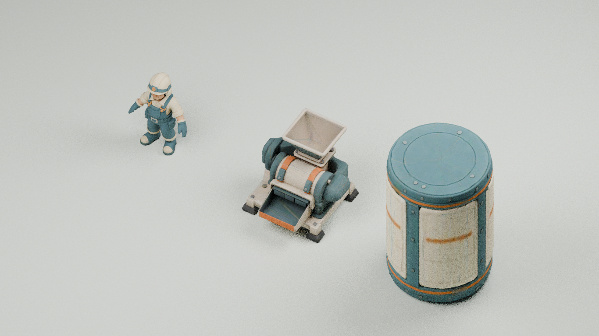

# v1.1 전환 — 2026-11-17 재개 기록

이 문서는 최신 작업 상태이며 전체 구현 완료를 뜻하지 않습니다.

## 확인된 환경 제한

2026-11-16 UTC 관리형 브라우저에서 실제 앱을 열었으나 `GL_VENDOR=Disabled, GL_RENDERER=Disabled`, `THREE.WebGLRenderer: Error creating WebGL context`가 발생했습니다. 브라우저의 실제 3D 검수와 FPS 측정은 BLOCKED입니다. 2D 대체 화면을 검수 통과 증거로 사용하지 않습니다.

이에 따라 작업자·가공기·로켓 하부 선체를 실제 게임 화면에서 검수한 뒤 나머지를 만드는 순서를 유지하고, 나머지 23개 Meshy 생성은 시작하지 않았습니다. `/asset-review`는 실제 게임과 같은 WorldView·GLB·고정 정사영 카메라를 사용합니다. GPU가 있는 브라우저에서 세 해상도와 두 품질 설정으로 확인한 후 계속할 수 있습니다.

## 구현 범위

- 원본 balance_v1.json, map_v1.json 변경 없음. 1~6인, 자동화, 여섯 건설 단계, 발사 상태 머신 유지.
- v1.1 고정 방향 정사영 카메라, 화면 기준 이동, 단계형 확대, 수동 이동, F 복귀, 데드존 추적, 품질별 버퍼 한도.
- 실제 GLB 로더, 바이트 해시 검사, 짧은 입장 티켓 발급 전 모델 디코딩, 캐릭터별 스켈레톤 복제와 독립 믹서.
- 모델 교체와 시점 설정은 경제/충돌 상태를 변경하지 않음. 모델 인스턴스별 투명 처리, 분리된 로켓 지상/비행 루트.
- 구버전 저장은 원래 해시 체인과 경제/맵/스키마 검증 후 허용하고, 복구 저널에서 런타임 메타데이터를 변경.

## 별도 검증 필요

- 세 파일의 실제 게임 외관·피벗·전면·발 접지·애니메이션, 1366×768 / 3840×2160 / 800×360 시각 검수.
- 나머지 23개 실제 모델 생성과 최종 26개 모델 예산·조립·시각 검수.
- 실제 GPU의 FPS/드로콜/메모리, 4K·모바일 조작감·멀미·6명 스킨 독립 재생.
- 새 렌더러에서 정상 시간 1인/6인 전체 브라우저 플레이, 강제 종료 직전 커밋·응답 유실·네트워크 분할·3방 30분 부하.
- 가림 실루엣, 25/50/75% 부품 조립 표시, 최종 렌더링 인수 항목은 아직 완료로 표시하지 않음.

인수 기준 전체는 **13 PASS / 147 NOT_RUN (총 160개)**입니다. 단위·통합 시험 수와 인수 기준 수는 다릅니다. 상세 매핑은 `acceptance_tests.csv`에 기록했습니다.

## 이번 변경에서 실행한 검증

| 검증 | 결과 | 증거/범위 |
|---|---|---|
| 설계 데이터 정합성 | PASS | balance / map / presentation 검증 스크립트. 정적 데이터 검사이며 실행 화면 검수가 아님 |
| 코어·카메라·에셋 단위 시험 | 46 PASS | 코어·카메라·GLB·입장/재접속·로딩 복구. 배포 manifest와 6개 LOD 파일 전체 경로 검증, 5동작·6개 독립 스켈레톤 포함 |
| TypeScript / 프로덕션 빌드 | PASS | `npm run check`; 번들 크기 안내는 남아 있음 |
| 실제 HTTP·WS·PostgreSQL | 18 PASS | `evidence/live-integration.json`; 경쟁·중복·재접속·저장 손상·writer fence |
| 구버전 저장 복구 | PASS | `evidence/v11-compat.json`; 원본 해시 검증 뒤 마이그레이션 저널, 알 수 없는 런타임 거부 |
| 1인·6인 코어 완주 | PASS | `evidence/core-full-runs.json`; 자원 주입·순간이동 없이 자동화 및 M1~M6·발사. 가속 논리 시계, 브라우저 아님 |
| 기존 1인 온라인 완주 | PASS (보존된 이전 실행) | `evidence/network-solo-run.json`; 실제 소켓·DB, 발사 수신·재로드 해시 일치. 가속 논리 시계. 이번에 재실행하지 않음 |
| 실제 6인 온라인 완주 | PASS (완료 로그 복구) | `evidence/network-full-runs.json`; 2026-11-17 01:37 KST 완료. 독립 게스트/소켓 6개, M1~M6·발사, 전원 결과 수신·DB 재로드 해시 일치. 3,384 명령, 논리 시계 가속. 이번에 재실행하지 않음 |
| 게임 화면 3D 검수 | BLOCKED | `evidence/browser-v11.json`; WebGL 비활성화 |
| 첫 세 모델 오프라인 확인 | PASS 범위 제한 | 아래 Blender CPU 렌더. 실제 게임 카메라·GPU 검수로 대체하지 않음 |

## 실제 파일 측정

| 모델 | LOD0 / LOD1 삼각형 | 텍스처 | 머티리얼 | 애니메이션 |
|---|---:|---:|---:|---|
| 작업자 | 5,410 / 2,819 | 1,024px | 1 | 5클립, root XZ 이동 제거 |
| 가공기 | 2,443 / 846 | 512px | 1 | 해당 없음 |
| 로켓 하부 선체 | 3,760 / 2,067 | 512px | 1 | 해당 없음 |

생성 비용은 참조 이미지·텍스처 포함 모델 72 + 작업자 리깅 5 + 4종 추가 동작 12 = **89 Meshy 크레딧**입니다. 리깅에 포함된 걷기는 추가 생성하지 않았습니다. 생성/리깅/동작 task ID 및 파일 SHA-256은 shipping manifest와 `model-measurements.json`에 기록했습니다. 공급자 응답에 라이선스 필드가 없어 권리 확인은 UNVERIFIED로 유지했습니다.

## 이어서 진행할 순서

1. `npm ci && npm run dev` 후 GPU 브라우저에서 `/asset-review`를 열고 세 해상도·두 품질을 확인.
2. 일반 게임에서 작업자 동작·시설 앞뒤·클릭 프록시·충돌 일치·카메라 추적을 확인. 결과 CSV에 증거 기록.
3. 첫 세 모델이 통과하면 나머지 23개를 원본 프롬프트/예산에 따라 생성. 현 상태에서 무조건 일괄 생성하는 스크립트는 제공하지 않음.
4. 전체 모델·조립 연결·실루엣·부분 조립 표현과 최종 160개 인수 항목 검증 후 출시 판정.

## 2026-11-17 이어서 수정한 내용

- 이전 실행 중단의 내부 원인은 확인할 수 없으며, 당시 작업 보고서에 확인된 차단 사유는 관리형 검수 브라우저의 WebGL 비활성화다. 2026-11-17 현재 같은 제한을 다시 확인했다.
- 마지막 수정이 GitHub에 반영되지 않은 작업 폴더를 복구했다. 원본 작업 폴더와 기존 DB는 덮어쓰지 않았고, 별도 작업 복사본/시험 DB에서 검증했다.
- 실제로 존재하는 `rocket_lower_hull-...glb` 경로의 밑줄을 거절하던 로더 검증식을 수정했다. 이 오류는 GPU 지원과 별개로 모든 파일 로딩을 막을 수 있었다. 배포 manifest와 6개 GLB 파일을 읽는 회귀 검사로 재발을 확인한다.
- 20ms 실시간 제한 때문에 부하에 따라 실패하던 타임아웃 시험 두 개를 제어 가능한 가상 타이머와 실제 디코더 시작 신호로 바꿨다. 운영용 90초 제한은 바꾸지 않았다.
- 입장 성공은 호환 WELCOME과 실제 초기 상태 수신 후에만 확정하며, 로딩 취소·지연 소켓·오래된 재접속 요청·해시 불일치의 회귀 시험을 포함한다.
- 관리형 브라우저에서도 실제 GLTF 로딩, 게스트 생성, 작업장 입장, 준비 완료와 M1 시작, 새로고침 후 최근 작업장 이어하기로 같은 M1 방 복귀를 확인했다. WebGL 오류 때문에 3D 월드의 실제 조작/외관 검수는 하지 못했다.
- 실제 PostgreSQL에서 COMMIT 직전 오류와 COMMIT 후 응답 유실을 재검증했다. 두 경우 모두 원자성과 자원 총량/해시가 유지됐다. OS 강제 종료·패킷 프록시 시험은 아니다.
- 게임과 동일한 WorldView/카메라/모델을 사용하는 별도 검수 빌드를 추가했다. `npm run build:review` 결과는 `dist/review/`이다. 현재 화면/품질·동작·메모를 명시적으로 기록하고 JSON으로 내보낸다. 화면 로딩 성공이나 사용자 기록만으로 전체 검수 자동 PASS를 부여하지 않는다.
- 검수 전용 비공개 주소: https://scrap-to-orbit-model-review.dsfs3975.chatgpt.site
- 실제 3D 화면 확인이 여전히 불가능하므로 나머지 23개 모델 생성은 시작하지 않았다. 이번 재개에서 추가 Meshy 생성 비용은 발생하지 않았다.

전체 게임 서버를 배포한 주소가 아니라 첫 세 모델의 검수 전용 주소다. 현재 브라우저의 GPU 제한을 사용자 PC의 Chrome 설정으로 해제할 수는 없다. 사용자 PC에서는 Chrome 설정의 시스템에서 가능한 경우 그래픽 가속 사용을 켠 후 다시 시작하고 `chrome://gpu`에서 WebGL/WebGL2 상태를 확인한다.
